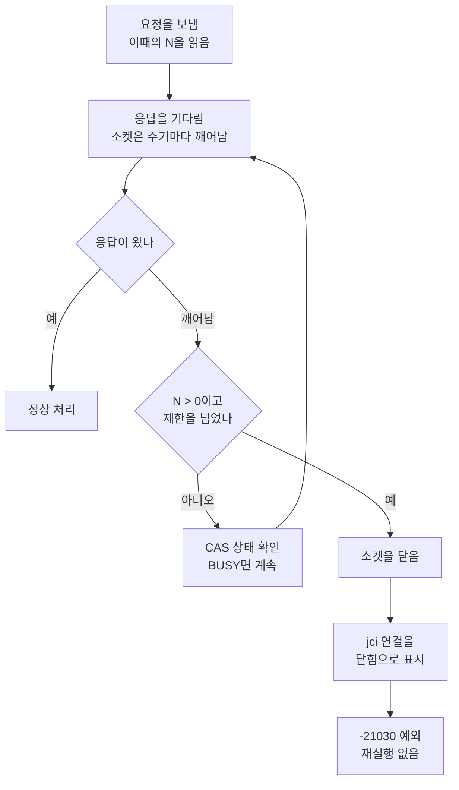

# APIS-1123 Connection.setNetworkTimeout 설계

- 이슈: http://jira.cubrid.org/browse/APIS-1123
- PR: 구현 전
- 상태: 설계 확정, 구현 전
- 날짜: 2026-10-30

## 요약
`setNetworkTimeout`을 "요청 하나의 응답을 기다리는 시간의 상한"으로 구현하기로 했다. 시간이 지나면 서버에 취소를 보내지 않고 소켓을 닫고, 연결을 닫힌 상태로 만들고, 새 오류 코드 `-21030`을 던진다.

## 배경 / 이슈
JDBC 4.1의 `Connection.setNetworkTimeout`, `getNetworkTimeout`을 CUBRID JDBC는 지원하지 않는다(`SQLFeatureNotSupportedException`). 그래서 서버가 살아서 오래 일하는 동안(예: 다른 트랜잭션의 락을 기다리는 동안) 드라이버가 스스로 대기를 끝낼 방법이 없다. 이슈의 완료 기준에는 Hibernate `LockTest.testContendedPessimisticLock` 통과가 들어 있다. Hibernate는 CUBRID 방언에 전용 처리가 없어서, 락 대기를 이 API(1초)로 끊는다.

## 원인 분석 (AS-IS)

### 지금 동작 (드라이버 develop `a2aa90f` 코드)

| 항목 | 현재 |
|---|---|
| API | [`setNetworkTimeout`, `getNetworkTimeout`](https://github.com/CUBRID/cubrid-jdbc/blob/a2aa90fc82fc0d52038842835ce4d8a187baa8fb/src/jdbc/cubrid/jdbc/driver/CUBRIDConnection.java#L1074-L1081) 모두 미지원 예외 |
| 응답 대기 | 소켓이 5초([`SOCKET_TIMEOUT`](https://github.com/CUBRID/cubrid-jdbc/blob/a2aa90fc82fc0d52038842835ce4d8a187baa8fb/src/jdbc/cubrid/jdbc/jci/UConnection.java#L154))마다 깨어난다. [대기 루프](https://github.com/CUBRID/cubrid-jdbc/blob/a2aa90fc82fc0d52038842835ce4d8a187baa8fb/src/jdbc/cubrid/jdbc/jci/UTimedDataInputStream.java#L79-L160)가 제한 시간을 검사하고, 남았으면 브로커에 CAS 상태를 물어 BUSY면 계속 기다린다 |
| 응답 앞부분(8바이트) 대기 제한 | 일반 요청은 없음. [문자열 배치 실행](https://github.com/CUBRID/cubrid-jdbc/blob/a2aa90fc82fc0d52038842835ce4d8a187baa8fb/src/jdbc/cubrid/jdbc/jci/UConnection.java#L590)만 queryTimeout + 10초 |
| 응답 본문 대기 제한 | [연결 스트림의 기본값](https://github.com/CUBRID/cubrid-jdbc/blob/a2aa90fc82fc0d52038842835ce4d8a187baa8fb/src/jdbc/cubrid/jdbc/jci/UClientSideConnection.java#L253-L271)인 connectTimeout |
| 클라이언트 쪽 시간 초과 | 일반 통신 오류(`ER_COMMUNICATION`)로 처리된다. 트랜잭션의 첫 실행이면 [다시 접속해서 재실행](https://github.com/CUBRID/cubrid-jdbc/blob/a2aa90fc82fc0d52038842835ce4d8a187baa8fb/src/jdbc/cubrid/jdbc/jci/UStatement.java#L983-L1003)한다. 연결은 닫힌 상태가 되지 않는다 |
| 닫힘 판단 | `CUBRIDConnection`의 [`isClosed`](https://github.com/CUBRID/cubrid-jdbc/blob/a2aa90fc82fc0d52038842835ce4d8a187baa8fb/src/jdbc/cubrid/jdbc/driver/CUBRIDConnection.java#L255), [`checkIsOpen`](https://github.com/CUBRID/cubrid-jdbc/blob/a2aa90fc82fc0d52038842835ce4d8a187baa8fb/src/jdbc/cubrid/jdbc/driver/CUBRIDConnection.java#L655), [`isValid`](https://github.com/CUBRID/cubrid-jdbc/blob/a2aa90fc82fc0d52038842835ce4d8a187baa8fb/src/jdbc/cubrid/jdbc/driver/CUBRIDConnection.java#L1014)가 자기 필드만 본다 |

- 응답을 기다리는 길은 모두 [`UConnection.send_recv_msg`](https://github.com/CUBRID/cubrid-jdbc/blob/a2aa90fc82fc0d52038842835ce4d8a187baa8fb/src/jdbc/cubrid/jdbc/jci/UConnection.java#L1856-L1897)를 지난다. 그래서 대기 제한을 거는 곳이 한 군데다.
- 5초마다 하는 CAS 상태 확인은 시간 제한이 아니다. CAS가 살아서 BUSY면 끝없이 기다린다.

### 근거: 규격과 다른 드라이버

- JDBC 규격(JDK 8 `Connection.setNetworkTimeout` 설명)
  - 네트워크 분할로 소켓 읽기가 OS TCP 타임아웃까지 멈추는 상황을 위한 기능이고, 일반 타임아웃보다 크게 정하라고 한다.
  - 시간이 지나면 연결을 닫힌 상태로 표시하고 자원을 놓는다. 그 뒤에는 `close`, `isClosed`, `isValid` 외의 호출이 SQLException이다.
  - queryTimeout이 먼저 지나면 문장만 취소되고 연결은 계속 쓸 수 있다고, 두 기능을 구분한다.
  - SecurityManager가 있으면 `SQLPermission("setNetworkTimeout")`을 확인한다.
- 다른 드라이버(pgjdbc, MySQL Connector/J, mssql-jdbc)
  - queryTimeout에서는 서버에 취소를 보낸다(pgjdbc 취소 요청, MySQL `KILL QUERY`, mssql attention).
  - networkTimeout에서는 연결만 닫는다.
  - executor는 받기만 한다. 음수는 예외다. SecurityManager 검사를 한다.
  - 자체 PooledConnection은 네트워크 타임아웃을 되돌리지 않는다. HikariCP가 돌려받을 때 처음 값으로 되돌린다.

## 변경 / 해결 (TO-BE)

### 결정

| 결정 | 내용 | 이유 |
|---|---|---|
| 시간 초과 때 | 서버에 취소를 보내지 않고 소켓을 닫는다 | 규격과 다른 세 드라이버가 같다. 서버 쪽 작업은 queryTimeout, lock timeout이 맡는다 |
| 값의 범위 | 연결마다 따로(`UConnection` 인스턴스 필드) | 규격상 그 Connection에만 적용되는 값이다 |
| 대기 제한 | 읽기 한 번마다, 데이터가 오지 않은 시간 | 지금 대기 루프와 다른 드라이버의 소켓 타임아웃이 같은 의미다 |
| N = 0(기본) | 지금과 똑같이 동작 | 기존 사용자에게 영향이 없게 |
| 오류 코드 | 새 jci 코드 `-21030` | 기존 `-21024`는 접속, 브로커 확인, queryTimeout 사전 검사 등에서 함께 쓰여 구분할 수 없다 |
| 풀 | 돌려줄 때 값을 되돌리지 않음 | 다른 드라이버와 같다. `setLockTimeout`도 같은 방식이다 |
| SecurityManager 검사 | 넣음 | 규격과 다른 드라이버에 맞춘다 |

### API (`CUBRIDConnection`)

`setNetworkTimeout(Executor executor, int milliseconds)`는 다른 Connection 메서드처럼 `synchronized`로 둔다.

1. 닫힌 연결이면 `connection_closed`(-21101)
2. `executor`가 null이면 `invalid_value`(-21120)
3. 음수면 `invalid_value`(-21120)
4. SecurityManager가 있으면 `SQLPermission("setNetworkTimeout")` 확인
5. 값을 `UConnection`에 저장. 연결된 소켓이 있으면 깨어나는 주기를 바로 맞춤

- `getNetworkTimeout()`: 닫힌 연결이면 `connection_closed`, 아니면 저장된 값(기본 0)을 돌려준다.
- `executor`는 쓰지 않는다.
- 값은 다음 요청부터 적용된다.
- 아직 접속하지 않은 연결(지연 접속, XA, DataSource)은 접속할 때 적용된다.

### 응답 대기

| 대기 | N = 0 | N > 0 |
|---|---|---|
| 응답 앞부분, 일반 요청 | 제한 없음 | N |
| 응답 앞부분, 문자열 배치 실행 | queryTimeout + 10초 | 둘 중 작은 값 |
| 응답 본문 | connectTimeout | 둘 중 작은 값 |

### 깨어나는 주기

시간이 지났는지는 소켓이 깨어날 때만 검사한다. 그래서 주기를 그대로 5초로 두면, 1초로 정해도 5초에야 끊긴다. 주기를 `ceil(N / ceil(N / 5000))`으로 맞춰 마감 시점에 깨어나게 한다(N = 0이면 5초).

| N | 주기 | 진행 |
|---|---|---|
| 0 | 5,000 ms | 지금과 같음 |
| 1,000 | 1,000 ms | 1초에 시간 초과 |
| 7,000 | 3,500 ms | 3.5초에 확인, 7초에 시간 초과 |
| 10,001 | 3,334 ms | 3.3초, 6.7초에 확인, 10초에 시간 초과 |
| 30,000 | 5,000 ms | 5초마다 확인, 30초에 시간 초과 |

### 시간 초과 처리

- jci 연결을 닫힘으로 표시하면, `UConnection` 메서드 27개가 시작할 때 이 표시를 먼저 보고 `ER_IS_CLOSED`로 끝난다. 그래서 몰래 다시 접속하지 않는다.
- `-21030`은 [통신 오류 목록](https://github.com/CUBRID/cubrid-jdbc/blob/a2aa90fc82fc0d52038842835ce4d8a187baa8fb/src/jdbc/cubrid/jdbc/jci/UConnection.java#L1574-L1599)에 없는 코드라 재실행 경로를 타지 않는다. 메시지는 "Network timeout expired. The connection is closed."이다.
- `CUBRIDConnection`의 `isClosed`, `checkIsOpen`, `isValid`가 jci 연결의 닫힘도 본다.

| 시간 초과 뒤 호출 | 결과 |
|---|---|
| 시간 초과가 난 그 메서드 | SQLException `-21030` |
| `isClosed()` | true |
| `isValid(n)` | false |
| `close()` | 정상 |
| `createStatement()`, `commit()`, `rollback()` 등 | SQLException `-21101` |
| 이미 만든 Statement, ResultSet 사용 | SQLException |

### 바꿀 파일 (cubrid-jdbc)

| 파일 | 내용 |
|---|---|
| `CUBRIDConnection` | API 구현. 닫힘 판단이 jci 연결도 봄 |
| `UConnection` | 값 필드와 접근자, 주기 계산, 대기 제한과 시간 초과 처리 |
| `UClientSideConnection` | 소켓을 만들 때 주기 설정 |
| `UInputBuffer` | 본문 대기 제한을 받아 씀 |
| `UErrorCode` | `ER_NETWORK_TIMEOUT`(-21030) |

## 검증

### 설계 근거로 잰 것

2026-10-30, CUBRID 11.5.0.2726(develop `4b32f66`), 드라이버 `a2aa90f`. 다른 트랜잭션이 잠근 행을 수정하며 기다리는 상황이다.

| 설정 | 결과 |
|---|---|
| queryTimeout 2초 | 1,912 ms에 `-4`. 연결은 계속 쓸 수 있고, 트랜잭션도 그대로 |
| `setLockTimeout(2000)` | 2,063 ms에 `-73`. 연결과 트랜잭션은 그대로 |
| 제한 없음, 7초 뒤 락 해제 | 6,999 ms에 정상 완료 |
| 연결만 끊고 떠남(이 설계를 흉내) | 그 CAS는 락이 풀릴 때까지 BUSY. autocommit이 켜져 있으면 포기한 수정이 나중에 반영되고 커밋됨, 꺼져 있으면 롤백 |
| 취소 요청 뒤 닫음(`Statement.cancel`로 흉내) | 63 ms에 `-4`. CAS가 바로 풀림 |

### 구현 뒤 확인할 것

- 새 TC `com.cubrid.jdbc.test.spec.connection.TestNetworkTimeout`(cubrid-testcases-private): 값 정하기와 읽기, 잘못된 인자, 닫힌 연결, 2초 시간 초과(`-21030`), 시간 초과 뒤 연결 상태, 재실행하지 않음, 0으로 되돌림, 6초, 지연 접속 연결
- 주기 계산 단위 테스트(`cubrid.jdbc.jci` 패키지)
- 따로 확인: SecurityManager 검사(JDK 8, 정책 파일), Hibernate `LockTest.testContendedPessimisticLock`, 관련 기존 TC를 고치기 전과 후로 비교
- "약 N"의 허용 범위는 구현한 뒤 실측해서 정한다.

## 결과 / 영향

- N이 0(기본)이면 지금과 똑같이 동작한다.
- 시간 초과 뒤에도 CAS는 그 요청을 계속 처리한다. 서버 쪽 작업까지 끊으려면 queryTimeout이나 lock timeout을 N보다 짧게 함께 써야 한다.
- N이 0보다 크면, 문자열 배치와 응답 본문의 대기 제한도 N과 비교해 작은 값이 되고, 그 제한에 걸려도 연결을 닫는다.
- 풀에서는 값이 다음 사용자에게 넘어간다. HikariCP를 쓰면 풀이 되돌린다.
- 이슈 본문의 `request_timeout(-21141)`을 `-21030`으로 고치고, 매뉴얼의 JDBC 오류 코드 표에 `-21030`을 더해야 한다.
- 열린 PR과 겹친다: CUBRID/cubrid-jdbc#98(TLS, 소켓 생성), #76(초안, `CUBRIDConnection`, `UConnection`).

별도 이슈로 분리한 것:

| 후보 | 내용 |
|---|---|
| queryTimeout 예외 | 규격은 `SQLTimeoutException`을 요구하지만, 지금은 일반 SQLException(`-4`, SQLState 없음) |
| 시간 초과 때 서버 취소 | CAS를 바로 풀어 줌. V13 이상 브로커에서 executor로 뒤에서 보내는 방식이 후보 |
| 모든 연결의 기본값 | 다른 드라이버의 URL 속성 `socketTimeout`과 같은 것 |
| 풀에 오류 알리기 | `notifyConnectionErrorOccurred`를 부르는 곳이 지금 0건 |
| 매뉴얼 lock_timeout 설명 | "트랜잭션 취소"라고 적혀 있지만 실측은 그 문장만 실패 |
| `DataSource.setLoginTimeout` | 값만 저장하고 접속에는 쓰지 않음 |

## 참고
- JIRA: http://jira.cubrid.org/browse/APIS-1123
- PR: 구현 전
- Commit: 구현 전
- JDK 8 `Connection.setNetworkTimeout`: https://docs.oracle.com/javase/8/docs/api/java/sql/Connection.html#setNetworkTimeout-java.util.concurrent.Executor-int-
- JDK 8 `Statement.setQueryTimeout`: https://docs.oracle.com/javase/8/docs/api/java/sql/Statement.html#setQueryTimeout-int-
- JDK 8 `SQLPermission`: https://docs.oracle.com/javase/8/docs/api/java/sql/SQLPermission.html
- 타임아웃 정리와 실측 상세: [study/2026-10-30-cubrid-jdbc-timeouts.md](../study/2026-10-30-cubrid-jdbc-timeouts.md)
