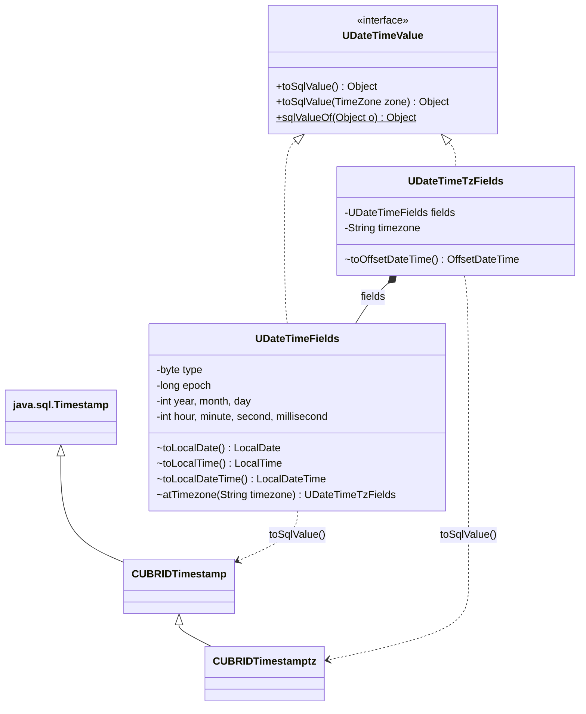
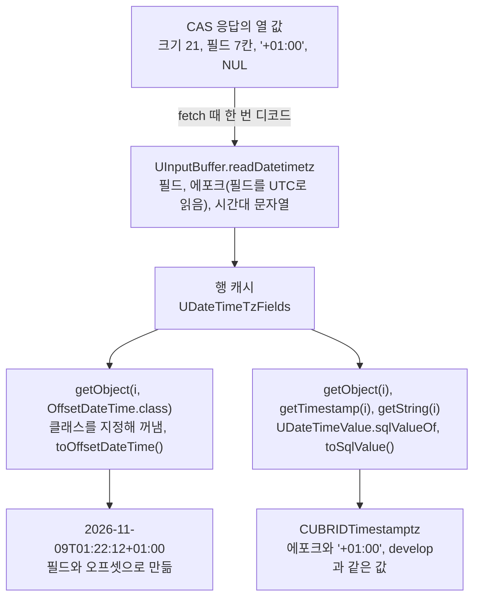

# APIS-1135 날짜·시각 값의 클래스 구조와 패킷 배치

- 이슈: https://jira.cubrid.org/browse/APIS-1135
- PR: 열리면 링크
- 상태: 구현 끝, PR 전
- 날짜: 2026-11-16
- 기준 코드: cubrid-jdbc `APIS-1135` 브랜치 `f9a8476` (develop [`5b46b6c`](https://github.com/CUBRID/cubrid-jdbc/commit/5b46b6c26783a420ae2bc326768ff2edda791f6d)에서 시작)

## 요약
`OffsetDateTime`을 지원하려고 시간대 타입 값도 행 캐시에 필드로 두는 클래스(`UDateTimeTzFields`)와 공통 인터페이스(`UDateTimeValue`)를 더했고, 이 값들이 드라이버와 CAS 사이에서 어떤 바이트로 오가는지를 코드와 실측으로 정리했다.

## 배경 / 이슈
JDBC 4.2는 `getObject(i, OffsetDateTime.class)`와 `setObject(i, OffsetDateTime)`를 요구한다. 그런데 CUBRID JDBC는 시간대 타입 값을 디코드하자마자 에포크 밀리초와 시간대 문자열로 바꿔 캐시에 넣었다. 그래서 `OffsetDateTime`을 만들려면 에포크에서 필드를 되살려야 했고, 이 과정에서 값이 바뀌는 경우가 있다. 이 문서는 그것을 피하려고 바꾼 클래스 구조와, 그 구조가 읽고 쓰는 패킷의 바이트 배치를 다룬다.

먼저 맞춰 둘 말:

| 말 | 뜻 |
|---|---|
| 필드 | 연, 월, 일, 시, 분, 초, 밀리초를 각각 숫자로 든 형태. 시간대 정보가 없다(`LocalDateTime`과 같은 모양) |
| 에포크 밀리초 | 1970-01-01T00:00:00Z부터 지난 밀리초. `java.sql.Date`, `Time`, `Timestamp`는 이 숫자 하나만 든다 |
| 오프셋 | UTC와의 시간 차이(`+01:00`) |
| 시간대 문자열 | 서버가 시간대 타입 값 뒤에 붙여 보내는 글자. 오프셋(`+01:00`)이거나 지역 이름과 약어(`Asia/Seoul KST`) |
| 행 캐시 | fetch한 행의 열 값을 디코드해 넣어 두는 곳(`UStatement.tuples`). getter는 여기서 꺼낸다 |

## 원인 분석 (AS-IS)

### 에포크를 거치면 필드가 바뀔 수 있다
필드를 에포크로 바꾸려면 "어느 시간대의 날짜·시각인가"를 정해야 하고, 드라이버는 이 일을 `java.util.Calendar`에 맡긴다. 그 에포크에서 java.time 값을 다시 만들면 처음 필드와 다른 값이 나올 때가 있다.

| 경우 | 서버가 보낸 필드 | 에포크를 거친 값 | 필드에서 바로 만든 값 |
|---|---|---|---|
| JVM 시간대 Asia/Seoul, 서머타임 시작으로 서울에 없는 시각 | 1988-05-08 02:30 | `Timestamp.toLocalDateTime()`: 1988-05-08T03:30 | `LocalDateTime.of(...)`: 1988-05-08T02:30 |
| 1582-10-15 이전 날짜 (시간대 값이라 UTC로 계산) | 1000-01-01 12:00 | `OffsetDateTime`: 1000-01-06T12:00Z | `OffsetDateTime.of(..., UTC)`: 1000-01-01T12:00Z |

- 두 번째는 `Calendar`가 율리우스력으로, java.time이 그레고리력으로 계산해서 생긴다. DATETIMETZ는 0001년부터 저장할 수 있어서 실제로 닿는 경우다.
- 원칙: java.time 값은 필드에서 바로 만들고, 에포크는 옛 java.sql getter에만 쓴다. APIS-1107이 시간대 없는 타입에 이 원칙을 적용했고, APIS-1135는 시간대 타입에 적용한다.

### 행 캐시에 무엇이 들어 있었나
getter는 행 캐시의 객체를 꺼내 원하는 타입으로 바꾼다. 그래서 캐시에 무엇을 넣느냐가 나머지를 정한다.

| 열 타입 | APIS-1107 이전 | develop (APIS-1107 뒤) | APIS-1135 |
|---|---|---|---|
| DATE | `java.sql.Date` | `UDateTimeFields` | `UDateTimeFields` |
| TIME | `java.sql.Time` | `UDateTimeFields` | `UDateTimeFields` |
| TIMESTAMP, DATETIME | `CUBRIDTimestamp` | `UDateTimeFields` | `UDateTimeFields` |
| 시간대 타입 4개 | `CUBRIDTimestamptz` | `CUBRIDTimestamptz` | `UDateTimeTzFields` |

- 시간대 타입 4개는 TIMESTAMPTZ, TIMESTAMPLTZ, DATETIMETZ, DATETIMELTZ다.
- `java.sql.Date`, `Time`, `CUBRIDTimestamp`는 에포크 하나를, `CUBRIDTimestamptz`는 에포크와 시간대 문자열을 든다. `UDateTimeFields`와 `UDateTimeTzFields`는 필드를 든다.
- develop은 시간대 열을 [`CUBRIDTimestamptz`로 디코드해](https://github.com/CUBRID/cubrid-jdbc/blob/5b46b6c26783a420ae2bc326768ff2edda791f6d/src/jdbc/cubrid/jdbc/jci/UInputBuffer.java#L457-L486) 캐시에 넣었으므로 필드가 남지 않았다.

## 변경 / 해결 (TO-BE)

### 클래스 구조



| 관계 | 대상 | 뜻 |
|---|---|---|
| 구현 | `UDateTimeFields`, `UDateTimeTzFields`가 `UDateTimeValue`를 구현 | 옛 java.sql getter가 두 클래스를 같은 방법으로 바꾼다 |
| 포함 | `UDateTimeTzFields`가 `UDateTimeFields`를 필드 `fields`로 든다 | 날짜·시각 계산과 0 날짜 반올림을 그대로 쓴다 |
| 상속 | `CUBRIDTimestamptz` → `CUBRIDTimestamp` → `java.sql.Timestamp` | `toSqlValue()`가 돌려주는 java.sql 쪽 객체. 이번 작업에서 바뀌지 않았다 |

| 클래스 | 들고 있는 것 | java.time 쪽 메서드 | `toSqlValue()` 결과 | 만드는 곳 |
|---|---|---|---|---|
| `UDateTimeFields` (APIS-1107) | 타입, 에포크, 필드 7개 | `toLocalDate()`, `toLocalTime()`, `toLocalDateTime()` | 타입에 따라 `java.sql.Date`, `java.sql.Time`, `CUBRIDTimestamp` | 읽을 때 `UInputBuffer.readDate` 등 4개, 쓸 때 `UDateTimeFields.of` (Calendar 판 setter) |
| `UDateTimeTzFields` (APIS-1135) | `UDateTimeFields fields`, `String timezone` | `toOffsetDateTime()` | `CUBRIDTimestamptz` | `UInputBuffer.readTimestamptz`, `readDatetimetz` |

- `toSqlValue(TimeZone)`은 Calendar를 받는 getter용이다. `UDateTimeFields`는 필드로 에포크를 그 시간대에서 다시 계산하고, `UDateTimeTzFields`는 시간대를 쓰지 않는다(develop과 같은 동작).

### 상속하지 않고 안에 들고 있는 이유
`UDateTimeFields`에 timezone 칸을 하나 더하거나, `UDateTimeTzFields`가 `UDateTimeFields`를 상속하게 하는 방법도 있었다. 쓰지 않은 이유는 이렇다.

- 바뀌는 대상 타입이 겹치지 않는다. 시간대 값은 `OffsetDateTime`으로만, 시간대 없는 값은 `LocalDate`, `LocalTime`, `LocalDateTime`으로만 바뀐다. 클래스가 다르면 `dateTimeFieldsOf(index, UDateTimeTzFields.class)`처럼 클래스만으로 정확히 고를 수 있다.
- java.sql 쪽 동작이 다르다. 시간대 값은 `CUBRIDTimestamptz`가 되고 Calendar 인자를 쓰지 않는다. 한 클래스에 넣으면 메서드마다 시간대가 있는지 묻는 분기가 생긴다.
- 상속하면 `toLocalDateTime()` 같은 메서드까지 물려받는다. 선언 타입이 없는 열(예: `select ? from db_root`)은 열 타입 검사(`JavaTimeRules.canRead`)를 통과시키고 캐시 객체의 클래스로 판단한다. 상속 관계라면 시간대 값이 `getObject(i, LocalDateTime.class)`에서 시간대를 버린 채 통과한다. 지금 구조에서는 형 변환 오류로 거절된다.
- `UDateTimeFields`는 `final`이고 생성자가 `private`이라, 상속하려면 이것부터 열어야 한다.

### UDateTimeValue: 옛 getter는 클래스를 묻지 않는다
캐시 객체를 옛 java.sql 값으로 바꾸는 곳은 세 군데다. develop에서는 `UDateTimeFields` 하나만 바꾸면 됐지만, 이제는 캐시에 드는 필드 클래스가 둘이다.

| 바꾸는 곳 | 쓰는 getter | develop | APIS-1135 |
|---|---|---|---|
| `UStatement.beforeGetXXX` | `getObject(i)`, `getTimestamp(i)`, `getString(i)` 등 | [`UDateTimeFields.sqlValueOf`](https://github.com/CUBRID/cubrid-jdbc/blob/5b46b6c26783a420ae2bc326768ff2edda791f6d/src/jdbc/cubrid/jdbc/jci/UStatement.java#L2160-L2163) | `UDateTimeValue.sqlValueOf` |
| 컬렉션 원소 디코드 | SET, MULTISET, LIST의 원소 | `UDateTimeFields.sqlValueOf` | `UDateTimeValue.sqlValueOf` |
| `UGetTypeConvertedValue.inZone` | `getTimestamp(i, Calendar)` 등 Calendar 판 | `instanceof UDateTimeFields` | `instanceof UDateTimeValue` |

```java
interface UDateTimeValue {
    Object toSqlValue();

    /* zone applies only to a value without its own time zone. */
    Object toSqlValue(TimeZone zone);

    static Object sqlValueOf(Object o) {
        return o instanceof UDateTimeValue ? ((UDateTimeValue) o).toSqlValue() : o;
    }
}
```

- 옛 getter는 캐시 객체가 어느 클래스인지 묻지 않는다. `sqlValueOf`는 날짜·시각 값이 아니면 그대로 돌려주므로, 날짜·시각 값인지조차 몰라도 된다.
- `toSqlValue()`는 언제나 java.sql 쪽 객체를 돌려준다. java.time 값은 이 경로로 나오지 않는다.
- java.time getter는 반대로 원하는 클래스를 지정해서 꺼낸다. `getLocalDateTime`은 `UDateTimeFields.class`를, `getOffsetDateTime`은 `UDateTimeTzFields.class`를 넘기고, 다른 클래스가 들어 있으면 형 변환 오류다.
- java.time 메서드는 이름도 돌려주는 타입도 클래스마다 달라서 인터페이스에 두지 않았다.
- Oracle JDBC도 같은 구성이다. 공통 상위 클래스 [`oracle.sql.Datum`](https://docs.oracle.com/en/database/oracle/oracle-database/21/jajdb/oracle/sql/Datum.html)에는 JDBC 표현으로 바꾸는 `Object toJdbc()`가 있고 java.time 메서드는 없다. `toOffsetDateTime()`, `toZonedDateTime()`, `toLocalDateTime()`은 하위 클래스 [`oracle.sql.TIMESTAMPTZ`](https://docs.oracle.com/en/database/oracle/oracle-database/21/jajdb/oracle/sql/TIMESTAMPTZ.html)에만 있다.

## 패킷: 선 위의 날짜·시각 값
선 위에는 에포크가 없다. 언제나 필드가 오가고, 시간대 타입이면 시간대 문자열이 뒤에 붙는다. 이 절의 바이트는 코드로 계산한 것이다(캡처 아님).

### 공통 틀
- 요청의 인자와 응답의 열 값은 모두 "4바이트 크기 + 데이터"다.
- 정수는 빅엔디언이다(`ByteArrayBuffer.writeShort`, `writeInt`, `UJCIUtil.bytes2short`).
- 날짜·시각 필드는 한 칸이 2바이트(short)다. 칸 순서는 연, 월, 일, 시, 분, 초, 밀리초다.

| 방향 | 값 하나의 모양 | NULL |
|---|---|---|
| 보낼 때 (바인드) | 타입 인자(크기 1 + 타입 코드 1바이트) 다음에 값 인자(크기 + 데이터) | 타입 인자(보통 NULL 타입 0) 다음에 크기 0 |
| 받을 때 (fetch 결과) | 크기 + 데이터 | 크기가 음수 |

- 받을 때, 선언 타입이 없는 열(예: `select ?`)과 CALL, EVALUATE 결과는 데이터 앞에 값의 타입 코드가 1~2바이트 붙고, 크기에 이 바이트도 들어 있다(`UStatement.readTypeFromData`).

| 타입 | 타입 코드 (`UUType`) |
|---|---|
| DATE | 13 |
| TIME | 14 |
| TIMESTAMP | 15 |
| DATETIME | 22 |
| TIMESTAMPTZ, TIMESTAMPLTZ | 29, 30 |
| DATETIMETZ, DATETIMELTZ | 31, 32 |

### 타입별 배치
보낼 때는 어떤 날짜·시각 타입이든 7칸을 채우고, 쓰지 않는 칸은 0이다. 받을 때는 타입마다 필요한 칸만 온다.

| 타입 | 보낼 때 (`UOutputBuffer`) | 받을 때 (`UInputBuffer`) |
|---|---|---|
| DATE | 7칸 14바이트 (시·분·초·밀리초 0) | 3칸 6바이트: 연, 월, 일 |
| TIME | 7칸 14바이트 (연·월·일·밀리초 0) | 3칸 6바이트: 시, 분, 초 |
| TIMESTAMP | 7칸 14바이트 (밀리초 0) | 6칸 12바이트 |
| DATETIME | 7칸 14바이트 | 7칸 14바이트 |
| TIMESTAMPTZ, TIMESTAMPLTZ | 7칸 + 시간대 문자열 (NUL 없음) | 6칸 + 시간대 문자열 + NUL |
| DATETIMETZ, DATETIMELTZ | 7칸 + 시간대 문자열 (NUL 없음) | 7칸 + 시간대 문자열 + NUL |

### 예: OffsetDateTime 하나를 보내고 두 열에서 읽기
값 `2026-11-09T01:22:12+01:00`을 `setObject`로 보낸다. 세션 시간대는 UTC다.

보낼 때, 실행 요청 안의 바인드 변수 하나 (`UOutputBuffer.addDatetimetz(OffsetDateTime)`):

```text
00 00 00 01  1F                                    타입 인자: 크기 1, DATETIMETZ(31)
00 00 00 14                                        값 인자 크기 20 = 필드 14 + 시간대 문자열 6
07 EA  00 0B  00 09  00 01  00 16  00 0C  00 00    2026, 11, 9, 1, 22, 12, 0
2B 30 31 3A 30 30                                  "+01:00" (NUL 없음)
```

받을 때, datetimetz 열 (`UInputBuffer.readDatetimetz`). 보낸 필드와 `+01:00`이 그대로 온다.

```text
00 00 00 15                                        크기 21 = 필드 14 + 시간대 문자열 6 + NUL 1
07 EA  00 0B  00 09  00 01  00 16  00 0C  00 00    2026, 11, 9, 1, 22, 12, 0
2B 30 31 3A 30 30  00                              "+01:00" + NUL
```

받을 때, datetimeltz 열. 서버가 세션 시간대로 바꾼 필드와 `UTC UTC`가 온다.

```text
00 00 00 16                                        크기 22 = 필드 14 + 시간대 문자열 7 + NUL 1
07 EA  00 0B  00 09  00 00  00 16  00 0C  00 00    시가 1에서 0으로
55 54 43 20 55 54 43  00                           "UTC UTC" + NUL
```

### 서버가 열 타입에 맞춰 바꾼다
드라이버는 DATETIMETZ 하나로 보내고, 열 타입에 맞게 바꾸는 일은 서버가 한다. 위 값을 세션 시간대 UTC에서 저장한 결과다(11.4.6과 nightly가 같음, 날짜는 모두 2026-11-09).

| 열 | 저장된 값 |
|---|---|
| datetimetz, timestamptz | `01:22:12.0 +01:00` (보낸 그대로) |
| datetimeltz, timestampltz | `00:22:12.0 UTC UTC` (세션 시간대로 바뀜) |
| datetime | `01:22:12.000` (시간대는 버림) |
| timestamp | `00:22:12` |
| date | `2026-11-09` |

### 무엇을 보낼지는 대상 타입이 정한다
`setObject(i, odt, targetSqlType)`은 대상 타입에 따라 보내는 것이 다르다(`JavaTimeRules.valueToSend`).

| 대상 타입 | 보내는 것 |
|---|---|
| 없음, `TIMESTAMP_WITH_TIMEZONE` | `OffsetDateTime` 그대로 (DATETIMETZ 타입 코드로) |
| 문자 타입 6개 (`CHAR`, `VARCHAR` 등) | 문자열 `2026-11-09 01:22:12.000 +01:00` |
| `TIME_WITH_TIMEZONE` | 보내지 않음: `SQLFeatureNotSupportedException` (CUBRID에 그 타입이 없음) |
| 그 밖 | 보내지 않음: -21120 |

- 결과셋 갱신도 같은 규칙이다. `updateRow`는 DATETIMETZ 타입 코드로 바인드해 보내고, `insertRow`는 `datetimetz'2026-11-09 01:22:12.000 +01:00'` 리터럴을 SQL 문에 적는다.

### 시간대 문자열에서 오프셋을 정하는 법
`toOffsetDateTime()`은 받은 시간대 문자열에서 오프셋을 정한다(`UDateTimeTzFields.offsetAt`).

| 모양 | 예 | 오프셋을 정하는 법 |
|---|---|---|
| 오프셋 | `+01:00`, `+05:45` | 그 값 그대로 |
| 지역 이름 + 숫자 약어 | `Asia/Ho_Chi_Minh +07` | 약어의 숫자 그대로 (서버가 쓴 오프셋) |
| 지역 이름 + 문자 약어 | `Asia/Seoul KST`, `America/New_York EDT`, LTZ 열의 `UTC UTC` | JVM 시간대 규칙에서 그 날짜·시각의 오프셋. 서머타임이 끝날 때처럼 한 시각에 오프셋이 둘이면 약어가 맞는 쪽 |

- 마지막 모양만 JVM 시간대 데이터를 쓴다. 서버와 JVM의 시간대 데이터가 다르면 시점이 1시간 어긋날 수 있다(PR에 알려진 한계로 적는다).

### 읽기: 패킷에서 행 캐시, getter까지



- 디코드는 fetch할 때 행의 모든 열에 대해 한 번 한다(`UStatement.readATuple`). 그래서 기본 설정(`zeroDateTimeBehavior=exception`)에서 2행에 0 날짜가 있으면 `executeQuery` 자체가 -21027로 실패하고, 1행도 읽을 수 없다(develop과 같음).
- 시간대 값의 에포크는 실제 시점이 아니라 필드를 UTC로 읽은 값이다. `readDatetime(true)`가 UTC `Calendar`로 계산하며, develop과 같다.
  - `CUBRIDTimestamptz`는 에포크 하나에 시간대 문자열을 붙인 클래스이고, `getString`은 이 에포크를 UTC로 포맷해 필드를 되살린다. 그래서 JVM 시간대와 상관없이 필드가 그대로 나온다.
  - `OffsetDateTime`은 이 에포크가 아니라 필드와 시간대 문자열로 만든다.

| getter (값 `2026-11-09 01:22:12 +01:00`) | 결과 | 뜻 |
|---|---|---|
| `getString` | `2026-11-09 01:22:12.0 +01:00` | 필드 그대로 |
| `getTimestamp` | `2026-11-09T01:22:12Z` | 필드를 UTC로 읽은 값 |
| `CUBRIDTimestamptz.getUnixTime()` | `2026-11-09T00:22:12Z` | 실제 시점 |
| `getObject(i, OffsetDateTime.class)` | `2026-11-09T01:22:12+01:00` (시점 `00:22:12Z`) | 실제 시점. develop은 -21120 |

datetimetz와 timestamptz 열의 결과가 같다. `getTimestamp`와 `getUnixTime`은 에포크를 UTC 시각으로 적었다.

### 0 날짜: NULL로 바꿔도 값의 크기만큼 넘어가야 한다
`zeroDateTimeBehavior=convertToNull`에서 0 날짜는 NULL이 된다. 이때도 필드 뒤의 시간대 문자열과 NUL까지 읽고 넘어가야 다음 열이 제자리에서 시작한다. develop의 `readDatetimetz`는 0 날짜이면 [필드만 읽고 바로 null을 돌려줘서](https://github.com/CUBRID/cubrid-jdbc/blob/5b46b6c26783a420ae2bc326768ff2edda791f6d/src/jdbc/cubrid/jdbc/jci/UInputBuffer.java#L470-L473) 다음 열을 밀린 위치에서 읽었다. APIS-1135는 필드가 null이어도 시간대 문자열을 읽는다.

행 `(datetimetz'0000-00-00 00:00:00 +00:00', 8)`에서 `getTimestamp(1)` 다음 `getInt(2)`:

| 빌드 | `getTimestamp(1)` | `getInt(2)` |
|---|---|---|
| develop | null | 808452096 |
| APIS-1135 | null | 8 |

808452096은 `0x30300000`이다. 둘째 열의 크기 자리에서 `+00:`를, 값 자리에서 `0`, `0`, NUL과 진짜 크기의 첫 바이트를 읽은 값이다.

```text
첫째 열 (datetimetz)  00 00 00 15 | 00 00 ... 00 (필드 14바이트) | 2B 30 30 3A 30 30 00
둘째 열 (int)         00 00 00 04 | 00 00 00 08
develop이 둘째 열로 읽은 것: 크기 2B 30 30 3A, 값 30 30 00 00 = 808452096
```

## 검증

| 확인한 것 | 결과 | 환경 |
|---|---|---|
| 에포크를 거친 변환 (원인 분석의 두 예) | 02:30이 03:30으로, 1000-01-01이 1000-01-06으로 바뀜 | JDK 17 jshell |
| 시간대 값의 getter 결과 (읽기 절의 표) | java.sql getter는 develop과 이번 빌드가 같음 | CUBRID 11.4.6, JDK 8, JVM 시간대 Asia/Seoul |
| 0 날짜가 있는 결과의 디코드 시점 | `executeQuery`가 -21027, develop과 같음 | CUBRID 11.4.6 |
| convertToNull 0 날짜 다음 열 | develop 808452096, 이번 빌드 8 | CUBRID 11.4.6 |
| 서버가 열 타입에 맞춰 바꾼 값 | 패킷 절의 표 | CUBRID 11.4.6, nightly |
| 바이트 배치 | 코드로 계산 (`UOutputBuffer`, `UInputBuffer`, `UBindParameter`, `UStatement.readAAttribute`) | `f9a8476` |

## 결과 / 영향
- 옛 java.sql getter는 develop과 같은 값을 돌려준다. 캐시 객체가 바뀌었을 뿐이고, 바꾸는 세 곳은 부르는 이름만 바뀌었다.
- java.time 값은 서버가 보낸 필드에서 바로 만든다. 1582년 이전 날짜와 서머타임 경계에서도 필드가 바뀌지 않는다.
- 0 날짜를 NULL로 바꾸는 설정에서 DATETIMETZ 다음 열이 밀리던 문제도 함께 고쳤다.
- 남은 한계: 문자 약어 시간대 문자열은 JVM 시간대 데이터에 기댄다.

## 참고
- JIRA: https://jira.cubrid.org/browse/APIS-1135
- PR: 열리면 링크
- Commit: cubrid-jdbc `APIS-1135` 브랜치 `f9a8476` (develop `5b46b6c`에서 시작)
- 앞선 작업: APIS-1107 [CUBRID/cubrid-jdbc#91](https://github.com/CUBRID/cubrid-jdbc/pull/91) (`UDateTimeFields`), APIS-1120 [CUBRID/cubrid-jdbc#100](https://github.com/CUBRID/cubrid-jdbc/pull/100) (Calendar 판)
- Oracle Database 21 JDBC API: [oracle.sql.Datum](https://docs.oracle.com/en/database/oracle/oracle-database/21/jajdb/oracle/sql/Datum.html), [oracle.sql.TIMESTAMPTZ](https://docs.oracle.com/en/database/oracle/oracle-database/21/jajdb/oracle/sql/TIMESTAMPTZ.html)
- CUBRID 11.4 매뉴얼: [날짜/시간 데이터 타입](https://www.cubrid.org/manual/ko/11.4/sql/datatype.html), [JDBC 연결 속성](https://www.cubrid.org/manual/ko/11.4/api/jdbc.html)
