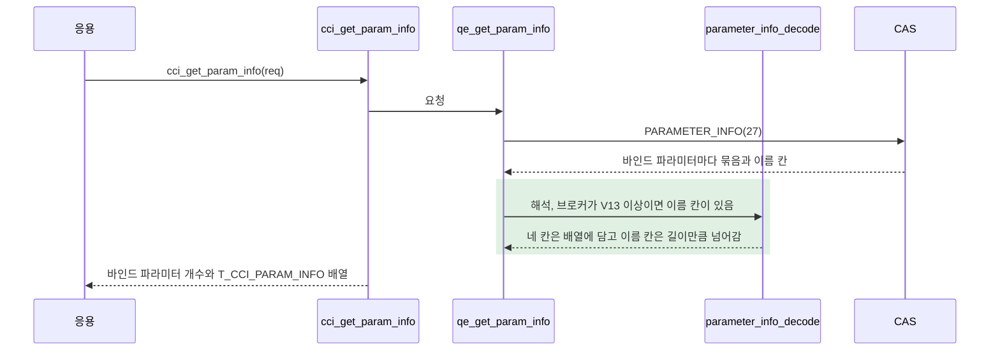
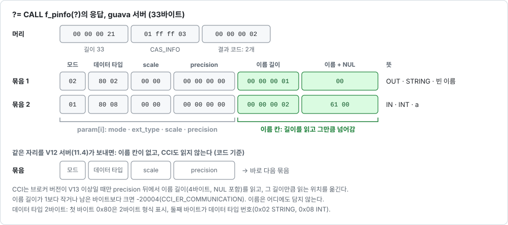
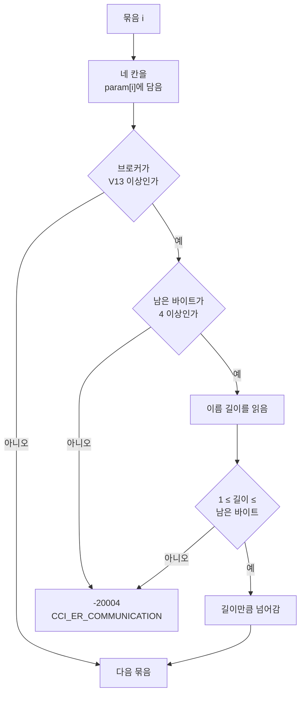
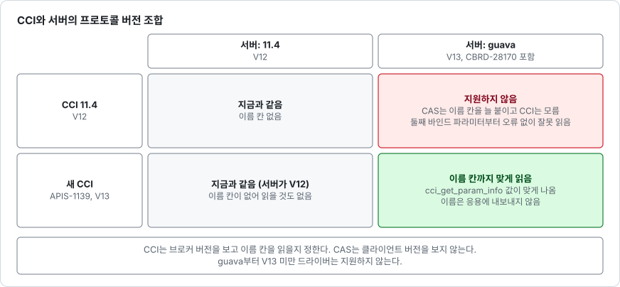

# APIS-1139 CCI: PARAMETER_INFO 응답의 매개변수 이름 칸 읽기

- 이슈: https://jira.cubrid.org/browse/APIS-1139 (서버 쪽: [CBRD-28170](https://jira.cubrid.org/browse/CBRD-28170))
- 작업 기록: 서버 쪽 [CBRD-28170-call-parameter-info.md](https://github.com/Srltas/work-docs/blob/master/CBRD-28170/CBRD-28170-call-parameter-info.md), 응답 형식은 [CBRD-28170-parameter-info-protocol.md](https://github.com/Srltas/work-docs/blob/master/CBRD-28170/CBRD-28170-parameter-info-protocol.md)
- 상태: 진행 중 (PR 전)
- 날짜: 2026-11-24

## 요약
guava 서버(PROTOCOL_V13)의 CAS는 PARAMETER_INFO 응답에서 바인드 파라미터마다 precision 뒤에 매개변수 이름 칸을 붙인다. CCI는 응답 형식대로 이 칸까지 읽어서, 둘째 바인드 파라미터부터도 맞는 자리에서 읽는다. 이름 값은 쓰지 않고 응용에 내보내지도 않으며, 공개 API, `T_CCI_PARAM_INFO`, 요청 핸들은 그대로다. 이름이 필요해지면 그때 API를 따로 추가한다.

이 문서는 CCI 안에서 무엇이 바뀌는지만 다룬다. 응답 형식은 CBRD-28170 프로토콜 설명에 있다.

## 1. 언제 오가나



- `cci_get_param_info`는 지금처럼 부를 때마다 서버에 묻는다. 요청은 그대로다.
- 바뀌는 것은 응답 해석 하나다(초록 부분).

## 2. 바뀐 곳

| 파일 | 이름 | 변경 | 하는 일 |
|---|---|---|---|
| cci_query_execute.c | `parameter_info_decode` | 고침 | 이름 칸이 있으면 precision 뒤의 이름 길이를 읽고 그만큼 넘어감 |
| cci_query_execute.c | `qe_get_param_info` | 고침 | 브로커 버전이 V13 이상이면 위 동작을 켬 |

- 그 밖의 파일은 그대로다. 공개 헤더(`cas_cci.h`), `T_CCI_PARAM_INFO`, 요청 핸들(`T_REQ_HANDLE`), 내보내기 목록(`cascci.def`)이 바뀌지 않는다.
- 이름을 꺼내는 공개 함수는 넣지 않았다. 이름을 쓰는 JDBC(APIS-1140)는 응답을 직접 해석하고, CCI에는 이름을 쓰는 곳이 없다.

## 3. 응답에서 이름 칸 읽기

예로 쓰는 함수:

```sql
CREATE FUNCTION f_pinfo (a INT) RETURN VARCHAR AS
BEGIN
  RETURN 'v' || a;
END;
```



- CAS 앞에 바이트를 기록하는 프록시를 두고 잡은 실제 응답이다(develop 131af8f86 + CBRD-28170 debug 빌드). CAS는 클라이언트 버전을 보지 않으므로 어느 CCI로 받아도 바이트는 같다.
- 네 칸은 지금처럼 `T_CCI_PARAM_INFO` 원소에 담는다.
- 이름 칸은 길이 4바이트를 읽고, 그 길이만큼 읽는 위치를 옮긴다. 묶음 2라면 4 + 2 = 6바이트를 넘긴다.

## 4. 묶음마다 읽는 순서



- 네 칸은 모드, 데이터 타입, scale, precision이다. 이 부분은 바꾸기 전과 같다.
- shell TC `cbrd_28170`(이 CCI로 만든 프로그램)이 13/13 통과했다. 바인드 파라미터가 넷인 CALL까지 값이 맞게 나오므로, 이름 칸까지 읽은 뒤 다음 묶음을 맞는 자리에서 읽는 것이 확인된다.
- 이 요청을 쓰는 기존 CCI TC `bug_bts_7683`, `bug_bts_8182`도 통과했다.

## 5. 버전과 호환성



- 새 CCI가 이름 칸을 읽을지는 브로커 버전으로 정한다.
- 새 CCI와 guava 서버: 4절의 shell TC 결과.
- 새 CCI와 11.4 서버: 응답에 이름 칸이 없고 CCI도 읽지 않는다. 이 경로의 코드는 바꾸기 전과 같다.
- 11.4 CCI와 guava 서버: 이름 칸을 몰라 둘째 묶음 자리에서 첫 묶음의 이름 칸을 읽는다. `CALL p_pinfo(?, ?, ?, ?)`의 둘째 값이 scale 4, precision 0x4E756D00(`Num`과 NUL)으로 나왔다. guava부터 V13 미만 드라이버는 지원하지 않는다.

## 6. 응용에서 보면

응용 코드는 바꿀 것이 없다.

```c
req = cci_prepare (con, "CALL p_pinfo(?, ?, ?, ?)", CCI_PREPARE_CALL, &err);
n = cci_get_param_info (req, &param, &err);
for (i = 1; i <= n; i++)
  {
    printf ("%d %d\n", CCI_GET_PARAM_INFO_MODE (param, i), CCI_GET_PARAM_INFO_TYPE (param, i));
  }
cci_param_info_free (param);
/* guava 서버: 1 8 / 2 7 / 3 21 / 1 2 */
```

- 선언대로 값이 나오는 것은 CBRD-28170(CAS가 루틴 선언을 읽음) 덕분이고, 둘째 바인드 파라미터부터 맞는 자리에서 읽는 것은 이 변경 덕분이다.

## 참고
- JIRA: [APIS-1139](https://jira.cubrid.org/browse/APIS-1139), [CBRD-28170](https://jira.cubrid.org/browse/CBRD-28170)
- 작업 기록: [CBRD-28170-call-parameter-info.md](https://github.com/Srltas/work-docs/blob/master/CBRD-28170/CBRD-28170-call-parameter-info.md)
- 브랜치: Srltas/cubrid-cci `APIS-1139` (커밋 5bc6328)
- PR: 아직 없음
