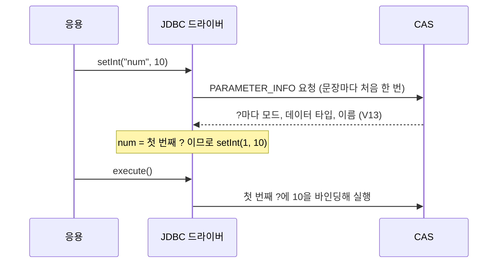

# CBRD-28170 CALL 문 매개변수 정보(PARAMETER_INFO) 바로잡기와 V13 매개변수 이름

- 이슈: https://jira.cubrid.org/browse/CBRD-28170
- PR: 아직 없음(엔진 PR에 CAS 수정과 cubrid-cci 갱신을 함께 넣을 예정)
- 상태: 진행 중(엔진·CCI 구현과 shell TC 통과, 리뷰·회귀 확인 중)
- 날짜: 2026-11-18

## 요약
CAS의 PARAMETER_INFO가 CALL 문에서 모드·데이터 타입을 틀리게 보내고 매개변수 이름은 보내지 않던 것을, 호출하는 루틴의 선언으로 바로잡고 V13 클라이언트에게는 이름도 보내도록 바꿨다. 엔진과 CCI를 바꾼 debug 빌드에서 shell TC 13개가 모두 통과했다.

## 배경 / 이슈
JDBC의 두 기능이 CAS의 PARAMETER_INFO 응답(함수 27)을 쓴다. ParameterMetaData는 바인드 파라미터(`?`)마다 모드와 데이터 타입이, CallableStatement 이름 기반 메서드는 `?`마다 그 자리의 매개변수 이름이 필요하다. 지금 CUBRID는 둘 다 구현하지 못했다.

| JDBC 기능 | 필요한 정보 | 지금 CUBRID |
|---|---|---|
| ParameterMetaData (`getParameterMode`, `getParameterType` 등 9개 메서드) | `?`마다 모드, 데이터 타입, precision, scale | 미구현 |
| CallableStatement 이름 기반 메서드 (`setInt("num", 10)` 등) | `?`마다 그 자리의 매개변수 이름 | 85개 모두 `SQLFeatureNotSupportedException` |

- ParameterMetaData에는 이름을 돌려주는 메서드가 없다. JDK 8·11·17·21·25 모두 같은 9개다(javap). 이름은 이름 기반 메서드에만 쓰인다.
- 이름 기반 메서드는 CallableStatement에만 있다. JDK 8 기준 83개(값 넣기 `set…` 47, OUT 등록 `registerOutParameter` 6, OUT 읽기 `get…` 30)이고, Statement·PreparedStatement에는 없다.
- CUBRID는 CUBRID 확장 `setTimestamptz(String, …)` 2개를 더해 85개다. 짝이 되는 번호 기반 메서드가 이미 동작하는 60개가 대상이고, 번호 기반 메서드부터 미지원인 25개는 그대로 둔다.

```java
// p(num INT, total OUT NUMERIC, acc INOUT BIGINT)
CallableStatement cs = conn.prepareCall("CALL p(?, ?, ?)");
cs.setInt(1, 10);       // 번호 기반: 지금도 동작
cs.setInt("num", 10);   // 이름 기반: 지금은 SQLFeatureNotSupportedException
```

## 원인 분석 (AS-IS)

### 지금 응답 (실측)

| 대상 | 지금 응답 (모드, 데이터 타입) | 맞는 값 |
|---|---|---|
| `INSERT INTO t VALUES (?)`의 `?` | IN, 열의 데이터 타입 | 같음 |
| `CALL p(?, ?, ?)`의 첫 번째 `?` (IN 매개변수) | IN, 모름 | IN, 선언한 데이터 타입 |
| 두 번째 `?` (OUT 매개변수) | IN, 모름 | OUT, 선언한 데이터 타입 |
| 세 번째 `?` (INOUT 매개변수) | IN, 모름 | INOUT, 선언한 데이터 타입 |
| `? = CALL f(?)`의 첫 번째 `?` (반환값) | IN, 모름 (인자의 정보가 옴) | OUT, 반환 데이터 타입 |
| `? = CALL f(?)`의 두 번째 `?` (인자) | 모드 모름 | IN, 선언한 데이터 타입 |
| 모든 문장의 `?` | 이름 없음 | (V13) 그 자리의 매개변수 이름 |

- CALL 문은 11-16 CCI `cci_get_param_info` 실측(develop 149fcf4f6 기반 빌드), INSERT는 11-18 기준 빌드(develop 9e76e7d3d) 실측이다.

### 원인
- 모드·데이터 타입: [`ux_get_parameter_info`](https://github.com/CUBRID/cubrid/blob/9e76e7d3d2d031a4a7e0baa5db43200f7d5f4446/src/broker/cas_execute.c#L3590)는 호출하는 루틴의 선언을 보지 않고 마커의 도메인만 본다. 도메인에 데이터 타입이 있으면 [IN으로만](https://github.com/CUBRID/cubrid/blob/9e76e7d3d2d031a4a7e0baa5db43200f7d5f4446/src/broker/cas_execute.c#L3655) 정한다.
- `?=` 위치: CAS는 [`?=`를 찾으면](https://github.com/CUBRID/cubrid/blob/9e76e7d3d2d031a4a7e0baa5db43200f7d5f4446/src/broker/cas_execute.c#L739-L742) [`?=` 뒤만 컴파일](https://github.com/CUBRID/cubrid/blob/9e76e7d3d2d031a4a7e0baa5db43200f7d5f4446/src/broker/cas_execute.c#L778)하고, `?` 개수는 [원문으로 센다](https://github.com/CUBRID/cubrid/blob/9e76e7d3d2d031a4a7e0baa5db43200f7d5f4446/src/broker/cas_execute.c#L799). 그래서 응답이 한 칸씩 밀린다.
- 이름: 응답에 이름 칸이 없다.
- 지금까지 드러나지 않은 이유: JDBC는 이 요청을 보내는 코드가 [주석으로 막혀 있어](https://github.com/CUBRID/cubrid-jdbc/blob/685da80ee7e24fed597bcb9495bf441d12d060db/src/jdbc/cubrid/jdbc/jci/UStatement.java#L2054) 보내지 않는다.

## 변경 / 해결 (TO-BE)

### 구성

| 구분 | 하는 일 |
|---|---|
| 엔진 CAS (CBRD-28170) | 새 함수 `jsp_get_call_params`(`src/sp/jsp_cl.cpp`)가 카탈로그에서 루틴의 반환 타입과 매개변수(모드, 데이터 타입, 이름)를 읽는다. `ux_get_parameter_info`가 컴파일된 인자 목록에서 `?` 자리를 찾아 매개변수와 짝짓는다. 루틴은 EXECUTE 권한으로 찾는다. 이름 칸은 V13 이상 클라이언트에게만 쓴다 |
| CCI (APIS, 등록 예정) | V13 브로커의 응답에서 이름을 읽어 요청 핸들에 보관하고, 번호로 이름을 꺼내는 `cci_get_param_name`을 추가한다. 공개 구조체 `T_CCI_PARAM_INFO`는 그대로 둔다 |
| JDBC (APIS, 등록 예정) | PARAMETER_INFO 요청과 해석, 이름 기반 메서드 60개가 이름을 번호로 바꿔 번호 기반 메서드를 부른다. 엔진 PR 뒤에 한다 |

### 응답 배치 (`?` 묶음 하나)

| 칸 | 크기(바이트) | V12 이하 클라이언트 | V13 이상 클라이언트 |
|---|---|---|---|
| 모드 | 1 | 있음 | 있음 |
| 데이터 타입 | 2 | 있음 | 있음 |
| scale | 2 | 있음 | 있음 |
| precision | 4 | 있음 | 있음 |
| 이름 길이 (NUL 포함) | 4 | 없음 | 추가 |
| 이름 + NUL | 가변 | 없음 | 추가 |

- 이름이 없는 `?`(일반 SQL, `?=`의 반환값, 식 안의 `?`)는 길이 1과 NUL 한 바이트를 보낸다.
- 이름은 PREPARE 응답의 열 이름과 같은 함수 `net_buf_column_info_set`으로 쓴다.
- 응답 끝에 이름을 모아 붙이는 방식도 검토했다. `?` 묶음 하나에 그 `?`의 정보를 모두 담는 모양을 지키려고 묶음 안에 넣었다.

### 처리 흐름 (JDBC 이름 기반 메서드)



### 왜 CAS에서 짝짓는가

| 드라이버 | 이름 기반 메서드 | 이름을 얻는 방법 |
|---|---|---|
| MySQL Connector/J | [구현](https://github.com/mysql/mysql-connector-j/blob/fac9201148ebe3f84a5754cb86ebbacaf1cdce7f/src/main/user-impl/java/com/mysql/cj/jdbc/CallableStatement.java#L2305-L2307) | [프로시저 메타데이터 조회](https://github.com/mysql/mysql-connector-j/blob/fac9201148ebe3f84a5754cb86ebbacaf1cdce7f/src/main/user-impl/java/com/mysql/cj/jdbc/CallableStatement.java#L818-L824)와 [CALL 문 파싱](https://github.com/mysql/mysql-connector-j/blob/fac9201148ebe3f84a5754cb86ebbacaf1cdce7f/src/main/user-impl/java/com/mysql/cj/jdbc/CallableStatement.java#L498) |
| MariaDB Connector/J | [구현](https://github.com/mariadb-corporation/mariadb-connector-j/blob/8e08d7cf1906c3bce39ba9a91e0114e8fa36cfa1/src/main/java/org/mariadb/jdbc/BaseCallableStatement.java#L959-L961) | [`information_schema.PARAMETERS` 조회](https://github.com/mariadb-corporation/mariadb-connector-j/blob/8e08d7cf1906c3bce39ba9a91e0114e8fa36cfa1/src/main/java/org/mariadb/jdbc/BaseCallableStatement.java#L2883) |
| Microsoft SQL Server (mssql-jdbc) | [구현](https://github.com/microsoft/mssql-jdbc/blob/e6d39d226e195c81648c56fa53c1b9e0ee16eae8/src/main/java/com/microsoft/sqlserver/jdbc/SQLServerCallableStatement.java#L2588-L2592) | [`sp_sproc_columns` 조회](https://github.com/microsoft/mssql-jdbc/blob/e6d39d226e195c81648c56fa53c1b9e0ee16eae8/src/main/java/com/microsoft/sqlserver/jdbc/SQLServerCallableStatement.java#L1624) |
| H2 | [구현](https://github.com/h2database/h2database/blob/519b0d26825ea6ce546a04764d8a61fc15d37975/h2/src/main/org/h2/jdbc/JdbcCallableStatement.java#L1411-L1413) | [호출 결과의 열 이름](https://github.com/h2database/h2database/blob/519b0d26825ea6ce546a04764d8a61fc15d37975/h2/src/main/org/h2/jdbc/JdbcCallableStatement.java#L1825-L1839) |
| Oracle | [API 문서에 있음](https://docs.oracle.com/en/database/oracle/oracle-database/19/jajdb/oracle/jdbc/OracleCallableStatement.html) | 소스 비공개 |
| PostgreSQL (pgjdbc) | [미구현](https://github.com/pgjdbc/pgjdbc/blob/9c6eeaab40b429bd5bc8030973ba49280a50f41c/pgjdbc/src/main/java/org/postgresql/jdbc/PgCallableStatement.java#L789-L791) | 없음 |
| Firebird (Jaybird) | [미구현](https://github.com/FirebirdSQL/jaybird/blob/0f60d685b4a61d72e3bcb242a4c6b323f333c6ea/src/main/org/firebirdsql/jdbc/FBCallableStatement.java#L935-L937) | 없음 |

- 구현한 드라이버들은 서버 프로토콜이 이름을 주지 않아, 드라이버가 메타데이터를 따로 조회하고 SQL을 파싱해 `?`와 매개변수를 짝짓는다. 규격상 선택 기능이라 지원하지 않는 드라이버도 있다.
- CUBRID는 CAS와 드라이버를 함께 고칠 수 있다. 문장을 실제로 컴파일한 CAS가 짝지으면 리터럴이 섞인 CALL, 생략된 기본값, `?=`, 소유자 이름을 엔진 판단 그대로 따른다.
- CAS에서 고치면 CCI 기반 드라이버(PDO 등)와 DBLink도 같은 값과 이름을 받는다.

### 왜 지금(V13)인가
- develop의 [`CURRENT_PROTOCOL`은 V13](https://github.com/CUBRID/cubrid/blob/9e76e7d3d2d031a4a7e0baa5db43200f7d5f4446/src/broker/cas_protocol.h#L300)이고 release/11.4는 [V12](https://github.com/CUBRID/cubrid/blob/77df7f61855a1616fb939527f03f289a0ad49690/src/broker/cas_protocol.h#L240)다. V13은 이번 릴리스에서 처음 나간다.
- 응답 배치는 V13이 출시되기 전에 바꾸는 것이 가장 싸다. 출시 뒤라면 V14가 필요하다.
- CALL 문 값 바로잡기는 배치를 바꾸지 않으므로 모든 클라이언트에 적용된다.

### 적용 범위와 권한
- 값 바로잡기는 `CCI_PREPARE_CALL`로 준비한 CALL 문에만 한다. JDBC `prepareCall`이 이 플래그를 쓰고, CCI 매뉴얼도 OUT 매개변수를 쓰는 CALL에 이 플래그를 쓰라고 한다. 플래그 없이 준비한 CALL은 지금 값 그대로다.
- 루틴은 EXECUTE 권한으로 찾는다. CALL은 권한 없이도 준비되므로, 권한 없이 찾으면 권한 없는 사용자도 매개변수 이름·모드·데이터 타입을 받게 된다(11-18 실측). 카탈로그 뷰 `db_stored_procedure_args`는 이 사용자에게 0행을 보여 준다. 그래서 권한이 없으면 선언을 찾지 못한 경우와 같이 지금 값과 빈 이름을 보낸다.

### 병합 순서
1. CCI PR 병합
2. 봇이 만든 cubrid-cci 갱신 PR 닫기
3. 엔진 PR: CAS 수정과 cubrid-cci 갱신을 커밋 하나로 넣는다(CBRD-27679 #8317과 같은 방식). 엔진의 [DBLink](https://github.com/CUBRID/cubrid/blob/9e76e7d3d2d031a4a7e0baa5db43200f7d5f4446/src/query/dblink_scan.c#L2091)가 엔진에 함께 빌드된 CCI로 이 요청을 쓰기 때문이다.
4. JDBC PR 병합(엔진 PR 뒤). 지금 JDBC는 PARAMETER_INFO를 보내지 않으므로, 새 CAS가 먼저 들어가도 엔진에 포함된 JDBC에는 문제가 없다.
5. 엔진의 cubrid-jdbc 갱신은 봇 PR로 들어간다.

## 검증

### shell TC `cbrd_28170` (CCI 프로그램)
- 환경: 엔진 develop 9e76e7d3d debug 빌드(11.5.0.2957), 컨테이너 안 DB.
- 출력 형식은 `?`마다 `모드|데이터 타입|scale|precision|이름`이다. 데이터 타입 번호는 `CCI_U_TYPE`(STRING 2, NUMERIC 7, INT 8, RESULTSET 20, BIGINT 21, 모름 0)이다.

| 단계 | 엔진 CAS | CCI | 결과 |
|---|---|---|---|
| 기준 빌드 | develop | develop | 링크 실패(`cci_get_param_name` 없음), NOK |
| CCI만 변경 | develop | 이름 읽음 | 확인 12개 모두 `ERROR -20004`. CAS가 이름을 보내지 않아 해석 실패 |
| CAS와 CCI 변경 | 변경 | 이름 읽음 | 13/13 OK (권한 확인 1개 추가 뒤) |

CAS와 CCI를 함께 바꿔야 하는 이유가 두 번째 줄에 그대로 드러난다.

| 확인 | 요청 | 기대값 (= 실제) |
|---|---|---|
| IN, OUT, INOUT, 기본값 있는 IN | `call p_pinfo (?, ?, ?, ?)` | `1\|8\|0\|0\|Num;2\|7\|0\|0\|Total;3\|21\|0\|0\|Acc;1\|2\|0\|0\|Note` |
| 기본값 있는 매개변수 생략 | `call p_pinfo (?, ?, ?)` | `1\|8\|0\|0\|Num;2\|7\|0\|0\|Total;3\|21\|0\|0\|Acc` |
| 첫 인자가 리터럴 | `call p_pinfo (5, ?, ?, ?)` | `2\|7\|0\|0\|Total;3\|21\|0\|0\|Acc;1\|2\|0\|0\|Note` |
| 함수 반환값 | `?= call f_pinfo (?)` | `2\|2\|0\|0\|;1\|8\|0\|0\|a` |
| 식 안의 `?` | `call p_pinfo (? + 1, ?, ?)` | `1\|0\|0\|0\|;2\|7\|0\|0\|Total;3\|21\|0\|0\|Acc` |
| 일반 SQL | `insert into t_pinfo values (?)` | `1\|8\|0\|10\|` |
| 일반 SQL | `select ? from db_root` | `1\|0\|0\|0\|` |
| EXECUTE 권한 받은 사용자가 소유자를 붙여 호출 | `call dba.p_pinfo (?, ?, ?, ?)` | 첫 줄과 같음 |
| 클래스 없이 만든 Java 프로시저 | `call p_pinfo_java (?, ?)` | `1\|8\|0\|0\|a;2\|2\|0\|0\|b` |
| 커서를 돌려주는 Java 함수 | `?= call f_pinfo_cursor (?)` | `2\|20\|0\|0\|;1\|8\|0\|0\|a` |
| 준비한 뒤 루틴 삭제 | `call p_pinfo_gone (?, ?)` | `1\|0\|0\|0\|;1\|0\|0\|0\|` (오류 없음) |
| EXECUTE 권한 없는 사용자 | `call dba.p_pinfo (?, ?, ?, ?)` | `1\|0\|0\|0\|;1\|0\|0\|0\|;1\|0\|0\|0\|;1\|0\|0\|0\|` |
| CCI 인자 오류 | `cci_get_param_name`에 번호 0, 개수+1, NULL 포인터 | `-20009;-20009;-20043` |

- 일반 SQL과 루틴을 지운 경우의 기대값은 바꾸기 전 기준 빌드에서 잰 값에 빈 이름을 붙인 것이다.
- 커서 반환은 카탈로그에 28(`DB_TYPE_RESULTSET`)로 저장되고 `CCI_U_TYPE_RESULTSET`(20)으로 나간다.

### 호환성 확인
CUBRID GitHub 저장소 전체에서 `PARAMETER_INFO`, `cci_get_param_info`를 검색하고 해당 소스를 읽었다(11-18).

| 사용처 | 응답을 해석하나 | 영향 |
|---|---|---|
| CCI `cci_get_param_info` | 예 | 이번에 V13 이름 읽기를 추가 |
| 엔진 DBLink | 예 (DML의 키 자리 확인) | CAS와 CCI가 엔진 PR 하나로 함께 바뀜 |
| PDO | 예 (prepare할 때마다) | 링크한 CCI가 해석. 출시판은 같은 릴리스의 CCI로 빌드 |
| JDBC | 아니요 (요청 코드가 주석) | 영향 없음 |
| ODBC, OLE DB | 아니요 (헤더만 포함) | 영향 없음 |
| ADO.NET, node-cubrid | 아니요 (상수만 정의) | 영향 없음 |
| SHARD proxy, gateway | 이 요청을 거절 | 새 경로 없음 |
| PL 서버 (서버 쪽 JDBC) | 아니요 (별도 구조체) | 영향 없음 |

| 클라이언트 | 서버 | 결과 |
|---|---|---|
| V12 이하 (11.4 이하 출시판) | 새 엔진 | 바이트 배치 그대로, CALL 문 값만 바로잡힘 |
| 새 CCI (V13, 이름 읽음) | 새 엔진 | 이름까지 정상 |
| 새 CCI | 11.4 이하 서버 | 서버가 옛 형식을 보내고 CCI도 이름을 읽지 않음 |
| 지금 develop CCI (V13, 이름 모름) | 새 엔진 | 해석 어긋남 (개발 빌드끼리만) |
| 새 CCI | 변경 전 develop 엔진 | 해석 어긋남 (개발 빌드끼리만) |

- 같은 방식의 전례가 있다. 이 응답의 데이터 타입 칸은 이미 클라이언트 버전에 따라 V7 미만 1바이트, V7 이상 2바이트로 다르다([`net_buf_cp_cas_type_and_charset`](https://github.com/CUBRID/cubrid/blob/9e76e7d3d2d031a4a7e0baa5db43200f7d5f4446/src/broker/cas_net_buf.c#L823-L825)).

### 남은 확인
- 엔진 코드 형식(astyle, indent)과 CCI cppcheck 2.13.0
- 이 요청을 쓰는 기존 CCI TC(bug_bts_7683, bug_bts_8182) 회귀
- 11.4 CCI(V12)로 접속했을 때 이름 칸이 없는 기존 형식
- release 빌드 결과(엔진 PR CI)
- JDBC 이름 기반 메서드, JDBC TC, CTP JDBC

## 결과 / 영향
- 출시된 클라이언트(V12 이하)가 받는 바이트 배치는 그대로이고, CALL 문의 값만 바로잡힌다. 릴리스 노트에 적을 변화는 CCI `cci_get_param_info`로 CALL 문을 읽는 응용이 OUT·INOUT 모드와 선언한 데이터 타입을 받는다는 것이다.
- V13 클라이언트는 모든 `?` 묶음에 이름 칸을 받는다. 일반 SQL은 빈 이름이다.
- 남는 위험은 V13 출시 전 개발 빌드끼리 섞일 때뿐이다. 엔진 안의 DBLink는 엔진 PR 하나로 함께 바뀌어 생기지 않는다.
- ParameterMetaData는 JDBC 타입 매핑 통일 뒤 별도로 한다. 이번에 바로잡은 모드·데이터 타입이 그 바탕이다.
- 관련 이슈
  - CBRD-25140(#8406): OUT 자리의 상수 인자 거부. 같은 `jsp_cl.cpp`에 카탈로그 읽기를 추가하지만 넣는 자리는 겹치지 않는다.
  - CBRD-27454: SHARD proxy가 이 요청을 CAS로 중계하지 않는다. 중계가 생기면 클라이언트 버전 전달을 확인해야 한다.

## 참고
- JIRA: https://jira.cubrid.org/browse/CBRD-28170
- 관련 이슈: CBRD-25140, CBRD-27454, CBRD-28056, CBRD-27679
- PR: 아직 없음
- Commit (로컬, push 전): 엔진 `74bce3199`, CCI `88dc537`, shell TC `5c503184a`
