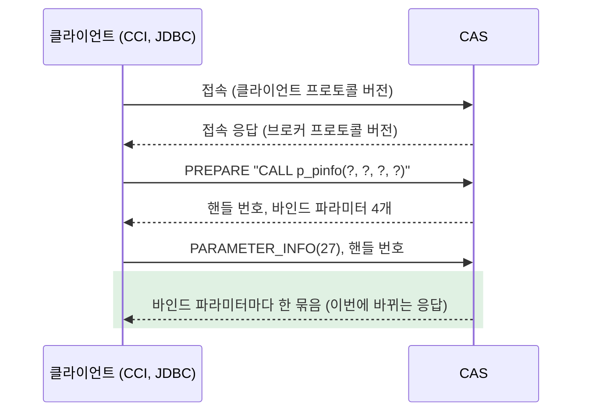
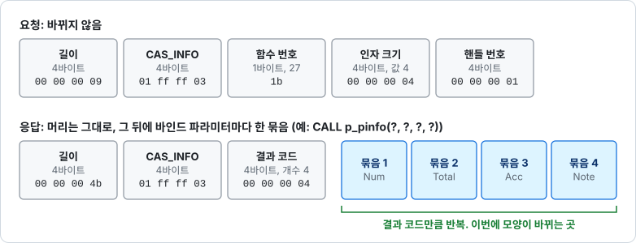
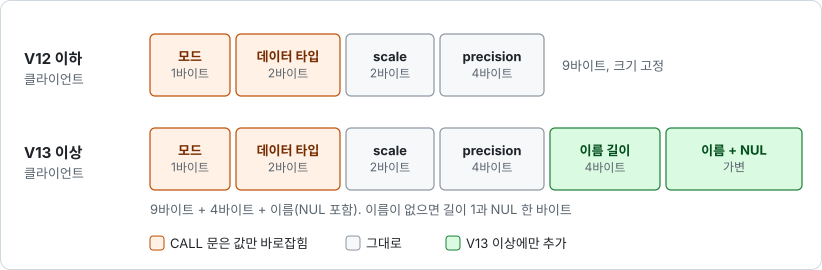
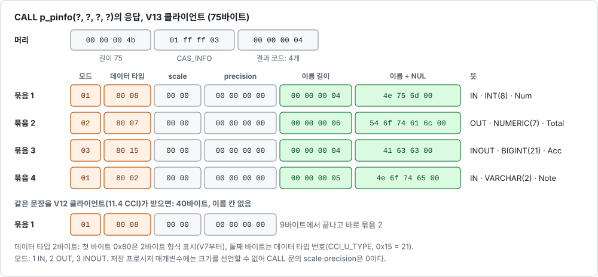
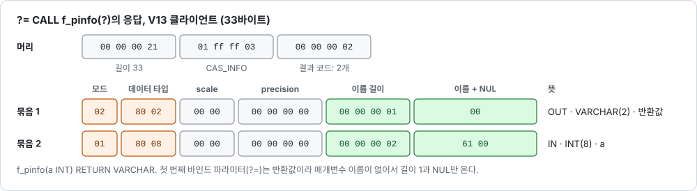
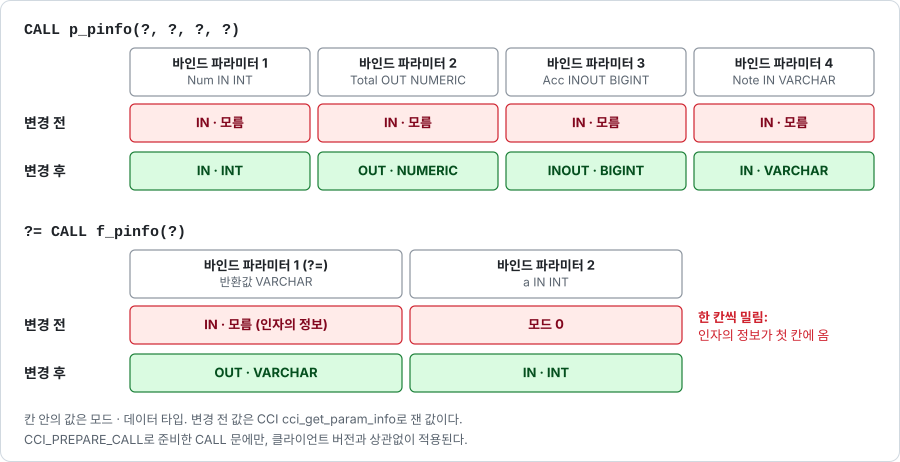
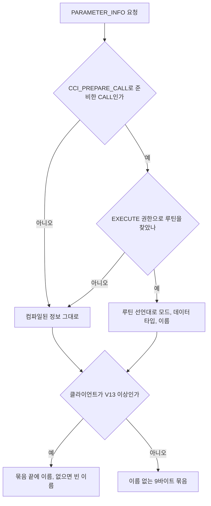
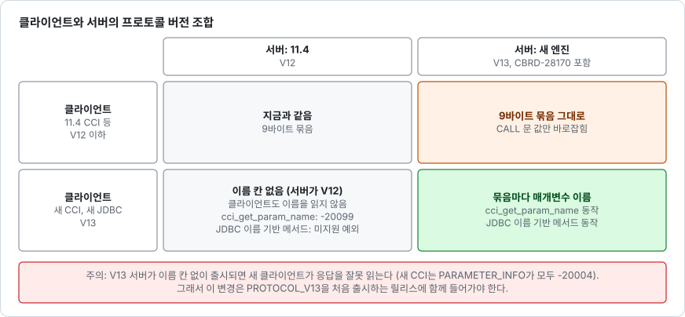
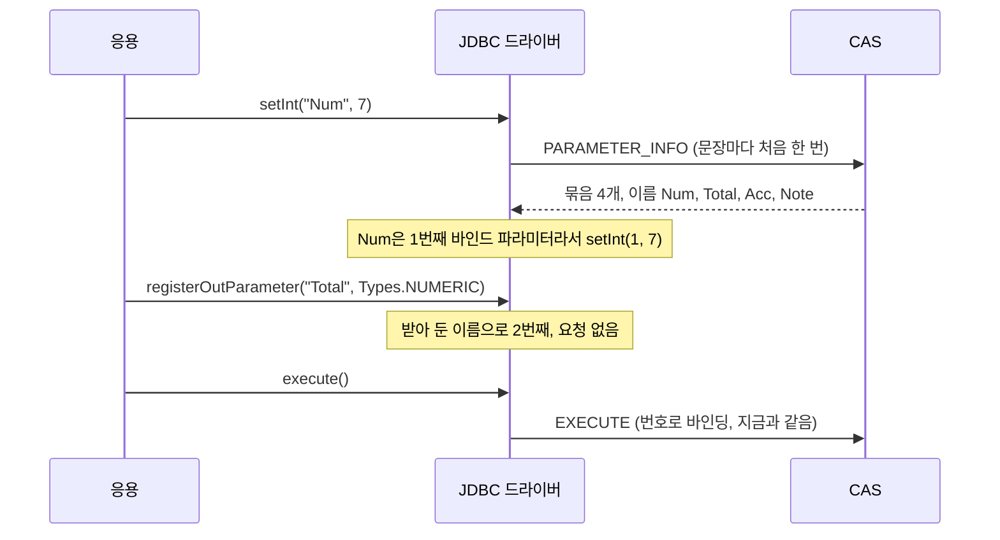

# CBRD-28170 PARAMETER_INFO 응답 변경: 바인드 파라미터 묶음에 매개변수 이름 추가

- 이슈: https://jira.cubrid.org/browse/CBRD-28170 (클라이언트 쪽: CCI [APIS-1139](https://jira.cubrid.org/browse/APIS-1139), JDBC [APIS-1140](https://jira.cubrid.org/browse/APIS-1140))
- 작업 기록: [CBRD-28170-call-parameter-info.md](CBRD-28170-call-parameter-info.md)
- 상태: 진행 중 (PR 전)
- 날짜: 2026-11-19

## 요약
CAS의 PARAMETER_INFO 응답은 바인드 파라미터(`?`)마다 묶음 하나(모드, 데이터 타입, scale, precision)를 보낸다. 이번 변경으로 V13 이상 클라이언트가 받는 묶음 끝에 매개변수 이름이 붙고, CALL 문의 묶음 값은 루틴 선언대로 바로잡힌다. 요청 형식과 V12 이하 클라이언트가 받는 바이트 배치는 그대로다.

이 문서는 프로토콜과 클라이언트 API가 어떻게 바뀌는지만 다룬다. 왜 이 작업을 하는지는 작업 기록에 있다.

## 1. PARAMETER_INFO는 언제 오가나



- 클라이언트가 문장을 PREPARE한 뒤, 바인드 파라미터의 정보가 필요할 때 보내는 요청이다(함수 번호 27).
- 지금 이 요청을 보내는 곳은 CCI `cci_get_param_info`, 그리고 CCI로 만든 엔진의 [DBLink](https://github.com/CUBRID/cubrid/blob/2e67e1d9482714f077b554dec5b17a64d167393f/src/query/dblink_scan.c#L2091)와 PDO 드라이버다.
- JDBC는 지금 이 요청을 보내지 않는다. 이번에 이름 기반 메서드 때문에 처음 보낸다.
- 바뀌는 것은 응답 하나다. 요청, PREPARE, EXECUTE는 그대로다.

## 2. 요청과 응답의 모양



- 요청 17바이트는 그대로다. 함수 번호 27과, PREPARE 응답으로 받은 핸들 번호를 보낸다.
- 응답 머리도 그대로다.
  - 길이는 CAS_INFO 뒤의 바이트 수다. 위 예에서 75 = 결과 코드 4 + 묶음 71.
  - 결과 코드는 바인드 파라미터 개수다.
- 머리 뒤에 묶음이 결과 코드만큼 이어진다. 이번 변경은 모두 이 묶음 안에서 일어난다.

## 3. 묶음 하나의 모양



- V13 이상 클라이언트에게만, precision 뒤에 이름 길이(4바이트, NUL 포함)와 이름 + NUL을 붙인다.
- 이름이 없는 바인드 파라미터(일반 SQL, `?=`의 반환값, 식 안의 바인드 파라미터)는 이름 길이 1과 NUL 한 바이트를 보낸다.
- 모드 뒤의 칸은 PREPARE 응답의 열 정보와 같은 모양이다.
  - PREPARE 응답은 열마다 데이터 타입, scale, precision, 열 이름을 [`net_buf_column_info_set`](https://github.com/CUBRID/cubrid/blob/2e67e1d9482714f077b554dec5b17a64d167393f/src/broker/cas_net_buf.c#L387-L416)으로 쓴다([PREPARE 열 정보](https://github.com/CUBRID/cubrid/blob/2e67e1d9482714f077b554dec5b17a64d167393f/src/broker/cas_common_execute.c#L452)).
  - 묶음도 V13 클라이언트에게는 같은 함수로 쓴다. 그래서 매개변수 이름은 열 이름과 같은 형식(길이 4바이트, 이름, NUL)이다.
- 이제 묶음 크기가 9바이트로 고정되지 않는다. 받는 쪽은 이름 길이를 읽어야 다음 묶음이 어디서 시작하는지 안다. 이름 칸을 모르는 클라이언트가 이 응답을 받으면 두 번째 묶음부터 엉뚱한 위치를 읽기 때문에, 형식을 프로토콜 버전으로 나눈다(6절).

## 4. 실제 바이트로 보기

예로 쓰는 루틴:

```sql
CREATE PROCEDURE p_pinfo (Num INT, Total OUT NUMERIC, Acc INOUT BIGINT, Note VARCHAR DEFAULT 'x') AS
BEGIN
  Total := Num;
  Acc := Acc + 1;
END;

CREATE FUNCTION f_pinfo (a INT) RETURN VARCHAR AS
BEGIN
  RETURN 'v' || a;
END;
```





- CAS 앞에 바이트를 기록하는 프록시를 두고 잡은 실제 응답이다. 새 CCI(V13)와 11.4 CCI(V12)로 같은 문장을 보냈다(develop 2e67e1d94 + CBRD-28170 debug 빌드).

| 문장 | V13 클라이언트 | V12 클라이언트 | 차이 |
|---|---|---|---|
| `CALL p_pinfo(?, ?, ?, ?)` | 75바이트 | 40바이트 | 35바이트 = 이름 길이 4 × 4 + `Num`, `Total`, `Acc`, `Note`와 NUL 19 |
| `?= CALL f_pinfo(?)` | 33바이트 | 22바이트 | 11바이트 = 이름 길이 4 × 2 + 빈 이름의 NUL 1 + `a`와 NUL 2 |

- 데이터 타입 칸은 V7에서 1바이트가 2바이트로 바뀐 칸이다. 그때도 CAS가 [클라이언트 버전을 보고](https://github.com/CUBRID/cubrid/blob/2e67e1d9482714f077b554dec5b17a64d167393f/src/broker/cas_net_buf.c#L822-L856) 1바이트와 2바이트를 나눠 썼다. 이번 이름 칸도 같은 방식이다.

## 5. 묶음에 담기는 값: CALL 문은 루틴 선언대로



CAS가 묶음마다 값을 정하는 순서:



- 값 바로잡기는 `CCI_PREPARE_CALL`로 준비한 CALL 문에만 한다. JDBC `prepareCall`이 쓰는 플래그다. 플래그 없이 준비한 CALL과 일반 SQL은 지금 값 그대로다.
- 값 바로잡기는 클라이언트 버전과 상관없이 적용된다. 묶음 모양은 그대로 두고 값만 바꾸기 때문이다. 그래서 11.4 CCI로도 바로잡힌 값을 받는다.
- 루틴은 EXECUTE 권한으로 찾는다. 권한이 없거나 루틴을 찾지 못하면(준비한 뒤 삭제한 경우 등) 오류 없이 지금 값과 빈 이름을 보낸다.
- 바인드 파라미터와 매개변수는 다음처럼 짝짓는다.

| 바인드 파라미터 | 묶음 값 |
|---|---|
| 인자 자리의 바인드 파라미터 | 그 자리 매개변수의 모드, 데이터 타입, 이름 |
| `?= CALL f(...)`의 첫 번째 바인드 파라미터 | 반환값: OUT, 반환 데이터 타입, 빈 이름 |
| 리터럴 인자(`CALL p(5, ?, ?, ?)`의 `5`) | 바인드 파라미터가 아니라 묶음이 없음. 첫 번째 바인드 파라미터가 두 번째 매개변수와 짝지어짐 |
| 식 안의 바인드 파라미터(`CALL p(? + 1, ...)`) | IN, 데이터 타입 모름, 빈 이름 |

- 저장 프로시저 매개변수에는 크기를 선언할 수 없어 CALL 문의 scale, precision은 0이다.

## 6. 버전이 다를 때



- CAS는 접속 때 받은 클라이언트 버전이 V13 이상일 때만 이름 칸을 쓴다([`DOES_CLIENT_UNDERSTAND_THE_PROTOCOL`](https://github.com/CUBRID/cubrid/blob/2e67e1d9482714f077b554dec5b17a64d167393f/src/broker/cas_protocol.h#L366)).
- 클라이언트는 브로커 버전이 V13 이상일 때만 이름 칸을 읽는다.
- 그래서 한쪽이라도 V12 이하이면 지금처럼 9바이트 묶음으로 주고받는다.
- 그림에서 새 엔진이나 새 클라이언트가 들어간 세 조합은 실제로 확인했다. V12 클라이언트는 11.4 CCI로, V12 서버는 11.4 엔진으로 확인했다.
- develop의 [`CURRENT_PROTOCOL`은 V13](https://github.com/CUBRID/cubrid/blob/2e67e1d9482714f077b554dec5b17a64d167393f/src/broker/cas_protocol.h#L300)이고 아직 출시되지 않았다. 이 변경은 V13을 처음 출시하는 릴리스에 함께 들어가야 한다. 늦어지면 이름 칸의 조건을 다음 프로토콜 버전으로 옮긴다.

## 7. 클라이언트 API

### CCI: `cci_get_param_name` 추가 (APIS-1139)

```c
T_CCI_PARAM_INFO *param;
char *name;
int req, n, i;

req = cci_prepare (con, "CALL p_pinfo(?, ?, ?, ?)", CCI_PREPARE_CALL, &err);
n = cci_get_param_info (req, &param, &err);              /* 지금과 같음 */
for (i = 1; i <= n; i++)
  {
    cci_get_param_name (req, i, &name, &err);            /* 새 함수 */
    printf ("%d %d %s\n", CCI_GET_PARAM_INFO_MODE (param, i), CCI_GET_PARAM_INFO_TYPE (param, i), name);
  }
cci_param_info_free (param);
/* 1 8 Num / 2 7 Total / 3 21 Acc / 1 2 Note */
```

| 반환 | 조건 |
|---|---|
| 0 | 성공. 이름이 없는 바인드 파라미터는 `""` |
| `CCI_ER_INVALID_ARGS` (-20043) | `name`이 NULL |
| `CCI_ER_NOT_IMPLEMENTED` (-20099) | 서버가 V13 미만 |
| `CCI_ER_BIND_INDEX` (-20009) | 번호가 1보다 작거나 바인드 파라미터 개수보다 큼 |

- `T_CCI_PARAM_INFO`와 `cci_get_param_info`는 그대로다. 응용이 `CCI_GET_PARAM_INFO_*` 매크로로 배열을 직접 읽어서, 구조체 크기가 바뀌면 이미 컴파일된 응용과 맞지 않기 때문이다.
- 처음 받은 이름을 요청 핸들이 닫힐 때까지 보관한다. 돌려준 문자열은 해제하지 않는다.
- 이름을 아직 받지 않았으면 PARAMETER_INFO를 한 번 보낸다.

### JDBC: CallableStatement 이름 기반 메서드 (APIS-1140)



```java
CallableStatement cs = conn.prepareCall("CALL p_pinfo(?, ?, ?, ?)");
cs.setInt("Num", 7);                              // setInt(1, 7)과 같음
cs.registerOutParameter("Total", Types.NUMERIC);  // registerOutParameter(2, ...)와 같음
cs.setLong("Acc", 10L);
cs.registerOutParameter("Acc", Types.BIGINT);
cs.setString("Note", "n");
cs.execute();
cs.getBigDecimal("Total");                        // 7
```

- 이름 기반 메서드는 이름을 바인드 파라미터 번호로 바꾼 뒤 짝이 되는 번호 기반 메서드를 부른다. 서버로 가는 EXECUTE는 지금과 같다.
- 이름 기반 메서드 85개 가운데 짝이 되는 번호 기반 메서드가 지원되는 60개를 지원한다. 나머지 25개는 그대로 `SQLFeatureNotSupportedException`이다.
- 이름은 대소문자를 무시하고 비교한다. 없는 이름이나 빈 이름은 새 오류 -21146이다.
- V13 미만 브로커, SHARD proxy, gateway에서는 이름 기반 메서드가 그대로 `SQLFeatureNotSupportedException`이다.
- `DatabaseMetaData.supportsNamedParameters()`는 V13 이상 브로커에 직접 접속했을 때 true를 돌려준다.

## 참고
- JIRA: [CBRD-28170](https://jira.cubrid.org/browse/CBRD-28170), [APIS-1139](https://jira.cubrid.org/browse/APIS-1139), [APIS-1140](https://jira.cubrid.org/browse/APIS-1140)
- 작업 기록: [CBRD-28170-call-parameter-info.md](CBRD-28170-call-parameter-info.md)
- PR: 아직 없음
