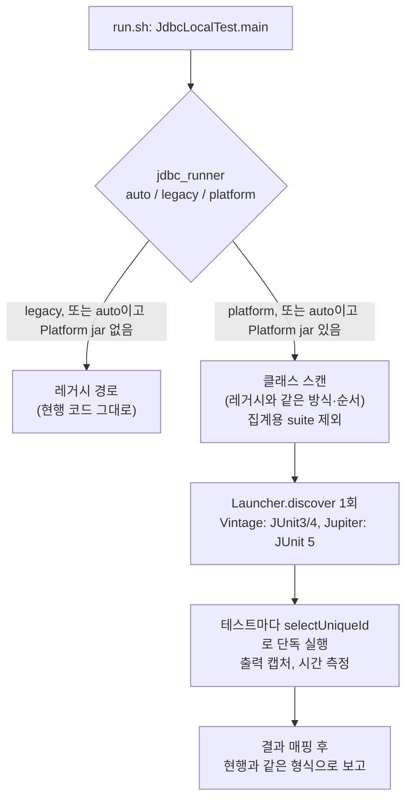
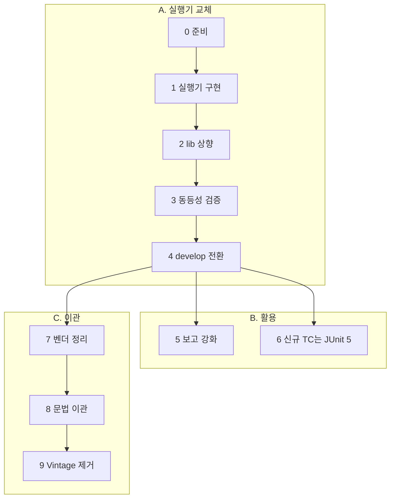

# JDBC TC JUnit 현대화: 실행기 선교체(JUnit Platform) 설계와 단계별 계획

- 분류: analysis
- 날짜: 2026-11-16
- 관련: `analysis/2026-07-14-jdbc-test-junit4-upgrade.md`(벤더 제거안), `analysis/2026-07-14-jdbc-ctp-harness-gradle.md`(Gradle 공존 하네스), `analysis/2026-07-23-javasp-plcsql-jdbc-tc-design.md`(신규 TC 설계), 사내 보고서 "phantom 정리·JUnit 4.13.2 검증"(2026-06-25), "CommentOut_ 비활성 TC 분석"(2026-07-02)

## 요약
벤더 JUnit3 TC를 JUnit4로 바꾸지 않고, CTP의 `JdbcLocalTest`를 JUnit Platform(Vintage + Jupiter) 실행기로 먼저 교체한 뒤 JUnit 5로 직행한다(실측: 이 교체만으로 가짜 등록 733건이 파일 수정 없이 사라지고 실제 테스트 1,626건은 그대로 실행되며, 함께 필요한 작업은 JUnit 4.13.2와 PowerMock 2.x 상향뿐이다).

## 목적
JUnit 3 스타일 벤더 TC(jTDS·PostgreSQL·MySQL 이식)를 JUnit 4로 먼저 바꾸는 것이 최종 목표(JUnit 5)에 맞는 첫 단계인지 판단한다. 맞지 않다면 문법 대신 바꿔야 할 지점인 CTP 실행기를 구현 가능한 수준으로 설계하고, 단계별 진행 계획을 세운다.

## 배경
- CTP JDBC 실행기 `JdbcLocalTest`는 메서드 이름에 "TEST"가 들어 있으면 테스트로 등록한다.
- 등록한 메서드마다 `JUnitCore`로 한 번씩 실행한다.
- 6월 실측에서 JUnit 4.13.2로 전면 상향하자 실패 767건이 생겼다. 원인은 이름 기반 등록이 만든 가짜 테스트였고, 근본 해결은 실행기 수정이라는 결론이 났다.
- 7월 노트에서는 벤더 스위트를 제거하는 안을 정리했다.
- 이번 질문은 "벤더 JUnit3 TC를 JUnit4로 바꿀 것인가"이다. 최종 목표는 JUnit 5인데, 문법만 JUnit 5로 바꾸면 현재 CTP에서 실행할 수 없다.

## 범위 / 방법
- 대상: `cubrid-testcases-private`의 `interface/JDBC/test_jdbc`(develop, 2026-07-14 스냅샷), `cubrid-testtools`의 CTP JDBC 경로.
- 정적 분석: CTP 실행기·빌드·결과 보고(Feedback) 코드, JUnit 4.8.1 jar 바이트코드(`javap -c`).
- 실측은 DB 없이 시뮬레이션으로 했다.
  - test_jdbc를 JDK 8로 컴파일했다. 현재 드라이버와 API가 맞지 않는 3개 파일은 뺐다.
  - 뺀 3개 파일의 등록 12건은 모두 `@Test`와 이름이 일치하므로 비교에 영향이 없다.
  - 도구 1: `JdbcLocalTest.getAllTestCase()`의 등록 규칙을 그대로 복제했다. 결과는 2,361건(뺀 12건 포함)으로 6월 실측과 일치한다.
  - 도구 2: JUnit Platform Launcher로 같은 클래스들을 발견하고, 도구 1의 목록과 원인별로 비교했다.
  - 도구 3: DB가 필요 없는 테스트를 UniqueId로 1건씩 실행했다.
- 측정 버전 대체: 로컬 캐시에 5.14.4용 Vintage가 없어서, 발견 측정에는 버전이 정렬된 JUnit 6.0.3 세트를 JDK 17에서 썼다.
  - 발견되는 테스트 집합은 Vintage가 감싸는 JUnit 4.13.2 러너가 정하므로 5.14.4와 같다고 판단했다.
  - JDK 17에서만 생기는 차이(PowerMock 1개 클래스)는 따로 표시했다.
- 외부 확인: JUnit 5.14 사용자 가이드, JUnit 6.0 릴리스 노트, Maven Central 버전 목록, OpenRewrite 레시피 정의, MySQL Connector/J·pgjdbc 저장소 이력.

## 발견 / 관찰

### 1) JUnit3 → 4 변환을 먼저 하면 실패가 늘어난다
현재 classpath의 JUnit 4.8.1은 "등록됐지만 실제 테스트가 아닌 메서드"를 러너 종류에 따라 다르게 처리한다(바이트코드로 확인).

| 클래스 형태 | 사용 러너 | 걸러서 남는 테스트가 0개일 때 | CTP 집계 |
|---|---|---|---|
| JUnit3 (`extends TestCase`) | `JUnit38ClassRunner.filter` | 예외 없이 반환 | 0건 실행, OK |
| JUnit4 (`@Test`) | `ParentRunner.filter` | `NoTestsRemainException`, 이어서 `FilterRequest`가 "No tests found matching"으로 바꿈 | NOK |

- 벤더 스위트에는 이런 가짜 등록이 733건 있다(CommentOut_ 695, 이름에 test가 든 헬퍼 38).
- 벤더 클래스를 JUnit4로 바꾸면 그 클래스의 가짜 등록이 OK에서 NOK로 바뀐다.
- 이는 JUnit 4.13.2 상향 때 막혔던 문제(실패 767건)를 그대로 다시 만든다.
- 실행 자체에는 변환이 필요 없다. JUnit4 러너가 JUnit3 클래스를 이미 실행하고 있다.
- 자동 변환 도구 OpenRewrite의 `JUnit4to5Migration`은 JUnit3 `TestCase`를 JUnit 5로 바로 바꾸는 `MigrateJUnitTestCase`를 포함한다.
- 3→4를 거치면 같은 파일을 두 번 바꾸게 된다.

### 2) JUnit 5 문법은 현재 CTP에서 실행되지 않는다
- 이름에 "test"가 없는 Jupiter 메서드는 등록되지 않는다. 오류 없이 빠진다.
- 이름에 "test"가 있는 Jupiter 메서드는 등록은 된다.
- 그러나 JUnit4 러너는 `org.junit.Test`가 없는 클래스를 "No runnable methods"로 실패 처리한다(`BlockJUnit4ClassRunner.validateInstanceMethods`).
- 따라서 막힌 곳은 테스트 문법이 아니라 실행기다.

### 3) 실측: 현재 등록과 Platform 발견의 차이
현재 등록 2,361건의 구성:

| 구성 | 건수 | Platform에서 |
|---|---:|---|
| 실제 테스트 | 1,626 | 그대로 발견·실행 |
| CommentOut_ 가짜 등록 (jTDS 361, PostgreSQL 148, MySQL 186) | 695 | 발견 안 됨 |
| 이름에 test가 든 헬퍼, 예: `createTestTable` (jTDS 6, PostgreSQL 10, MySQL 22) | 38 | 발견 안 됨 |
| 오버로드 메서드 이중 등록 | 2 | 1건으로 |

Platform 쪽에만 생기는 항목:

| 항목 | 건수 | 처리 |
|---|---:|---|
| `@Ignore` 메서드 | 193 | 발견 후 실행 단계에서 skip. 현행처럼 집계에서 제외 |
| 추상 베이스(`BaseDataSource`)의 테스트를 상속한 2개 클래스의 실행 | 2 | 새로 실제 실행됨. 현행은 추상 클래스 쪽에 가짜 등록 1건 |
| pg 집계용 suite가 멤버 테스트를 한 번 더 발견 | 20 이상 | 집계용 suite(현재 4개)는 선택에서 제외 |
| 집계용 suite 중 `suite()`가 DB에 접속하는 2개의 초기화 오류 | 2 | 위와 같이 제외 |

- 예상 보고 건수는 1,628건이다(실제 1,626 + 상속 2). JDK 8, PowerMock 2.x, 집계용 suite 제외가 전제다.
- 줄어드는 건수는 모두 가짜 OK다. 실제 테스트의 NOK 수는 변하지 않아야 한다.
- 레거시 실행기에 JUnit 4.13.2만 넣으면 852건이 오류가 된다(CommentOut_ 695, 헬퍼 38, PowerMock 1.4.12 비호환 118, 오버로드 중복 1).

### 4) 함께 바꿔야 하는 것: PowerMock
- PowerMock을 쓰는 CUBRID 테스트 클래스는 8개(145건)다.
- PowerMock 1.4.12 + JUnit 4.13.2에서는 JDK 8에서도 7개 클래스(118건)의 러너 생성이 실패한다.
- 원인은 PowerMock 1.4.12가 JUnit 4.13.2에 없는 내부 필드를 찾기 때문이다.

```
org.powermock.reflect.exceptions.FieldNotFoundException:
  Field 'fTestClass' was not found in class org.junit.internal.runners.MethodValidator.
```

- 나머지 1개(`TestCUBRIDClob2`, 27건)는 JDK 8에서는 동작하고 JDK 17에서만 `IllegalAccessError`로 실패한다.
- 6월 검증에서 PowerMock 2.0.9 + Mockito 3.3.3 + EasyMock 4.0.1 + JUnit 4.13.2 조합은 VerifyError 0, 기능 회귀 0이었다(레거시 실행기 기준).
- PowerMock은 Jupiter를 지원하지 않는다. 이 8개 클래스는 Vintage로 계속 돌리거나 Mockito로 다시 작성해야 한다.

### 5) Platform 실행 방식의 동작 확인 (DB 없는 테스트로 실측)

| 확인 항목 | 결과 |
|---|---|
| JUnit4 테스트 1건을 UniqueId로 단독 실행 (`TestCUBRIDCommandType.test1`) | 발견 1, 성공 1, 22ms |
| JUnit3 테스트 1건을 UniqueId로 단독 실행 (jTDS 단위 테스트 3건) | 각각 발견 1, 성공 1, 2~25ms |
| `@Ignore` 메서드 단독 실행 (`TestCUBRIDConnection.test9`) | skipped 1로 보고 |
| 전체 클래스 1회 발견 | 약 1초 |
| JUnit jar 버전 혼용 (Platform 1.14.4 + Vintage 5.11.4) | Launcher가 발견을 거부 (`ClasspathAlignmentChecker`) |

- Vintage가 발견한 JUnit3/4 테스트는 클래스·메서드 이름을 그대로 가진다.
- 그래서 현행과 같은 케이스 이름을 만들 수 있다. 공통 1,469건의 키가 그대로 일치했다.
- 단독 실행 1건의 추가 비용은 수 ms다. 실제 테스트 약 1,600건 기준으로 수 초 수준이다.

### 6) 환경과 CTP 구조의 제약

| 항목 | 사실 | 근거 |
|---|---|---|
| CTP 실행 JDK 하한 | 커밋된 `cubridqa-shell.jar`가 Java 8 바이트코드(major 52) | `javap -v` |
| JUnit 5.x 요구 | Java 8 이상 | JUnit 5.14 사용자 가이드 |
| JUnit 6 요구 | Java 17 이상, Vintage deprecated | JUnit 6.0.0 릴리스 노트 |
| Vintage 요구 | classpath에 JUnit 4.12 이상 | JUnit 5.14 사용자 가이드 |
| 5.x 최신 버전 | 5.14.4 | Maven Central |
| 실행기 호출처 | `jdbc/bin/run.sh` 한 곳 | CTP 소스 |
| 실행 classpath | 시나리오 `lib/*.jar`(CPCLASSES). CTP `jdbc/lib`는 들어가지 않음 | `jdbc/bin/run.sh:240-257` |
| CTP 빌드 classpath | `jdbc/lib/*.jar` 포함, javac target 1.8 | `CTP/build.xml` |
| 결과 보고의 skip 필드 | `SKIP_TYPE_NO/BY_MACRO/BY_TEMP`가 있으나 JDBC 실행기는 항상 `NO` | `shell/common/Constants.java:47-49` |
| 실패 메시지 | 첫 실패의 메시지만 기록, 스택트레이스 없음 | `JdbcLocalTest.runTests` |
| 케이스 이름 | `<시나리오>/src/<경로>.java => <메서드>()` | `run_case_details.log`, `test-jdbc.xml` |

- 로컬 CTP 재현 환경(Docker, CUBRID 11.4 이미지)도 Java 8이다.
- 따라서 목표 버전은 JUnit 5.x(5.14.4)다. JUnit 6은 CTP 실행 JDK가 17 이상이 된 뒤에 검토한다.

### 7) 다른 드라이버의 선례 (저장소 이력)

| 드라이버 | 경로 | 근거 |
|---|---|---|
| MySQL Connector/J | 8.0.20까지 JUnit3, 8.0.21에서 JUnit4를 건너뛰고 Jupiter로 일괄 전환 | 태그별 `BaseTestCase.java` |
| pgjdbc | 2019-11 Gradle 이전 때 vintage와 jupiter를 함께 도입하고 점진 이관. 현재 Jupiter 파일 233개, JUnit4 파일 0개 | 커밋 `9f396707`, 현재 트리 |

- 두 드라이버 모두 3→4 중간 단계를 거치지 않았다.

## 결론
**JUnit3→4 변환은 하지 않는다. CTP 실행기를 JUnit Platform으로 먼저 바꾸고, 그 위에서 JUnit 5로 직행한다.** 실행기 교체는 가짜 등록 정리, JUnit 4.13.2 상향, JUnit 5 실행을 한 번에 해결하는 유일한 지점이다. 실행기의 등록 규칙만 고치는 대안(이름 대신 `@Test`와 JUnit3 규칙으로 등록)은 JUnit 4.13.2까지만 풀고 JUnit 5에서 다시 바꿔야 하므로 택하지 않는다. 7월 노트의 Gradle 공존 하네스와도 충돌하지 않는다. 테스트가 Platform 위에서 돌게 되면 나중에 Gradle(`useJUnitPlatform`)로 옮겨도 같은 엔진으로 같은 결과가 나온다.

### 실행기 교체 상세 설계



설계 원칙:

| 항목 | 설계 | 이유 |
|---|---|---|
| 모드 선택 | `jdbc.conf` `[common]`의 `jdbc_runner=auto\|legacy\|platform`, 기본값 `auto` | 명시적 제어와 비상 전환 |
| auto 판정 | `LauncherFactory`와 `VintageTestEngine`을 모두 로드할 수 있으면 platform | jar를 넣은 시나리오만 전환된다. 릴리스 브랜치는 자동으로 레거시 |
| 클래스 분리 | `org.junit.platform.*` 참조는 신규 `PlatformJdbcCaseRunner`에만 둔다 | jar가 없는 브랜치에서 `JdbcLocalTest` 로딩이 깨지지 않게 |
| 대상 클래스 | 레거시와 같은 `.class` 스캔과 순서, `$`가 든 클래스 제외 | 실행 순서 변화를 최소화 |
| 집계용 suite 제외 | `TestSuite` 상속, 또는 `TestCase`가 아니면서 static `suite()`가 있는 클래스 | 중복 실행과 DB 의존 초기화 오류 방지 |
| 발견 | `selectClass`로 한 번에 발견, (클래스, 메서드) 중복 제거 | 판별 누락에 대한 안전장치 |
| 정적 skip | JUnit4 `@Ignore`, Jupiter `@Disabled`(메서드·클래스)는 등록 단계에서 제외 | 현행 집계(미등록)와 같고, 총계와 보고 건수가 일치 |
| 실행 단위 | 테스트 1건씩 `selectUniqueId` | 현행과 같은 격리: 클래스 fixture, 출력 캡처, 실패 격리가 테스트마다 |
| 케이스 이름 | `<시나리오>/src/<클래스 경로>.java => <메서드>()` | 이전 결과와 같은 키로 비교 |
| JDK·버전 | Java 8, JUnit 5.14.4 세트로 고정 | CTP 하한, 버전 정렬 검사 |

결과 매핑:

| Platform 결과 | CTP 보고 | 비고 |
|---|---|---|
| SUCCESSFUL | OK | |
| FAILED | NOK, 메시지와 스택트레이스 | 현행은 첫 메시지만 |
| 컨테이너 실패(클래스 초기화 오류 등) | 해당 테스트 NOK | 원인 예외를 기록 |
| ABORTED (Assume 위반) | 1단계: OK와 `[ABORTED]` 로그 | 현행 `JUnitCore`와 같은 집계. 현재 트리의 Assume 사용은 0건 |
| SKIPPED (실행 중 동적 skip) | 1단계: 보고 제외와 로그 | 정적 `@Ignore`는 등록 단계에서 이미 제외 |

코드 골격(Java 8, CTP 쪽 신규 클래스):

```java
package com.navercorp.cubridqa.shell.main;

import java.lang.reflect.Method;
import java.lang.reflect.Modifier;
import java.util.ArrayList;
import java.util.HashSet;
import java.util.List;
import java.util.Set;

import junit.framework.TestCase;
import junit.framework.TestSuite;

import org.junit.platform.engine.DiscoverySelector;
import org.junit.platform.engine.TestExecutionResult;
import org.junit.platform.engine.TestSource;
import org.junit.platform.engine.discovery.DiscoverySelectors;
import org.junit.platform.engine.support.descriptor.ClassSource;
import org.junit.platform.engine.support.descriptor.MethodSource;
import org.junit.platform.launcher.Launcher;
import org.junit.platform.launcher.TestExecutionListener;
import org.junit.platform.launcher.TestIdentifier;
import org.junit.platform.launcher.TestPlan;
import org.junit.platform.launcher.core.LauncherDiscoveryRequestBuilder;
import org.junit.platform.launcher.core.LauncherFactory;

/** JUnit Platform(Vintage + Jupiter) 실행 경로. org.junit.platform.* 는 이 클래스에서만 참조한다. */
class PlatformJdbcCaseRunner {

	/** 시나리오 classpath에 Launcher와 Vintage가 모두 있으면 true. 없으면 JdbcLocalTest가 레거시 경로를 쓴다. */
	static boolean isAvailable() {
		try {
			Class.forName("org.junit.platform.launcher.core.LauncherFactory");
			Class.forName("org.junit.vintage.engine.VintageTestEngine");
			return true;
		} catch (Throwable t) {
			return false;
		}
	}

	private final Launcher launcher = LauncherFactory.create();

	/** 레거시와 같은 스캔 순서의 클래스 목록을 받아 한 번에 발견하고, 보고할 테스트를 순서대로 돌려준다. */
	List<TestIdentifier> discover(List<Class<?>> classes) {
		List<DiscoverySelector> selectors = new ArrayList<DiscoverySelector>();
		for (Class<?> c : classes) {
			if (!isAggregatorSuite(c)) {
				selectors.add(DiscoverySelectors.selectClass(c));
			}
		}
		TestPlan plan = launcher.discover(LauncherDiscoveryRequestBuilder.request().selectors(selectors).build());
		List<TestIdentifier> tests = new ArrayList<TestIdentifier>();
		Set<String> seen = new HashSet<String>();
		for (TestIdentifier root : plan.getRoots()) {
			for (TestIdentifier t : plan.getDescendants(root)) {
				if (t.isTest() && !isStaticallyIgnored(t) && seen.add(caseKey(t))) {
					tests.add(t);
				}
			}
		}
		return tests;
	}

	/** 테스트 1건을 UniqueId로 단독 실행한다. 클래스 fixture와 출력 캡처가 현행처럼 테스트마다 분리된다. */
	CaseResult execute(TestIdentifier test) {
		final CaseResult r = new CaseResult();
		launcher.execute(LauncherDiscoveryRequestBuilder.request()
				.selectors(DiscoverySelectors.selectUniqueId(test.getUniqueId())).build(),
				new TestExecutionListener() {
					@Override
					public void executionSkipped(TestIdentifier id, String reason) {
						r.onSkipped(id, reason);
					}

					@Override
					public void executionFinished(TestIdentifier id, TestExecutionResult result) {
						r.onFinished(id, result); // 테스트 결과, 또는 클래스 초기화 실패 같은 컨테이너 실패
					}
				});
		return r;
	}

	/** TestSuite 상속, 또는 TestCase가 아니면서 static suite()가 있는 클래스: 멤버를 중복 실행하므로 제외한다. */
	static boolean isAggregatorSuite(Class<?> c) {
		if (TestSuite.class.isAssignableFrom(c)) {
			return true;
		}
		if (TestCase.class.isAssignableFrom(c)) {
			return false;
		}
		try {
			Method m = c.getMethod("suite");
			return Modifier.isStatic(m.getModifiers());
		} catch (NoSuchMethodException e) {
			return false;
		}
	}

	/** 케이스 키: MethodSource면 클래스#메서드, 클래스 초기화 오류처럼 ClassSource면 클래스#표시 이름. */
	static String caseKey(TestIdentifier t) {
		TestSource s = t.getSource().orElse(null);
		if (s instanceof MethodSource) {
			MethodSource m = (MethodSource) s;
			return m.getClassName() + "#" + m.getMethodName();
		}
		if (s instanceof ClassSource) {
			return ((ClassSource) s).getClassName() + "#" + t.getDisplayName();
		}
		return t.getUniqueId();
	}

	// isStaticallyIgnored(): MethodSource의 클래스·메서드에 org.junit.Ignore 또는 org.junit.jupiter.api.Disabled가 있으면 true
	// CaseResult: SUCCESSFUL→OK, FAILED와 컨테이너 실패→NOK(메시지+스택트레이스), ABORTED→1단계 OK와 [ABORTED] 로그
}
```

- `JdbcLocalTest.start()`는 모드만 판정한다. platform이면 위 클래스로 발견·실행하고, 출력 형식(`[TESTCASE]`, `[ELAPSE TIME(ms)]`, `[RUNTIME LOG]`)과 `onTestCaseStopEvent` 호출은 현행 `runTests()`와 같은 코드를 공유한다.
- 레거시 경로(`getAllTestCase()`, `runTests()`)는 손대지 않는다.

배포 구성:

| 위치 | 넣는 것 | 용도 |
|---|---|---|
| `cubrid-testtools` `CTP/jdbc/lib` | Platform launcher·engine·commons 1.14.4, opentest4j 1.3.0, apiguardian 1.1.2 | 실행기 컴파일 전용(빌드 classpath `libs`) |
| `cubrid-testtools` `CTP/shell/lib/cubridqa-shell.jar` | `ant dist`로 재생성 | 실행기 배포 |
| `test_jdbc/lib` (develop만) | JUnit 4.13.2, hamcrest-core 1.3, Platform 1.14.4 세트, Jupiter 5.14.4(api·engine), Vintage 5.14.4, opentest4j 1.3.0, apiguardian 1.1.2, PowerMock 2.0.9 세트(6월 검증 조합) | 런타임과 TC 컴파일 |
| `test_jdbc/lib`에서 제거 | `junit-4.8.1.jar`, `junit-4.8.2.jar`, PowerMock 1.4.12 계열 | 중복·비호환 제거 |

- 롤백은 test_jdbc lib 커밋을 되돌리는 것으로 한다.
- 시나리오에 JUnit 4.13.2를 둔 채 `jdbc_runner=legacy`로만 바꾸면 852건 오류가 다시 생긴다.

## 다음 단계

### 단계별 계획



| 단계 | 작업 | 산출물 | 완료 기준 |
|---|---|---|---|
| 0. 준비 | QA와 범위 합의(CTP 변경, auto 기본값, 롤백). 최신 develop으로 본 측정 도구를 다시 돌려 차이표 갱신. 현행 기준선 CTP 결과 확보 | 기준선 결과, 갱신한 차이표 | 차이 항목 전부 원인 분류됨 |
| 1. 실행기 구현 | `cubrid-testtools`: 모드 선택, `PlatformJdbcCaseRunner`, 컴파일용 jar, `ant dist` | PR 1건 | jar 없는 시나리오에서 결과가 현행과 완전히 같음 |
| 2. 시나리오 lib 상향 | `test_jdbc` develop: 배포 구성 표대로 jar 교체 | PR 1건 | CTP 컴파일 성공 |
| 3. 동등성 검증 | 같은 빌드·시나리오로 legacy와 platform을 각각 실행해 비교(로컬 CTP Docker, Java 8, `jdbc-ctp-verify-report`) | 비교 보고서 | 공통 실제 테스트의 OK/NOK 100% 일치, 차이는 차이표 범주에만 |
| 4. 전환 | develop 일일 CTP에 적용, 1~2주 관찰 | 운영 결과 | 실패 수 안정, 회귀 없음 |
| 5. 보고 강화 | 스택트레이스 기록, Assume과 동적 skip을 skip 유형으로 보고, 테스트별 타임아웃(`isTimeOut` 기록) | PR | QA 결과 화면에서 확인 |
| 6. 신규 TC는 JUnit 5 | isValid fakeSocket, PL/CSQL CallableStatement 등 | TC PR | CTP에서 Jupiter 테스트 실행 확인 |
| 7. 벤더 스위트 정리 | 남길 테스트 선별, CommentOut_ 695건 삭제 또는 재활성 | PR | 비활성 표기가 `@Ignore`(사유 포함) 또는 삭제로 통일 |
| 8. 문법 이관 | OpenRewrite로 상속 계층 단위 3/4→5, PowerMock 8개 클래스는 Mockito로 재작성 | PR 여러 건 | 이관 전후 결과 동일 |
| 9. Vintage 제거 | JUnit3/4 테스트가 0개가 되면 제거 | PR | Jupiter만으로 전체 실행 |

8단계의 이관 단위(부모 클래스가 JUnit3/4로 남아 있으면 자식만 Jupiter로 바꿀 수 없으므로 상속 계층이 단위다):

| 묶음 | 규모 | 방법 |
|---|---|---|
| CUBRID 자체 | JUnit4 141개 클래스, `@Test` 1,306개, `GeneralTestCase` 상속 43개 | Jupiter용 베이스를 옆에 두고 자식 클래스를 하나씩 옮김 |
| PowerMock 사용 | 8개 클래스, 145건 | Mockito `mockStatic`(3.4+)로 재작성하기 전까지 Vintage 유지 |
| PostgreSQL 이식 | 36개가 `TestCase` 직접 상속 | 파일 단위 변환 가능 |
| MySQL 이식 | 34개가 `BaseTestCase` 상속 | 베이스와 함께 일괄 |
| jTDS 이식 | 직접 부모: `BaseTestCase` 16, `DatabaseTestCase` 13, `UnitTestBase` 8 | 계층별 일괄 |

- OpenRewrite는 Maven/Gradle 플러그인으로 실행하므로, Ant 프로젝트인 test_jdbc는 변환할 때만 임시 빌드 파일이 필요하다.
- 실행기 교체가 늦어지는 동안 새로 쓰는 TC는 JUnit4로 써도 된다. 8단계에서 자동 변환된다.
- 벤더 스위트를 손으로 3→4 변환하는 일만 피한다.

### 위험과 대응

| 위험 | 영향 | 대응 |
|---|---|---|
| PowerMock 2.0.9 조합이 Vintage 경유에서 깨짐 | PowerMock 8개 클래스 145건 | 6월 검증은 레거시 실행기 기준이므로 3단계에서 Vintage 경유로 재확인 |
| 실행 순서 변화 | 테스트 간 DB 상태 의존이 드러남 | 클래스 순서는 레거시 스캔 순서 유지. 메서드 순서는 현행도 보장되지 않으므로 차이가 나면 원인 분석 |
| 집계용 suite 판별 누락 | 중복 실행 | (클래스, 메서드) 중복 제거 |
| JUnit jar 버전 혼용 | 발견 자체가 거부됨 | 한 릴리스 세트로 고정하고 세트 단위로만 업그레이드 |
| 공유 CTP를 쓰는 다른 브랜치 | 영향이 없어야 함 | auto 모드: 시나리오에 jar가 없으면 레거시 |
| 총계 변화(2,361 → 약 1,628)의 오해 | 결과 해석 혼선 | 전환 공지에 차이표 첨부, 실제 NOK 수 불변을 명시 |

### 코드로 확인하지 못한 것
- 실제 DB 실행에서 공통 테스트의 OK/NOK가 같은지: 3단계에서 확인한다.
- PowerMock 2.0.9 조합이 Vintage 경유로도 동작하는지: 로컬 캐시에 해당 jar가 없어 측정하지 못했다.
- QA 결과 화면(DB 보고)이 총계 변화와 skip 유형을 어떻게 표시하는지.
- 공식 CTP 장비의 JDK 상한: JUnit 6 판단에만 영향이 있다.
- Vintage 5.14.4로 직접 측정하지 않았다(6.0.3으로 대체).
- 측정 스냅샷은 2026-07-14 develop이다. 최근 CTP 실행은 2,6xx건이므로 0단계에서 다시 측정한다.

### 이슈화
- "CTP JDBC 실행기의 JUnit Platform 전환"(1단계)과 "test_jdbc JUnit 의존성 상향"(2~4단계)을 분리해 등록한다. 등록 프로젝트는 QA와 합의한다.
- 5단계 이후는 각각 별도 이슈로 진행한다.

## 참고
- CTP 실행기: `cubrid-testtools/CTP/shell/src/com/navercorp/cubridqa/shell/main/JdbcLocalTest.java`(등록 205-253, 실행 121-173)
- CTP 실행 스크립트: `cubrid-testtools/CTP/jdbc/bin/run.sh`(드라이버 교체 235-236, classpath·컴파일 240-245, 실행 257)
- CTP 빌드: `cubrid-testtools/CTP/build.xml`(`libs` classpath, javac target 1.8, `shell/lib/cubridqa-shell.jar`)
- CTP 결과 보고: `CTP/shell/src/com/navercorp/cubridqa/shell/common/Constants.java:47-49`, `CTP/shell/src/com/navercorp/cubridqa/shell/result/FeedbackFile.java:207-233`
- JUnit 4.8.1 바이트코드: `JUnit38ClassRunner.filter`, `ParentRunner.filter`, `FilterRequest.getRunner`, `BlockJUnit4ClassRunner.validateInstanceMethods`
- JUnit 5.14 사용자 가이드: https://docs.junit.org/5.14.0/user-guide/
- JUnit 6.0.0 릴리스 노트: https://docs.junit.org/6.0.0/release-notes/
- Vintage 버전 목록: https://repo1.maven.org/maven2/org/junit/vintage/junit-vintage-engine/maven-metadata.xml
- OpenRewrite `JUnit4to5Migration` 정의: https://github.com/openrewrite/rewrite-testing-frameworks/blob/main/src/main/resources/META-INF/rewrite/junit5.yml
- PowerMock JUnit 5 지원 요청: https://github.com/powermock/powermock/issues/1129
- MySQL Connector/J: https://github.com/mysql/mysql-connector-j (태그 8.0.20, 8.0.21의 `src/test/java/testsuite/BaseTestCase.java`)
- pgjdbc: https://github.com/pgjdbc/pgjdbc (커밋 `9f396707` "chore: migrate build scripts to Gradle", 2019-11-29)
- 선행 노트: `analysis/2026-07-14-jdbc-test-junit4-upgrade.md`, `analysis/2026-07-14-jdbc-ctp-harness-gradle.md`
- 사내 보고서: "JUnit 4.13.2 적용을 위한 phantom 정리 검증"(2026-06-25), "CUBRID JDBC CommentOut_ 비활성 TC 분석"(2026-07-02)
