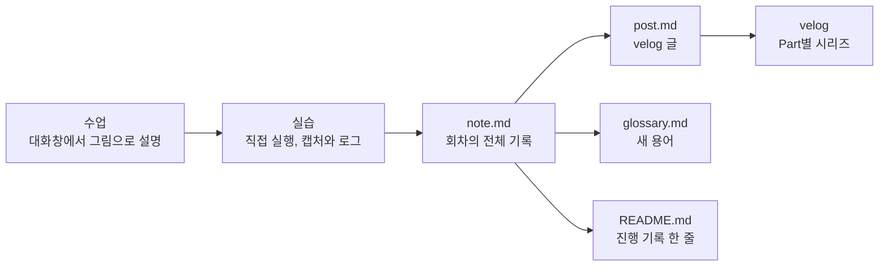

# 기록 규칙

- 대상: 이 디렉터리(`cubrid-jdbc-study/`)에 남기는 모든 기록
- 작성: 2026-10-08

이 디렉터리에는 CUBRID JDBC 공부에 관한 기록만 둔다. 커리큘럼과 진행 상황은 [README.md](README.md)에 있다.

## 기록이 만들어지는 흐름



## 디렉터리 구조

```
cubrid-jdbc-study/
├── README.md               커리큘럼과 진행 기록. 공부의 입구
├── CONVENTIONS.md          이 파일
├── glossary.md             용어집. 회차마다 새 용어를 더한다 (0-1에서 시작)
├── bench/                  여러 회차가 함께 쓰는 실습 작업대 (0-1, 0-3에서 만든다)
├── tools/                  그림을 PNG로 만드는 스크립트 (첫 글을 쓸 때 만든다)
└── p00-big-picture/        Part 0
    └── 01-what-is-jdbc/    0-1회차
        ├── note.md         학습 노트
        ├── post.md         velog 글
        ├── images/         velog용 PNG와 그 원본(.mmd)
        └── lab/            실습 코드, 명령, 캡처와 로그 발췌
```

폴더는 그 회차를 시작할 때 만든다. 미리 빈 폴더를 만들지 않는다.

### 폴더 이름

Part 번호와 회차 번호는 두 자리로 쓴다. GitHub 목록이 커리큘럼 순서대로 보이게 하려는 것이다. 한 자리로 쓰면 `6-10`이 `6-2`보다, `10-1`이 `2-1`보다 앞에 온다.

| Part | 폴더 | 회차 폴더 예 |
|---|---|---|
| 0 큰 그림 | `p00-big-picture` | 0-1 → `p00-big-picture/01-what-is-jdbc` |
| 1 와이어 기초 | `p01-wire-basics` | 1-1 → `p01-wire-basics/01-envelope` |
| 2 실행 경로 | `p02-execution` | |
| 3 트랜잭션 | `p03-transactions` | |
| 4 연결의 일생 | `p04-connection-lifetime` | |
| 5 값 인코딩 상세 | `p05-value-encoding` | |
| 6 그 밖의 기능 | `p06-more-features` | 6-10 → `p06-more-features/10-pool-leftovers` |
| 7 XA | `p07-xa` | |
| 8 상태·메모리 종합 | `p08-state-memory` | |
| 9 스레드·동시성 종합 | `p09-threads` | |
| 마무리 | `p10-closing` | |

회차 폴더의 영어 이름은 그 회차를 시작할 때 정한다.

## 회차 하나가 남기는 것

| 파일 | 내용 | 언제 |
|---|---|---|
| `note.md` | 그 회차의 전체 기록 | 회차를 진행하면서 |
| `post.md` | velog에 올릴 글 | 노트를 마친 뒤 |
| `images/` | 글에 넣을 PNG와 그 원본 | 글을 쓸 때 |
| `lab/` | 실행한 코드와 명령, 캡처와 로그 발췌 | 실습하면서 |
| `glossary.md` (공용) | 이 회차에서 새로 나온 용어 | 노트를 마칠 때 |
| `README.md` (공용) | 상태 표시와 진행 기록 한 줄 | 회차를 마칠 때 |

### note.md의 틀

```markdown
# 0-1. JDBC란 무엇인가

- 회차: 0-1 (Part 0 큰 그림)
- 날짜: YYYY-MM-DD
- 핵심 질문: getConnection() 한 줄은 어떻게 CUBRID 드라이버를 찾아내나?
- 실습 환경: 서버 이미지, 드라이버 커밋, JDK, 바꾼 브로커 설정

## 한 줄 요약
## 용어
## 개념: JDBC가 약속하는 것
## 바이트
## 상태·메모리
## 스레드
## 실습
## 틀렸던 예상
## 확인 질문
## 더 볼 것
## 참고
```

회차에 따라 다룰 내용이 없는 단계가 있으면 "이 회차에는 해당 없음"이라고 적고 넘어간다. 절 자체를 지우지 않는다.

### post.md의 규칙

- 노트를 다시 다듬은 글이다. 노트에 없는 사실을 새로 쓰지 않는다.
- 순서: 제목, 요약(1~2줄), 들어가며, 핵심, 정리, 참고
- 짧은 문단과 개조식으로 쓴다. 개념은 그림으로 보여준다.
- Part 하나를 velog 시리즈 하나로 묶는다.
- em-dash(—)는 쓰지 않는다. 쉼표, 콜론, 괄호, 마침표로 바꾼다.

## 그림 규칙

흐름과 개념은 글보다 그림으로 먼저 보여준다. 글은 그림을 읽는 법을 설명하는 데 쓴다.

### 어디에 무엇으로 그리나

| 자리 | 형식 | 이유 |
|---|---|---|
| 수업 중 대화창 | 대화창에 바로 그리는 그림 | 설명하는 그 자리에서 보여준다 |
| `note.md` | Mermaid 코드 블록 | GitHub가 바로 그림으로 보여준다. 원본이 곧 그림이라 고치기 쉽다 |
| `post.md` | PNG 이미지 | velog는 Mermaid와 SVG를 보여주지 못한다 |

velog용 PNG는 노트의 Mermaid 원본을 `images/*.mmd`로 옮긴 뒤 로컬 Chrome(headless)으로 렌더링해서 만든다. 2026-10-08에 공개 Kroki 서비스의 Mermaid 렌더링이 실패해서 로컬 방식으로 정했다. 렌더링 스크립트는 첫 글을 쓸 때 `tools/`에 만든다.

### 무엇을 어떤 그림으로 그리나

| 보여줄 것 | 그림 |
|---|---|
| 누가 누구에게 무엇을 어떤 순서로 보내나 | 시퀀스 다이어그램 |
| 바이트가 어떻게 놓이나 | 바이트 배치도: 필드마다 칸 하나, 오프셋, 실제 hex 값 |
| 호출이 어느 클래스를 거쳐 가나 | 층으로 묶은 흐름도 |
| 상태가 어떻게 바뀌나 (casinfo, 연결 상태, XA 브랜치) | 상태도 |
| 무엇이 무엇을 들고 있고 언제 사라지나 | 객체 그래프와 수명 막대 |
| 스레드가 언제 무엇을 잡나 | 스레드 타임라인: 가로축은 시간, 세로축은 스레드 |
| 프로세스와 소켓이 어떻게 이어지나 | 구성도: 애플리케이션, 드라이버, 브로커, CAS, DB 서버 |

노트에는 바이트 배치를 주석 단 hex 코드 블록으로도 함께 적는다. 그림은 구조를 보여주고, 코드 블록은 정확한 값을 보여준다.

### 그림 원칙

- 그림 하나에 질문 하나만 담는다.
- 노드는 15개를 넘기지 않는다. 넘으면 그림을 나눈다.
- 실제 이름과 실제 값을 쓴다. 클래스, 함수, 상수 이름과 hex 값이다.
- 그림 바로 아래에 근거를 file:line으로 적는다.
- 글자가 칸 밖으로 나가거나 단어 중간에서 줄이 바뀌면 고친다. PNG는 만든 뒤 직접 열어서 확인한다.

## 실습 기록 규칙

- 명령마다 다섯 가지를 적는다: 명령, 각 부분(옵션)의 뜻, 예상 출력, 실제 출력(발췌), 다르게 나오면 의심할 것
- 실습 코드와 스크립트는 `lab/`에 그대로 실행할 수 있는 상태로 둔다.
- 캡처와 로그는 필요한 부분만 발췌한다. 원본 pcap은 1MB 이하일 때만 넣는다.
- 노트 머리에 실습 환경을 적는다: 서버 이미지, 드라이버 커밋, JDK, 바꾼 브로커 설정
- 비밀번호, 사내 주소, 사내 문서 내용은 넣지 않는다. 실습 계정은 공개 기본값(dba, 빈 비밀번호)만 쓴다.

## 출처와 사실 표시

- 출처는 공개 저장소의 GitHub 파일:행으로 적고, 커밋을 고정한 링크를 쓴다.
- 코드를 읽고만 알아낸 내용에는 "(가설)"을 붙인다. 실습으로 확인하면 "(확인: 0-4 캡처)"처럼 근거를 단다.
- 틀렸던 예상은 지우지 않고 note.md의 "틀렸던 예상" 절에 남긴다.

## 커밋 규칙

- 제목 한 줄만 쓴다. 형식은 `<type>(cubrid-jdbc-study): <무엇을>`이고, 영어 명령형 소문자로 쓴다.
- type은 회차 노트와 글이면 `note`, 커리큘럼·규칙·용어집이면 `docs`, 작업대와 도구면 `chore`를 쓴다.
- 예: `note(cubrid-jdbc-study): add lesson 0-1 note`, `docs(cubrid-jdbc-study): mark lesson 0-1 done`
- push는 직접 한다.
