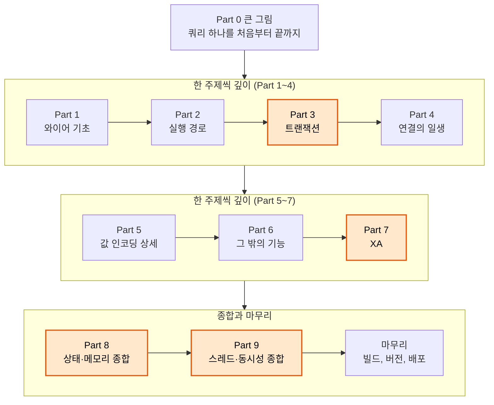

# CUBRID JDBC 깊이 공부하기: 커리큘럼

- 작성: 2026-10-05, 고침: 2026-10-08
- 상태: 확정. 0-1 시작 전
- 기록 규칙: [CONVENTIONS.md](CONVENTIONS.md)

## 이 문서의 용도

공부의 기준표다. 매 회차를 이 문서를 읽는 것으로 시작하고, 회차가 끝나면 맨 아래 진행 기록에 한 줄을 더한다. 결정한 내용이 대화창에만 남아 있다가 사라지지 않게 하려는 것이다.

## 목표

CUBRID JDBC 드라이버가 서버와 어떻게 통신하는지를 바이트 단위까지 이해한다. 그중에서도 메모리 상태, 트랜잭션, 스레드를 가장 깊게 본다. 출발점은 JDBC 자체를 잘 모르는 상태다.

## 전체 지도



주황색은 가장 깊게 보는 영역(트랜잭션, XA, 메모리, 스레드)이다. 메모리와 스레드는 Part 8, 9에서만 다루는 것이 아니라 모든 회차의 "상태·메모리", "스레드" 단계에서 계속 나온다. Part 8, 9는 그것을 한 장으로 모으는 자리다.

## 정해진 규칙

| 항목 | 규칙 |
|---|---|
| 순서 | 먼저 쿼리 하나를 처음부터 끝까지 따라가며 큰 그림을 잡는다(Part 0). 그다음 와이어 기초에서 출발해 한 주제씩 깊이 들어간다(Part 1~7). 앞 회차에서 배운 것만으로 읽히도록 순서를 잡았다. 마지막에 메모리와 스레드를 종합한다(Part 8~9) |
| 실습 | 매 회차 실제로 띄워서 측정한다. 명령은 모두 직접 실행한다 |
| 명령 설명 | 명령마다 다섯 가지를 적는다: 명령, 각 부분(옵션)의 뜻, 예상 출력, 출력을 읽는 법, 다르게 나오면 의심할 것 |
| 산출물 | 회차마다 노트(`note.md`) 1편과 velog 글(`post.md`) 1편을 이 디렉터리의 회차 폴더에 남긴다. 노트는 바이트, 로그, 틀렸던 예상까지 그대로 남기는 기록이고, 글은 노트를 다시 다듬은 것이다 |
| 그림 | 흐름과 개념은 글보다 그림으로 먼저 보여준다. 자세한 규칙은 [CONVENTIONS.md](CONVENTIONS.md) |
| 출처 | 공개 저장소(CUBRID/cubrid-jdbc, CUBRID/cubrid)의 코드와 공개 매뉴얼에서 확인한 것만 쓴다. 출처는 GitHub 파일:행으로 적는다 |
| 사실의 기준 | 코드를 읽고 알아낸 것은 가설로 둔다. 패킷과 로그로 확인한 것만 사실로 적는다 |
| 범위 밖 | JDBC 4.2 스펙 대조, 로드맵 이슈 |
| 속도 | 0-1을 해본 뒤 정한다 |

## 회차 진행 순서

모든 회차가 같은 순서로 진행된다.

**용어 → 개념 → 바이트 → 상태·메모리 → 스레드 → 실습 → 확인 질문 → 노트 → 글**

| 단계 | 답할 질문 |
|---|---|
| 용어 | 이 회차에 나오는 용어를 한 줄씩 먼저 정의한다 |
| 개념 | JDBC 표준은 이 기능이 무엇을 한다고 약속하나. 애플리케이션 코드는 어떻게 생겼나 |
| 바이트 | 드라이버는 실제로 어떤 바이트를 보내고 받나. 필드 하나하나는 어디서 어떤 값으로 채워지나 |
| 상태·메모리 | 이 동작 뒤에 드라이버와 서버에 무엇이 생기고, 언제까지 남나 |
| 스레드 | 그 상태를 다른 스레드가 동시에 건드리면 어떻게 되나 |
| 실습 | 바이트, 상태, 스레드 단계에서 세운 예상을 직접 실행해서 확인한다 |
| 확인 질문 | 2~3개. 답하지 못하면 해당 단계로 돌아간다 |

바이트 단계의 예: `conn.commit()`이 보내는 14바이트

```
00 00 00 06   본문 길이 6 (아래 세 필드: 1 + 4 + 1)
xx xx xx xx   casinfo 4바이트 (1-6에서 다룸)
01            함수 코드 1 = END_TRANSACTION
00 00 00 01   다음 값의 길이 1
01            값 1 = COMMIT (ROLLBACK이면 02)
```

함수 코드와 값은 `jci/UClientSideConnection.java:331-332`, 값 앞의 길이는 `jci/UOutputBuffer.java:108-112`, 맨 앞 8바이트는 `util/ByteArrayBuffer.java:148-163`에서 채워진다.

## 실습 작업대

| 구성 | 내용 |
|---|---|
| 서버 | 공부 전용 컨테이너를 새로 만든다. 이미지는 공식 `cubrid/cubrid:11.4`라서 velog 독자도 같은 명령으로 따라 할 수 있다. 업무용 컨테이너는 건드리지 않는다 |
| 비교용 서버 | `cubrid/cubrid:10.2`. 1-4(버전 모델)처럼 구버전 서버가 필요한 회차에서만 띄운다 |
| 브로커 | CAS 개수를 1개로 고정한다(`MIN_NUM_APPL_SERVER = MAX_NUM_APPL_SERVER = 1`). 어느 CAS의 로그를 봐야 하는지 헷갈리지 않게 하려는 것이다. 이 밖에 기본값과 다르게 설정하는 값은 회차마다 따로 적는다 |
| 드라이버 | `blog/cubrid-jdbc`(커밋 `6b4386b`)를 직접 빌드한 jar를 쓴다. 읽는 코드의 줄 번호와 실제로 실행되는 코드가 같아야 하기 때문이다. 빌드 방법은 0-1에서 다룬다 |
| 엔진 소스 | `blog/cubrid`(develop, 커밋 `5d8fc7bd5`). 실습 서버는 11.4 릴리스라서 동작이 다를 수 있다. 차이가 보이면 그것도 기록한다 |
| JDK | 0-1에서 하나로 정해서 고정한다. 빌드 타깃(1.8)과 설치된 JDK가 맞는지는 그 회차에서 확인한다. 실행할 때는 `-Dfile.encoding=UTF-8`을 항상 붙인다 |
| 패킷 캡처 | 기본은 Mac의 `lo0`에서 `tcpdump`로 잡는다. 서버 쪽 TCP 동작을 봐야 하는 회차만 컨테이너 안에서 잡는다 |
| 디스크 | 여유가 10GB 정도라서 새 이미지는 받지 않는다 |

## 회차 목록

상태 표시: ☐ 아직 안 함, ◐ 진행 중, ☑ 끝남

### Part 0. 큰 그림

| 회차 | 제목 | 핵심 질문 | 상태 |
|---|---|---|---|
| 0-1 | JDBC란 무엇인가: 표준 인터페이스, 드라이버, DriverManager | `getConnection()` 한 줄은 어떻게 CUBRID 드라이버를 찾아내나? (실습 환경 구축 포함) | ☐ |
| 0-2 | JDBC 객체 모델과 드라이버의 세 층 | `executeQuery()`는 어느 클래스를 거쳐 소켓까지 가나? | ☐ |
| 0-3 | CUBRID 서버 쪽 구조와 실습 작업대 | 브로커, CAS, DB 서버는 각각 무엇이고, 내 연결의 로그는 어디에 남나? | ☐ |
| 0-4 | 호출 하나가 패킷이 되기까지 | 연결부터 close까지 몇 개의 패킷이 오가고, 각각 무엇인가? | ☐ |

### Part 1. 와이어 기초

| 회차 | 제목 | 핵심 질문 | 상태 |
|---|---|---|---|
| 1-1 | 8바이트 봉투와 인자 프레임 | 요청과 응답은 어떤 틀에 담기고, 성공과 실패는 어디서 갈리나? | ☐ |
| 1-2 | 10바이트 인사와 소켓 넘겨주기 | 브로커에 연결했는데 왜 CAS가 답하나? | ☐ |
| 1-3 | 628바이트 접속 정보와 44바이트 접속 응답 | 사용자 이름과 비밀번호는 어떤 바이트로 가고, 세션 20바이트에는 무엇이 들어 있나? | ☐ |
| 1-4 | 버전 모델 | 드라이버와 서버는 서로의 버전을 어떻게 알고, 어느 분기가 실제로 살아 있나? | ☐ |
| 1-5 | 함수 코드 지도와 CAS의 처리 표 | 45개 번호 중 빈 번호와 겹치는 번호는 왜 생겼나? | ☐ |
| 1-6 | casinfo 4바이트 | 모든 응답 머리에 붙는 4바이트는 무엇을 결정하나? | ☐ |
| 1-7 | 에러 응답 | 실패는 어떤 바이트로 오고, 메시지는 어떤 문자셋으로 읽히나? | ☐ |
| 1-8 | 버퍼 세 개 | 요청 버퍼, 응답 버퍼, CAS 버퍼는 언제 만들어지고 얼마나 커지나? | ☐ |
| 1-9 | 타입 최소한: 태그, 확장 타입, NULL, OID | 값 하나는 어떤 틀로 오가고, NULL은 왜 요청과 응답에서 모양이 다른가? | ☐ |

### Part 2. 실행 경로

| 회차 | 제목 | 핵심 질문 | 상태 |
|---|---|---|---|
| 2-1 | PREPARE | 플래그 바이트 하나에 무엇이 담기고, 기본 연결에서는 왜 0x08이 붙나? | ☐ |
| 2-2 | EXECUTE | EXECUTE는 무엇을 싣고 가고, 왜 첫 FETCH 결과까지 함께 돌아오나? | ☐ |
| 2-3 | FETCH와 tuple | fetchSize는 정말 행 수인가? | ☐ |
| 2-4 | 커서 이동과 여러 결과 | 스크롤과 NEXT_RESULT는 무엇을 더 보내나? | ☐ |
| 2-5 | OID와 객체 API | CUBRID는 행 하나를 어떻게 가리키고, 그 주소로 무엇을 할 수 있나? | ☐ |
| 2-6 | 갱신 가능한 ResultSet | updateRow, deleteRow, insertRow는 각각 무엇을 보내나? | ☐ |
| 2-7 | CallableStatement | 저장 프로시저의 OUT 값은 어떤 바이트로 돌아오나? | ☐ |

### Part 3. 트랜잭션

| 회차 | 제목 | 핵심 질문 | 상태 |
|---|---|---|---|
| 3-1 | commit, rollback, savepoint | commit은 몇 바이트이고, RELEASE SAVEPOINT는 왜 없나? | ☐ |
| 3-2 | autocommit은 모드가 아니라 바이트 | autocommit의 커밋은 실제로 언제, 누가 하나? | ☐ |
| 3-3 | 연결 직후와 트랜잭션 경계 | 연결하자마자 왜 COMMIT을 보내고, CHECK_CAS는 언제 나가나? | ☐ |
| 3-4 | DB 파라미터, 격리 수준, lock timeout | JDBC의 4와 CUBRID의 4는 같은 격리 수준인가? | ☐ |
| 3-5 | 문장 재사용과 미뤄지는 close | Statement를 닫으면 서버로 무엇이 가나? | ☐ |
| 3-6 | holdability와 commit이 없애는 것 | 닫지 않은 ResultSet 하나가 왜 CAS를 붙잡아 두나? | ☐ |
| 3-7 | 배치와 생성키 | executeBatch는 행마다 커밋되나? 생성키를 요청하면 왜 왕복이 하나 늘어나나? | ☐ |
| 3-8 | 왕복 회계 (종합) | 0-4에서 캡처한 패킷을 이제 하나도 빠짐없이 설명할 수 있나? | ☐ |

### Part 4. 연결의 일생

| 회차 | 제목 | 핵심 질문 | 상태 |
|---|---|---|---|
| 4-1 | 연결 속성 전체 | 속성 하나하나는 실제로 무엇을 바꾸나? | ☐ |
| 4-2 | 다른 소켓들: PING, ST, X1, 상태 점검 | 오래 걸리는 쿼리 중에 왜 소켓이 5초마다 새로 열리나? | ☐ |
| 4-3 | 서버가 연결을 끊을 때 | SESSION_TIMEOUT, CAS 뺏기, 메모리 초과 재시작은 드라이버에 어떻게 보이나? | ☐ |
| 4-4 | failover | 첫 호스트가 죽으면 드라이버와 CAS는 각각 무엇을 하나? | ☐ |
| 4-5 | 드라이버가 몰래 다시 보내는 것 | 응답을 받지 못한 INSERT가 두 번 실행될 수 있나? | ☐ |
| 4-6 | SSL | 암호화는 어디서부터 시작되고, 무엇을 보호하지 않나? | ☐ |

### Part 5. 값 인코딩 상세

| 회차 | 제목 | 핵심 질문 | 상태 |
|---|---|---|---|
| 5-1 | 수치형과 NUMERIC | 정수는 빅엔디안으로 그대로 가는데, NUMERIC은 왜 문자열로 다니나? | ☐ |
| 5-2 | 문자열, 비트열, BINARY | 문자열 끝의 NUL과 문자셋은 어디서 붙고 어디서 떨어지나? | ☐ |
| 5-3 | 날짜와 시간 4종 | 보낼 때는 14바이트인데 받을 때는 왜 6/6/12/14바이트인가? | ☐ |
| 5-4 | 시간대 타입 | 시간대는 오프셋이 아니라 무엇으로 다니나? | ☐ |
| 5-5 | 컬렉션 | SET, MULTISET, SEQUENCE는 원소를 어떻게 싣나? | ☐ |
| 5-6 | 참조 타입과 바인드 태그 선택 | Java 객체의 클래스는 어떤 타입 태그로 바뀌나? | ☐ |

### Part 6. 그 밖의 기능

| 회차 | 제목 | 핵심 질문 | 상태 |
|---|---|---|---|
| 6-1 | 에러 번호 체계 다섯 개 | 엔진, CAS, 드라이버의 에러 번호는 어떻게 SQLException 하나가 되나? | ☐ |
| 6-2 | 에러 경로의 스레드 안전성과 로그 추적 | 동시에 처음 난 에러의 메시지가 왜 null이었나? | ☐ |
| 6-3 | LOB 핸들과 세 가지 요청 | BLOB 값은 실제로 어디에 있고, 행에는 무엇이 저장되나? | ☐ |
| 6-4 | LOB 청크와 버퍼, CLOB의 문자와 바이트 | 1MB를 쓰면 몇 번 왕복하나? | ☐ |
| 6-5 | LOB 로케이터의 일생 | rollback이나 연결 끊김 뒤에 LOB 파일은 어떻게 되나? | ☐ |
| 6-6 | SCHEMA_INFO 요청과 응답 | getTables는 무엇을 보내나? | ☐ |
| 6-7 | DatabaseMetaData 메서드 지도 | 어느 메서드가 서버에 묻고, 어느 메서드가 상수로 답하나? | ☐ |
| 6-8 | 타입 지도 세 개와 PARAMETER_INFO | 같은 컬럼의 타입을 세 메서드가 왜 서로 다르게 답하나? | ☐ |
| 6-9 | DataSource 세 종류와 풀 | 풀에서 빌린 연결은 누구 소유인가? | ☐ |
| 6-10 | 빌린 연결이 남기는 것 | 앞 사람이 끝내지 않은 트랜잭션을 다음 사람이 커밋할 수 있나? | ☐ |
| 6-11 | 서버 형태가 바꾸는 것: SHARD, 게이트웨이, 쿼리 치환 | broker_info의 첫 바이트 하나가 드라이버 동작을 어떻게 바꾸나? | ☐ |
| 6-12 | (선택) 쿼리 플랜 조회 | 실행 계획은 어떤 파일을 거쳐 돌아오나? | ☐ |

### Part 7. XA

| 회차 | 제목 | 핵심 질문 | 상태 |
|---|---|---|---|
| 7-1 | 분산 트랜잭션과 2단계 커밋 | XAResource의 start와 end는 왜 서버로 아무것도 보내지 않나? | ☐ |
| 7-2 | XID 바이트 | XID 하나는 몇 바이트이고, 길이 제한은 누가 검사하나? | ☐ |
| 7-3 | recover | recover()는 누구의 XID를 돌려주나? | ☐ |
| 7-4 | prepared 브랜치가 살아남는 이유 | 연결이 끊겨도 prepare한 트랜잭션은 왜 남나? | ☐ |
| 7-5 | 물리 연결 두 개와 전역 XID 표 | XAConnection 하나는 실제로 몇 개의 연결을 쓰나? | ☐ |
| 7-6 | commit 경로와 규약에서 벗어난 곳 | forget()이 빈 메서드면 어떤 일이 생기나? | ☐ |

### Part 8. 상태·메모리 종합

| 회차 | 제목 | 핵심 질문 | 상태 |
|---|---|---|---|
| 8-1 | 연결 객체 그래프 한 장 | 연결 하나가 들고 있는 상태는 모두 무엇이고, 언제 사라지나? | ☐ |
| 8-2 | 결과 캐시 4단계와 청소 스레드 | 캐시는 언제 켜지고, failover 뒤에는 무엇을 돌려주나? | ☐ |
| 8-3 | 문장 캐시와 서버 핸들의 수명 | 드라이버의 캐시와 CAS의 풀링은 같은 핸들을 두고 어떻게 어긋나나? | ☐ |
| 8-4 | 경계를 넘은 뒤 남는 것 | commit, close, 재연결, 풀 반납 뒤에 각각 무엇이 남나? | ☐ |
| 8-5 | static 사냥과 CAS 프로세스가 남기는 것 | 상한 없이 자라는 전역 표는 몇 개인가? | ☐ |

### Part 9. 스레드·동시성 종합

| 회차 | 제목 | 핵심 질문 | 상태 |
|---|---|---|---|
| 9-1 | 스레드 전수 조사 | 드라이버를 쓰면 내 JVM에 어떤 스레드가 생기나? | ☐ |
| 9-2 | cancel 패킷 | cancel이 다음 쿼리를 취소할 수 있나? | ☐ |
| 9-3 | 모든 타임아웃 | 단계마다 마감 시간은 얼마이고, 지나고 나서도 연결을 쓸 수 있나? | ☐ |
| 9-4 | 락 중첩과 교착 | 두 스레드가 commit과 executeUpdate를 동시에 부르면 어떻게 되나? | ☐ |
| 9-5 | 브로커와 CAS가 공유하는 락 | CAS를 뺏기는 순간 이미 읽고 있던 요청은 어떻게 되나? | ☐ |
| 9-6 | 스레드 사이에 공유해도 되는 것 | Connection 하나를 여러 스레드가 써도 되나? | ☐ |

### 마무리

| 회차 | 제목 | 핵심 질문 | 상태 |
|---|---|---|---|
| 10-1 | 빌드, 버전, 배포, 그리고 드라이버를 품은 서버 | 드라이버의 public 클래스 이름 하나를 바꾸면 서버 빌드가 깨질 수 있나? | ☐ |

모두 70회차다(선택 1회차 포함).

## 기존 노트와 연결되는 회차

이 과정을 시작하기 전에 쓴 노트들이다. 원래 자리(`study/`)에 그대로 두고 여기서 연결만 한다.

| 회차 | 이미 있는 노트 |
|---|---|
| 0-2 | [CUBRID JDBC 실행 구조: 애플리케이션에서 서버까지 다섯 층](../study/2026-10-08-apis1120-jdbc-layers.md), [jci 패키지 안의 흐름: 쓰기 12단계와 읽기 15단계](../study/2026-10-08-apis1120-jci-internal-flow.md) |
| 1-4 | [CAS 프로토콜 버전과 릴리스 대응표](../study/2026-09-15-cas-protocol-version-releases.md), [CAS 요청 번호, 하위 타입과 프로토콜 버전별 기능](../study/2026-09-28-cas-protocol-version-features.md) |
| 1-5 | [CAS 요청 번호, 하위 타입과 프로토콜 버전별 기능](../study/2026-09-28-cas-protocol-version-features.md) |
| 5-2 | [setBoolean과 setObject(Boolean)의 전송 표현 비교](../study/2026-08-04-boolean-bind-wire.md) |
| 5-3 | [Calendar 인자 쓰기·읽기 흐름](../study/2026-10-08-apis1120-calendar-write-read-flow.md), [Calendar를 줬을 때와 안 줬을 때](../study/2026-10-08-apis1120-calendar-path-split.md), [바인딩 값과 받은 행에 담기는 객체](../study/2026-10-08-apis1120-values-and-attributes.md) |
| 5-4 | [숫자, 시간대, 시점](../study/2026-10-08-apis1120-fields-zone-instant.md), [inZone 흐름](../study/2026-10-08-apis1120-inzone-flow.md) |
| 5-6 | [CUBRID 11.4 지원 데이터 타입 정리](../study/2026-07-23-cubrid-11-4-data-types.md), [JDBC 표준 데이터 타입 정리](../study/2026-07-23-jdbc-sql-types.md) |
| 6-7 | [CUBRID JDBC가 제공하는 메타데이터 전수 정리](../study/2026-09-15-jdbc-metadata-inventory.md) |

## 기록 규칙

폴더 구조, 노트와 글의 틀, 그림 규칙, 실습 기록 규칙, 커밋 규칙은 [CONVENTIONS.md](CONVENTIONS.md)에 있다.

회차 준비에 쓰는 소스 정찰 자료는 검증하지 않은 가설이라 공개하지 않고 로컬(`~/Devel/blog/recon/`)에만 둔다.

## 진행 기록

| 회차 | 날짜 | 노트 | 글 | 메모 |
|---|---|---|---|---|

## 참고

- 드라이버: https://github.com/CUBRID/cubrid-jdbc/tree/6b4386b
- 엔진: https://github.com/CUBRID/cubrid/tree/5d8fc7bd5
- CUBRID 매뉴얼: https://www.cubrid.org/manual
