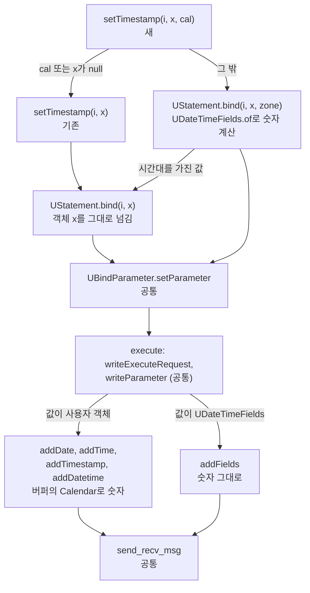
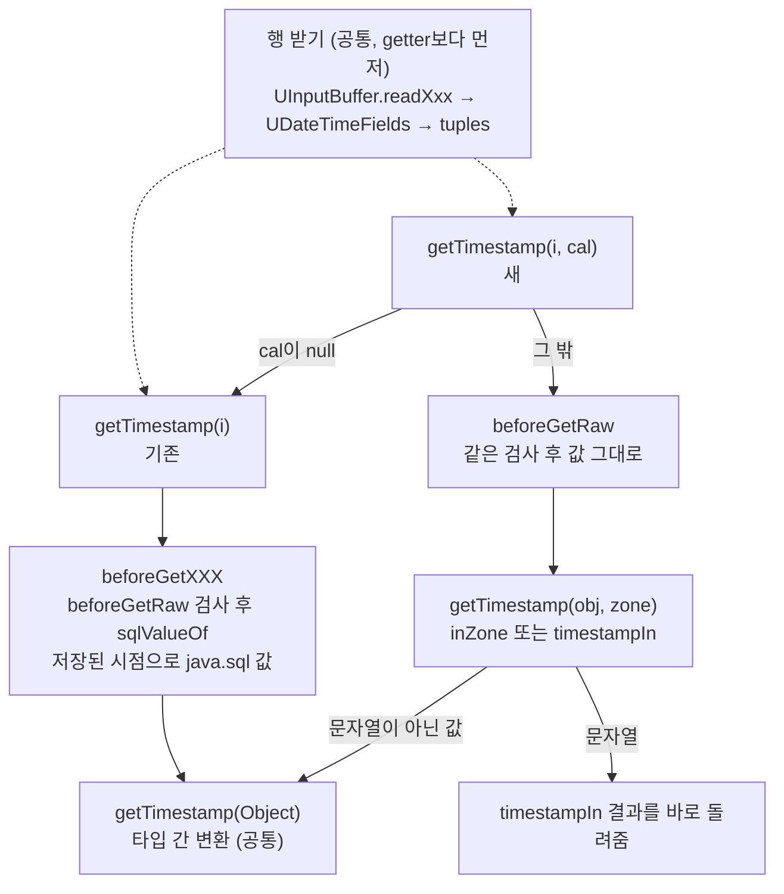

# Calendar를 줬을 때와 안 줬을 때: 경로가 갈라지고 합쳐지는 곳

- 분류: study
- 날짜: 2026-10-08
- 관련: [APIS-1120](http://jira.cubrid.org/browse/APIS-1120), 같은 날 쓴 APIS-1120 study 노트 7편 중 5편

## 요약
경로는 driver 패키지의 Calendar 메서드 첫 줄에서 갈라진다. cal이 `null`이면 기존 메서드로 간다. 그 뒤로 다른 코드를 지나는 곳과 같은 코드를 지나는 곳이 나뉜다.
- **다른 코드:**
  - 쓰기: 바인딩 값을 만들 때와 바이트를 쓸 때
  - 읽기: 보관한 값을 java.sql 값으로 바꿀 때
- **같은 코드:** 보관, 실행 요청, 전송, 행 받기, 마지막 타입 변환

## 목적
"Calendar를 줬을 때와 주지 않았을 때 수행되는 경로가 애초에 다른가"에 답한다. 어디서 갈라지고 어디서 다시 같은 코드를 지나는지 쓰기와 읽기로 나눠 정리한다.

## 배경
develop에는 경로가 하나뿐이었다. Calendar 메서드가 Calendar 없는 메서드를 그대로 불렀기 때문이다. APIS-1120이 Calendar 메서드에 새 경로를 만들었다. 그래서 두 경로가 어디까지 다르고 어디부터 같은지를 알아야 변경 범위가 보인다.

## 범위 / 방법
- **코드 기준:** APIS-1120 브랜치 15a71e0의 driver 패키지 Calendar 메서드와 jci의 `bind`, getter, `UOutputBuffer.writeParameter`, `UGetTypeConvertedValue`를 따라갔다.
- **예시:** `setTimestamp`와 `getTimestamp`로 그렸다. `setDate`, `setTime`, `getDate`, `getTime`도 같은 모양이다.

## 발견 / 관찰

### 쓰기

| 단계 | Calendar 없음 (기존) | Calendar 있음 (새) | 코드 |
|---|---|---|---|
| driver 패키지 | `setTimestamp(i, x)` → `u_stmt.bind(i-1, x)` | `setTimestamp(i, x, cal)` → `u_stmt.bind(i-1, x, zone)` | 다름 |
| `UStatement.bind` | 객체 x를 그대로 넘김 | `UDateTimeFields.of`로 zone 기준 숫자를 계산 | 다름 |
| `UBindParameter.setParameter` | 받은 값을 `values[]`에 보관 | 같음 (담기는 것만 다름) | 같음 |
| `execute` | `writeExecuteRequest` → `writeParameter` | 같음 | 같음 |
| `UOutputBuffer` | `addDatetime` 등: 버퍼의 Calendar(연결할 때의 JVM 기본 시간대)로 숫자를 꺼냄 | `addFields`: 보관한 숫자를 그대로 씀 | 다름 |
| `UConnection.send_recv_msg` | 서버로 보냄 | 같음 | 같음 |

### 읽기

| 단계 | Calendar 없음 (기존) | Calendar 있음 (새) | 코드 |
|---|---|---|---|
| 행 받기 | `UInputBuffer.readDate` 등이 숫자와 JVM 기본 시간대 시점을 담아 `tuples`에 보관 | 같음. getter보다 먼저 일어나고 Calendar와 무관 | 같음 |
| driver 패키지 | `getTimestamp(i)` → `u_stmt.getTimestamp(i-1)` | `getTimestamp(i, cal)` → `u_stmt.getTimestamp(i-1, zone)` | 다름 |
| 검사 | `beforeGetRaw`: 닫힘, 번호, 데이터, NULL | 같음 | 같음 |
| java.sql 값 만들기 | `sqlValueOf`: 담아 둔 기본 시간대 시점 | `getTimestamp(obj, zone)`: 서버 숫자는 `inZone`이 zone 기준으로 계산, 문자열은 `timestampIn` | 다름 |
| 타입 간 변환 | `getTimestamp(Object)` | 같음 (문자열이 아닌 값) | 같음 |

### 새 경로에서 기존 경로로 돌아가는 경우

| 경우 | 방향 | 결과 |
|---|---|---|
| cal이 `null` | 쓰기, 읽기 | Calendar 없는 메서드를 그대로 부름 |
| 바인딩 값이 `null` | 쓰기 | Calendar 없는 메서드가 NULL을 바인딩 |
| 시간대를 가진 값 (`CUBRIDTimestamptz`) | 쓰기 | `bind(int, Timestamp, TimeZone)`이 기존 `bind(int, Timestamp)`를 부름 |
| 시간대를 가진 칼럼 (TZ, LTZ) | 읽기 | `inZone`이 값을 그대로 넘겨 Calendar 없을 때와 같은 시점 |

### Calendar가 JVM 기본 시간대와 같을 때
새 경로를 타지만 결과는 기존 경로와 같다. 0 날짜와 서머타임 구간도 포함해서 TC로 확인했다.
- **서버 숫자:** `epochIn`이 읽기와 같은 계산을 한다.
- **java.sql 값:** `hasSameRules` 조건으로 그대로 돌려준다.
- **문자열:** `valueOf`와 같은 결과가 나온다.

## 결론
두 경로는 driver 패키지에서 갈라지지만 끝까지 따로 가지는 않는다. 실제로 다른 코드를 지나는 곳은 두 곳이다.
- **쓰기:** 숫자를 언제 어떤 규칙으로 꺼내느냐 (`bind`, add 함수)
- **읽기:** 보관한 값을 어떤 규칙으로 java.sql 값으로 바꾸느냐 (`sqlValueOf`와 `getTimestamp(obj, zone)`)

## 다음 단계
- 후속 이슈는 Calendar 없는 경로도 `UDateTimeFields` 변환을 쓰게 하는 작업이다. 그렇게 되면 두 경로의 차이는 "기본 시간대냐 Calendar의 시간대냐" 하나로 줄어든다.

## 참고
- [APIS-1120](http://jira.cubrid.org/browse/APIS-1120)
- 줄 번호 기준: APIS-1120 브랜치 15a71e0 (공개 전)

  | 위치 | 메서드 |
  |---|---|
  | `CUBRIDPreparedStatement.java:773` | `setDate(int, Date, Calendar)` 첫 줄의 `null` 검사 |
  | `CUBRIDResultSet.java:1514` | `getDate(int, Calendar)` 첫 줄의 `null` 검사 |
  | `UStatement.java:500` | `bind(int, Timestamp, TimeZone)` |
  | `UStatement.java:2173` | `beforeGetXXX` |
  | `UStatement.java:2179` | `beforeGetRaw` |
  | `UOutputBuffer.java:439` | `instanceof UDateTimeFields` 분기 |
  | `UGetTypeConvertedValue.java:335` | `getTimestamp(Object, TimeZone)` |

- 함께 보는 노트: [Calendar 인자 쓰기·읽기 흐름](./2026-10-08-apis1120-calendar-write-read-flow.md), [values[]와 attributes[]](./2026-10-08-apis1120-values-and-attributes.md), [inZone 흐름](./2026-10-08-apis1120-inzone-flow.md)
