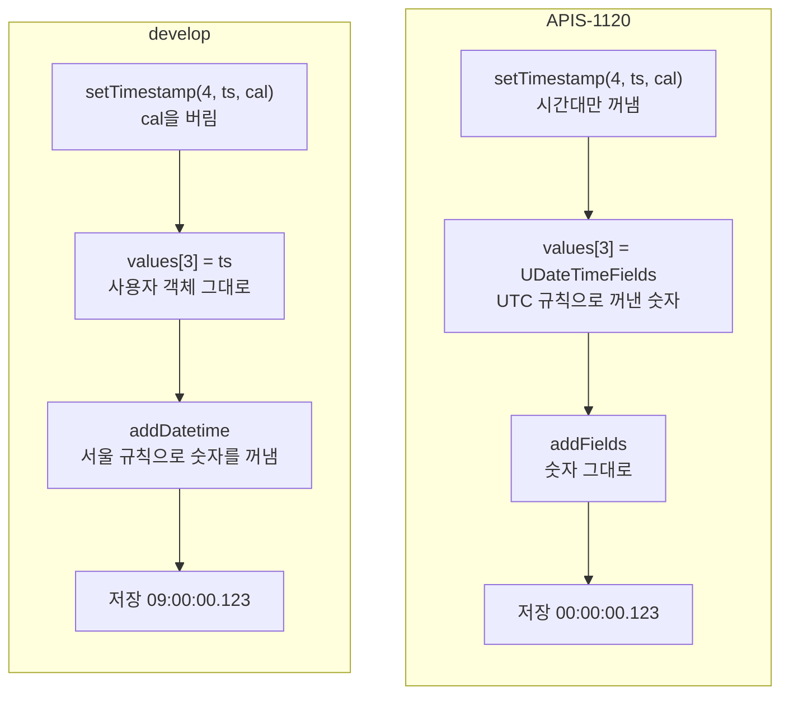

# Calendar 인자 쓰기·읽기 흐름: develop과 APIS-1120 비교

- 분류: study
- 날짜: 2026-10-08
- 관련: [APIS-1120](http://jira.cubrid.org/browse/APIS-1120), 같은 날 쓴 APIS-1120 study 노트 7편 중 2편

## 요약
UTC Calendar로 같은 시점을 쓰고 읽을 때 두 버전의 동작이 다르다.
- **develop:** Calendar를 버리고 JVM 기본 시간대(서울)로 계산한다. 그래서 `09:00`이 저장되고, 읽을 때도 서울 기준으로 해석한다.
- **APIS-1120:**
  - 쓰기: 바인딩할 때 Calendar의 시간대로 숫자를 꺼내 두어서 `00:00`이 저장된다.
  - 읽기: 보관한 숫자를 Calendar의 시간대로 다시 계산한다.

## 목적
Calendar 인자를 받는 메서드의 쓰기와 읽기가 develop과 APIS-1120에서 어느 단계에서 갈라지는지, 값이 단계마다 어떻게 바뀌는지 정리한다.

## 배경
JDBC는 시간대 정보가 없는 값을 넘긴 Calendar의 시간대로 만들고 해석하도록 정하고 있다. develop의 Calendar 메서드 18개는 Calendar를 받기만 하고 쓰지 않았다. 내부에서 Calendar 없는 메서드를 그대로 불렀기 때문이다.

| 클래스 | Calendar 메서드 |
|---|---|
| `CUBRIDPreparedStatement` | `setDate`, `setTime`, `setTimestamp` (3개) |
| `CUBRIDResultSet` | `getDate`, `getTime`, `getTimestamp`의 번호판과 이름판 (6개) |
| `CUBRIDCallableStatement` | `getDate`, `getTime`, `getTimestamp`의 번호판 (3개) |
| `CUBRIDResultSetWithoutQuery` | `getDate`, `getTime`, `getTimestamp`의 번호판과 이름판 (6개) |

## 범위 / 방법
- **예시 조건:**
  - JVM 기본 시간대는 Asia/Seoul이고, Calendar는 UTC다.
  - 칼럼은 DATETIME이고, 시점은 UTC 2000-01-01 00:00:00.123이다.
- **코드 기준:** develop 9bd89eb와 APIS-1120 브랜치 15a71e0을 읽었다.
- **저장값 확인:** 서버에 저장된 문자열로 확인한 APIS-1120 TC 결과와 같다. 쓰기 TC는 JDBC로 다시 읽지 않고 `to_char`로 비교한다.

## 발견 / 관찰

### 쓰기: `ps.setTimestamp(4, ts, cal)` → `ps.executeUpdate()`

| 단계 | 위치 | develop | APIS-1120 |
|---|---|---|---|
| 1 | 애플리케이션 | `ps.setTimestamp(4, ts, cal)` | 같음 |
| 2 | `CUBRIDPreparedStatement` | cal을 버리고 `setTimestamp(4, ts)`를 부름 | `u_stmt.bind(3, ts, UTC)`: Calendar에서 시간대만 꺼냄 |
| 3 | `UStatement.bind` | `bindValue(3, DATETIME, ts)`: 객체 그대로 | `UDateTimeFields.of(ts, DATETIME, UTC)`: 숫자 2000-01-01 00:00:00.123 |
| 4 | `UBindParameter` | `values[3]` = 사용자 객체 ts | `values[3]` = 숫자 객체 |
| 5 | 애플리케이션 | `ps.executeUpdate()` | 같음 |
| 6 | `UOutputBuffer` | `addDatetime`: 연결할 때 만든 Calendar(서울 규칙)로 ts에서 숫자를 꺼냄 | `addFields`: 보관한 숫자를 그대로 씀 |
| 7 | 서버로 가는 숫자 | 2000, 1, 1, 9, 0, 0, 123 | 2000, 1, 1, 0, 0, 0, 123 |
| 8 | 서버에 저장 | `2000-01-01 09:00:00.123` | `2000-01-01 00:00:00.123` |

### 읽기: 저장된 `2000-01-01 00:00:00.123`을 `rs.getTimestamp("dt", cal)`로

| 단계 | 위치 | develop | APIS-1120 |
|---|---|---|---|
| 1 | 서버 → `UInputBuffer` | `readDatetimeFields`가 숫자와, 서울 규칙으로 계산한 시점(UTC 1999-12-31 15:00:00.123)을 함께 담음 | 같음 |
| 2 | `UStatement` | 행의 칼럼 값으로 보관 | 같음 |
| 3 | 애플리케이션 | `rs.getTimestamp("dt", cal)` | 같음 |
| 4 | `CUBRIDResultSet` | cal을 버리고 `getTimestamp(4)`를 부름 | `u_stmt.getTimestamp(3, UTC)` |
| 5 | `UStatement` | `beforeGetXXX`: 담아 둔 서울 기준 시점으로 java.sql 값을 만듦 | `beforeGetRaw`: 숫자 객체를 그대로 꺼냄 |
| 6 | `UGetTypeConvertedValue` | `getTimestamp(Object)`: 그 시점 그대로 | `getTimestamp(obj, UTC)` → `inZone` → `epochIn(UTC)`: 같은 숫자를 UTC 규칙으로 다시 계산 |
| 7 | 받는 값 | UTC 1999-12-31 15:00:00.123 (UTC로 읽으라 했지만 서울 규칙으로 해석) | UTC 2000-01-01 00:00:00.123 |

### 갈라지는 곳

| 방향 | 갈라지는 곳 | develop | APIS-1120 |
|---|---|---|---|
| 쓰기 | driver 패키지의 Calendar 메서드 | Calendar를 버림 | 시간대를 jci에 넘김 |
| 쓰기 | 숫자를 꺼내는 시점과 규칙 | 실행할 때, 연결의 Calendar(서울) | 바인딩할 때, Calendar의 시간대 |
| 읽기 | `UStatement`에서 값을 꺼낼 때 | 읽을 때 계산해 둔 서울 기준 시점 | 보관한 숫자로 Calendar의 시간대 기준 시점을 새로 계산 |

### develop끼리는 왜 맞아 보이나
develop으로 쓰고 develop으로 읽으면 두 쪽 모두 서울 규칙을 쓴다. 그래서 같은 시점이 돌아오고, 문제가 보이지 않는다.

하지만 서버에는 Calendar의 시간대가 아닌 날짜·시각이 저장된다. 그래서 다른 클라이언트나 서버 함수가 읽으면 어긋난다. APIS-1120 전후의 행이 한 칼럼에 섞여도 시간대 차이만큼 어긋난다.

APIS-1120 PR 초안의 실측 조건과 결과는 다음과 같다(11.4.6, 11.5.0.2608 개발 빌드).
- 조건: JVM과 세션 시간대가 Asia/Seoul이고, UTC Calendar로 쓰고 읽었다.
- develop이 쓴 행을 APIS-1120으로 읽으면 9시간 밀린다.

## 결론
갈라지는 곳은 driver 패키지의 Calendar 메서드다. 실제로 값이 달라지는 곳은 방향마다 하나씩이다.
- **쓰기:** 숫자를 언제, 어떤 규칙으로 꺼내느냐
- **읽기:** 보관한 숫자를 어떤 규칙으로 계산하느냐

## 다음 단계
- **업그레이드 영향:** 기존 행과 섞이면 시간대 차이만큼 어긋난다. 예전 동작으로 되돌리는 속성은 두지 않고, PR에 문서화한다.
- **후속 이슈:** Calendar 없는 경로도 같은 변환(`UDateTimeFields`)을 쓰게 맞춘다. Calendar 없이 바인딩한 객체가 실행 때 다시 읽히는 문제를 함께 고친다.

## 참고
- [APIS-1120](http://jira.cubrid.org/browse/APIS-1120)
- 드라이버 develop 9bd89eb (공개): https://github.com/CUBRID/cubrid-jdbc/tree/9bd89eb7f8d3c7ef5965373fff254061fcd30738
- 줄 번호 기준: APIS-1120 브랜치 15a71e0 (공개 전)

  | 위치 | 메서드 |
  |---|---|
  | `CUBRIDPreparedStatement.java:799` | `setTimestamp(int, Timestamp, Calendar)` |
  | `UStatement.java:500` | `bind(int, Timestamp, TimeZone)` |
  | `UOutputBuffer.java:307` | `addFields` |
  | `CUBRIDResultSet.java:1556` | `getTimestamp(int, Calendar)` |
  | `UStatement.java:1751` | `getTimestamp(int, TimeZone)` |
- 함께 보는 노트: [CUBRID JDBC 실행 구조](./2026-10-08-apis1120-jdbc-layers.md), [숫자, 시간대, 시점](./2026-10-08-apis1120-fields-zone-instant.md), [jci 패키지 안의 흐름](./2026-10-08-apis1120-jci-internal-flow.md), [Calendar 유무에 따른 경로 분기](./2026-10-08-apis1120-calendar-path-split.md)
