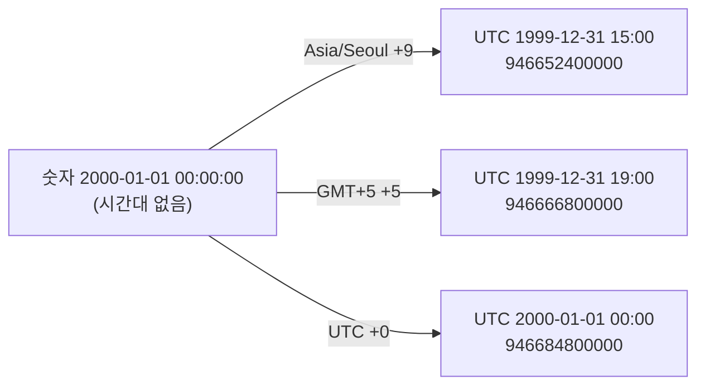

# 숫자, 시간대, 시점: 같은 날짜·시각이 다른 시점이 되는 이유

- 분류: study
- 날짜: 2026-10-08
- 관련: [APIS-1120](http://jira.cubrid.org/browse/APIS-1120), 같은 날 쓴 APIS-1120 study 노트 7편 중 3편

## 요약
서버와 주고받는 날짜·시각은 시간대 정보 없는 숫자다. 시간대라는 규칙을 정해야 시점(에포크 밀리초)이 하나로 정해진다. 드라이버는 이 규칙으로 늘 JVM 기본 시간대를 썼고, APIS-1120은 Calendar 메서드에서만 Calendar의 시간대를 쓴다.

## 목적
APIS-1120의 핵심 계산인 `UDateTimeFields.epochIn(zone)`, `toSqlValue(zone)`, `of(value, type, zone)`이 무엇을 계산하는지 개념으로 정리한다.

## 배경
"zone은 시간대, 즉 규칙인데 그것으로 에포크 시간을 만든다는 것이 무슨 말인가"라는 질문에서 시작했다. 답은 "zone만으로 만드는 것이 아니라 숫자와 zone을 함께 써서 만든다"이다.

## 범위 / 방법
- 개념을 정리하고, 숫자 `2000-01-01 00:00:00` 하나를 세 시간대로 계산해 보았다.
- 코드를 대조했다.
  - 바뀌지 않은 `UInputBuffer.readDate`: develop 9bd89eb
  - 바뀐 `UDateTimeFields.epochIn`, `of`: APIS-1120 브랜치 15a71e0

## 발견 / 관찰

### 세 가지는 서로 다른 것

| 것 | 무엇인가 | 예 |
|---|---|---|
| 필드 (서버가 보낸 숫자) | 시간대 정보 없는 날짜·시각. 연, 월, 일, 시, 분, 초, 밀리초 숫자 7개 | `2000-01-01 00:00:00` |
| zone (`TimeZone`) | 규칙. 날짜·시각마다 UTC와의 차이(오프셋)와 서머타임 변경 시기 | Asia/Seoul +9, 뉴욕은 겨울 −5·여름 −4 |
| 에포크 밀리초 | 실제 시점. 1970-01-01 00:00 UTC부터 지난 밀리초 | 946684800000 (UTC 2000-01-01 00:00) |

java.sql의 `Date`, `Time`, `Timestamp`는 에포크 밀리초 하나만 담는다. 숫자나 시간대는 담지 않는다.

### 숫자 + 규칙 → 시점

같은 숫자도 규칙에 따라 다른 시점이 된다.



| 해석에 쓴 zone | 그 날짜의 오프셋 | 시점 (UTC) | 에포크 밀리초 | 드라이버에서 |
|---|---|---|---|---|
| Asia/Seoul | +9 | 1999-12-31 15:00 | 946652400000 | Calendar 없이 읽을 때 (JVM 기본 시간대가 서울). develop은 Calendar를 넘겨도 이것 |
| GMT+5 | +5 | 1999-12-31 19:00 | 946666800000 | APIS-1120에서 GMT+5 Calendar로 읽을 때 |
| UTC | +0 | 2000-01-01 00:00 | 946684800000 | APIS-1120에서 UTC Calendar로 읽을 때 |

```
에포크 = (숫자를 UTC로 셌을 때의 밀리초) − (그 날짜·시각에서 zone의 오프셋)
```

오프셋은 날짜에 따라 바뀐다(서머타임, 시간대의 역사적 변경). 그래서 고정된 수를 빼는 것이 아니라, GregorianCalendar가 zone의 규칙에서 그 날짜·시각의 오프셋을 찾아 계산한다.

### 코드에서 이 계산이 있는 곳

| 방향 | 계산 | 기존 코드 (규칙 = JVM 기본 시간대) | APIS-1120 (규칙 = Calendar의 시간대) |
|---|---|---|---|
| 읽기 | 숫자 + 규칙 → 시점 | `UInputBuffer.readDate` 등: `Calendar.getInstance()` ([UInputBuffer.java:314][uib-314]) | `UDateTimeFields.epochIn(zone)`: `new GregorianCalendar(zone)` |
| 쓰기 | 시점 + 규칙 → 숫자 | `UOutputBuffer.writeDate` 등: 연결을 처음 맺을 때 만든 `Calendar c` | `UDateTimeFields.of(value, type, zone)`: `new GregorianCalendar(zone)` |

`epochIn(zone)`의 핵심 줄이다(APIS-1120 브랜치 `UDateTimeFields.java:182`).

```java
Calendar c = new GregorianCalendar(zone);            // 규칙: zone
c.set(year, month - 1, day, hour, minute, second);   // 숫자: 서버가 보낸 날짜·시각
c.set(Calendar.MILLISECOND, millisecond);
return c.getTimeInMillis();                          // 숫자 + 규칙 → 시점
```

기존 `UInputBuffer.readDate`도 같은 일을 한다. 규칙만 `Calendar.getInstance()`, 즉 JVM 기본 시간대다.

```java
Calendar cal = Calendar.getInstance();
cal.set(year, month - 1, day, 0, 0, 0);
cal.set(Calendar.MILLISECOND, 0);
return UDateTimeFields.ofDate(cal.getTimeInMillis(), year, month, day);
```

### `toSqlValue(zone)`이 하는 일
java.sql 값은 시점 하나만 담으므로, `epochIn(zone)`으로 구한 시점을 담아 java.sql 값을 만든다. 숫자는 그대로이고, zone에 따라 담기는 시점만 달라진다.

```java
new UDateTimeFields(type, epochIn(zone), 같은 숫자들).toSqlValue()
// DATETIME이면 new CUBRIDTimestamp(그 시점, DATETIME)
```

### 반대 방향: 시점 + 규칙 → 숫자 (쓰기)
`of(value, type, zone)`은 시점을 zone 규칙으로 보고 숫자를 꺼낸다.

| 시점 | 규칙 | 꺼낸 숫자 |
|---|---|---|
| 946684800123 (UTC 2000-01-01 00:00:00.123) | UTC | 2000-01-01 00:00:00.123 |
| 946684800123 | Asia/Seoul | 2000-01-01 09:00:00.123 |

### 헷갈리기 쉬운 점: `toString()`
java.sql 값의 `toString()`은 시점을 JVM 기본 시간대의 숫자로 보여 준다. 그래서 UTC Calendar로 읽은 Timestamp는 서울 JVM에서 `2000-01-01 09:00:00.0`으로 찍힌다. 시점(946684800000)은 맞다.

## 결론
"zone으로 에포크를 만든다"는 말은 서버 숫자를 zone 규칙의 날짜·시각으로 보고 그 시점을 구한다는 뜻이다. 기존 코드와 APIS-1120은 같은 계산을 하고, 쓰는 규칙만 다르다. 기존 코드는 JVM 기본 시간대를, APIS-1120의 Calendar 메서드는 Calendar의 시간대를 쓴다.

## 다음 단계
- 이슈화하지 않는다. 공부용 정리다.
- 이 계산이 실제 코드 흐름 어디에서 일어나는지는 jci 흐름 노트와 inZone 흐름 노트에서 본다.

## 참고
- [APIS-1120](http://jira.cubrid.org/browse/APIS-1120)
- [Java SE 21 API: GregorianCalendar](https://docs.oracle.com/en/java/javase/21/docs/api/java.base/java/util/GregorianCalendar.html)
- 줄 번호 기준: 바뀌지 않은 파일은 develop 9bd89eb, 바뀐 파일(`UDateTimeFields.java`)은 APIS-1120 브랜치 15a71e0 (공개 전)
- 함께 보는 노트: [Calendar 인자 쓰기·읽기 흐름](./2026-10-08-apis1120-calendar-write-read-flow.md), [jci 패키지 안의 흐름](./2026-10-08-apis1120-jci-internal-flow.md), [inZone 흐름](./2026-10-08-apis1120-inzone-flow.md)

[uib-314]: https://github.com/CUBRID/cubrid-jdbc/blob/9bd89eb7f8d3c7ef5965373fff254061fcd30738/src/jdbc/cubrid/jdbc/jci/UInputBuffer.java#L314
