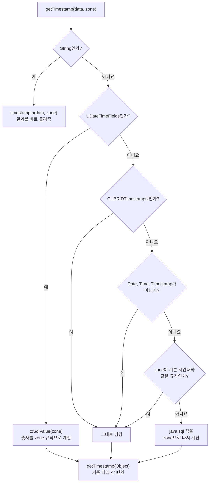

# inZone 흐름: 들어온 값의 종류에 따라 갈리는 길

- 분류: study
- 날짜: 2026-10-08
- 관련: [APIS-1120](http://jira.cubrid.org/browse/APIS-1120), 같은 날 쓴 APIS-1120 study 노트 7편 중 7편

## 요약
`inZone`은 문자열이 아닌 값을 정해진 순서로 검사한다.
1. `UDateTimeFields`
2. `CUBRIDTimestamptz`
3. 날짜·시각이 아닌 값
4. 기본 시간대와 같은 규칙

어디에도 걸리지 않은 java.sql 값만 zone 기준으로 다시 계산한다. 결과는 문자열이 아닌 값이면 모두 기존 `getTimestamp(Object)`를 거친다.

## 목적
Calendar getter의 핵심 분기인 `UGetTypeConvertedValue.inZone`이 어떤 값을 어느 길로 보내는지 정리한다. 검사 순서가 왜 그렇게 정해졌는지도 함께 정리한다.

## 배경
Calendar getter(`getDate`, `getTime`, `getTimestamp`의 `(…, Calendar)`)는 jci의 `UGetTypeConvertedValue.getXxx(Object, TimeZone)`을 부른다. 이 메서드는 문자열이 아니면 `inZone`으로 값을 zone에 맞춘 뒤 기존 변환에 넘긴다. 같은 Calendar getter라도 값의 종류에 따라 하는 일이 다르다.
- 서버 숫자, 시간대를 가진 값, 숫자, 메타데이터 결과의 java.sql 값이 모두 다르게 처리된다.

## 범위 / 방법
- **코드 기준:** APIS-1120 브랜치 15a71e0의 `UGetTypeConvertedValue.java:319-380`을 읽었다. `15a71e0`이 `hasSameRules` 조건을 더한 최종 형태다.
- **예시:** JVM 기본 시간대 Asia/Seoul. 결과는 APIS-1120 TC로 확인한 값과 같다.

## 발견 / 관찰

### 코드

```java
public static Timestamp getTimestamp(Object data, TimeZone zone) throws UJciException {
    if (data instanceof String) {
        return timestampIn((String) data, zone);
    }
    return getTimestamp(inZone(data, zone));
}

private static Object inZone(Object data, TimeZone zone) {
    if (data instanceof UDateTimeFields) {
        return ((UDateTimeFields) data).toSqlValue(zone);
    }
    if (data instanceof CUBRIDTimestamptz
            || !(data instanceof Date || data instanceof Time || data instanceof Timestamp)
            || zone.hasSameRules(TimeZone.getDefault())) {
        return data;
    }
    java.util.Date value = (java.util.Date) data;
    Calendar shown = new GregorianCalendar();
    shown.setTime(value);
    Calendar c = new GregorianCalendar(zone);
    c.clear();
    c.set(Calendar.ERA, shown.get(Calendar.ERA));
    c.set(
            shown.get(Calendar.YEAR),
            shown.get(Calendar.MONTH),
            shown.get(Calendar.DAY_OF_MONTH),
            shown.get(Calendar.HOUR_OF_DAY),
            shown.get(Calendar.MINUTE),
            shown.get(Calendar.SECOND));
    c.set(Calendar.MILLISECOND, shown.get(Calendar.MILLISECOND));
    long epoch = c.getTimeInMillis();
    if (value instanceof Timestamp) {
        Timestamp t = new Timestamp(epoch);
        t.setNanos(((Timestamp) value).getNanos());
        return t;
    }
    return value instanceof Time ? new Time(epoch) : new Date(epoch);
}
```

`getDate(Object, TimeZone)`, `getTime(Object, TimeZone)`도 모양이 같다. 문자열이면 `dateIn`, `timeIn`으로 간다.

### 흐름도



### 값의 종류별 경로

| 입력 | 어디서 오나 | 걸리는 칸 | 결과 |
|---|---|---|---|
| `String '2000-01-01 00:00:00.123'`, zone GMT+5 | 문자열 칼럼 | String | `inZone`에 오지 않음. `timestampIn`이 UTC 1999-12-31 19:00:00.123을 돌려줌 |
| `UDateTimeFields` (숫자 2000-01-01 00:00:00.123), zone UTC | DATE, TIME, DATETIME, TIMESTAMP 칼럼 | `UDateTimeFields` | `epochIn(UTC)` = 946684800123. 기존 변환이 UTC 2000-01-01 00:00:00.123인 Timestamp로 |
| `CUBRIDTimestamptz` (2000-01-01 00:00:00 +09:00), zone GMT+5 | TZ, LTZ 칼럼 | `CUBRIDTimestamptz` | 그대로. Calendar 없이 읽은 것과 같은 UTC 1999-12-31 15:00:00 |
| `Integer 42`, zone UTC | 숫자 칼럼 | 날짜·시각이 아님 | 그대로. 기존 변환이 `ER_TYPE_CONVERSION`. Calendar 없을 때와 같은 오류 |
| `null` | 메타데이터 결과의 빈 칸 | 날짜·시각이 아님 | 그대로. 기존 변환이 `null` |
| java.sql `Timestamp`, zone Asia/Seoul | 메타데이터 결과 | 기본 시간대와 같은 규칙 | 그대로. Calendar 없는 getter와 같은 값 |
| `Timestamp.valueOf("2000-01-01 00:00:00.5")` (서울에서 만든 값, UTC 1999-12-31 15:00:00.5), zone UTC | 메타데이터 결과 | 어디에도 걸리지 않음 | 다시 계산: 946684800500 (UTC 2000-01-01 00:00:00.5), 나노초 500000000 |

### java.sql 값을 다시 계산하는 단계

| 줄 | 하는 일 | 예 (`Timestamp.valueOf("2000-01-01 00:00:00.5")`, zone UTC) |
|---|---|---|
| `shown = new GregorianCalendar(); shown.setTime(value)` | 값이 기본 시간대에서 보이는 날짜·시각을 얻음 | 2000-01-01 00:00:00.500 (서울) |
| `c = new GregorianCalendar(zone); c.clear()` | zone의 Calendar를 비운 상태로 준비 | |
| `c.set(Calendar.ERA, …)` | 기원을 옮김. 기원전 값은 연도가 양수로 나오기 때문 | 서기 |
| `c.set(연, 월, 일, 시, 분, 초)`, 밀리초 | 같은 날짜·시각을 zone에서의 날짜·시각으로 설정 | UTC 2000-01-01 00:00:00.500 |
| `epoch = c.getTimeInMillis()` | zone 기준 시점 | 946684800500 |
| 원래 타입으로 새로 만듦 | Timestamp면 나노초를 붙임 | 나노초 500000000 |

다음 단계의 `getTimestamp(Object)`가 `new Timestamp(getTime())`으로 다시 만든다. 그래서 밀리초 아래 나노초는 최종 결과에 남지 않는다. Calendar 없는 getter도 같다.

### 검사 순서의 이유

| 순서 | 검사 | 이유 |
|---|---|---|
| 1 | `UDateTimeFields` | 가장 흔한 값이다. 숫자를 들고 있어 바로 zone으로 계산할 수 있다 |
| 2 | `CUBRIDTimestamptz` | `Timestamp`의 하위 클래스라 먼저 거르지 않으면 맨 아래 "다시 계산"으로 잘못 들어간다 |
| 3 | 날짜·시각이 아닌 값 | 시간대와 관계없는 값은 손대지 않고 기존 변환이 판단하게 한다 |
| 4 | `hasSameRules` | 타입 검사 뒤에 있어서 java.sql 값에만 적용된다 |

`hasSameRules` 조건은 15a71e0에서 더했다.
- **문제:** zone이 기본 시간대와 같으면 원래 값이 그대로 나와야 한다. 그런데 서머타임이 끝나 같은 시각이 두 번 오는 구간에서는 날짜·시각만으로 두 시점을 구별할 수 없다. GregorianCalendar는 늦은 쪽을 고르므로 1시간 밀린다.
  - 예: 뉴욕 2020-11-01 01:30 EDT, 에포크 1604208600000
- **해결:** 이 조건으로 다시 계산하지 않고 값을 그대로 돌려준다.
- **`equals` 대신 `hasSameRules`인 이유:** ID가 달라도 규칙이 같은 시간대를 같은 것으로 보기 위해서다.

## 결론
`inZone`의 길은 다섯 가지이고, 실제로 시점을 새로 계산하는 길은 둘뿐이다.
- **서버 숫자:** 필드로 계산한다(`toSqlValue(zone)`).
- **java.sql 값:** 에포크에서 날짜·시각을 거꾸로 꺼내 다시 계산한다.

나머지는 값을 그대로 넘긴다. 그래서 타입 간 변환 규칙과 오류 코드가 Calendar 없을 때와 같다.

## 다음 단계
- 리뷰에서 그대로 두기로 한 항목이 남아 있다.
  - java.sql 분기를 검사하는 TC가 약하다(M7).
  - `setNanos`가 최종 결과에 드러나지 않는다(M8).
- 실제로 java.sql 분기를 타는 것은 메타데이터 결과의 칸이다. 드라이버가 java.sql 날짜·시각 값을 직접 넣는 곳은 찾지 못했고, TC는 직접 만든 행으로 검사한다.

## 참고
- [APIS-1120](http://jira.cubrid.org/browse/APIS-1120)
- 줄 번호 기준: APIS-1120 브랜치 15a71e0 (공개 전)

  | 위치 | 메서드 |
  |---|---|
  | `UGetTypeConvertedValue.java:335` | `getTimestamp(Object, TimeZone)` |
  | `UGetTypeConvertedValue.java:349` | `inZone` |
  | `UGetTypeConvertedValue.java:304` | `getTimestamp(Object)` |
  | `UDateTimeFields.java:175` | `toSqlValue(zone)` |
  | `UDateTimeFields.java:182` | `epochIn` |

- [Java SE 21 API: TimeZone.hasSameRules](https://docs.oracle.com/en/java/javase/21/docs/api/java.base/java/util/TimeZone.html#hasSameRules(java.util.TimeZone))
- 함께 보는 노트: [숫자, 시간대, 시점](./2026-10-08-apis1120-fields-zone-instant.md), [jci 패키지 안의 흐름](./2026-10-08-apis1120-jci-internal-flow.md), [Calendar 유무에 따른 경로 분기](./2026-10-08-apis1120-calendar-path-split.md)
