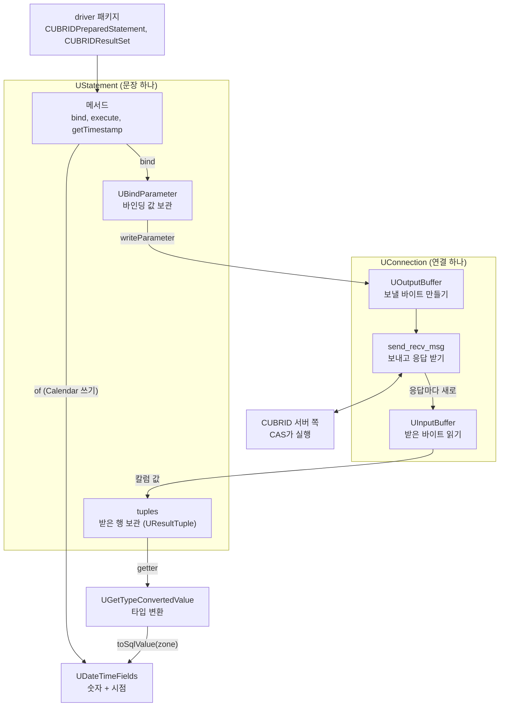
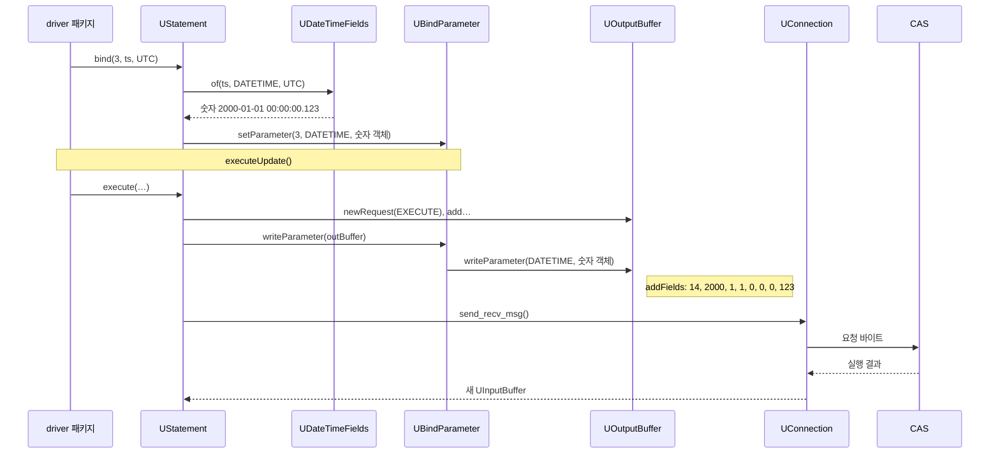
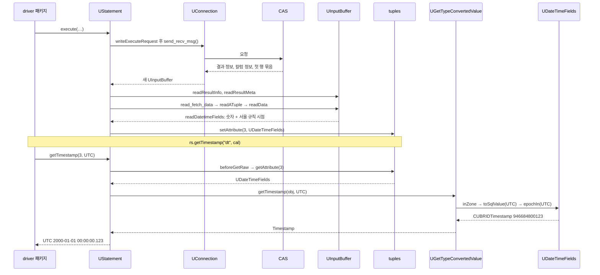

# jci 패키지 안의 흐름: 쓰기 12단계와 읽기 15단계

- 분류: study
- 날짜: 2026-10-08
- 관련: [APIS-1120](http://jira.cubrid.org/browse/APIS-1120), 같은 날 쓴 APIS-1120 study 노트 7편 중 4편

## 요약
jci 패키지 안의 흐름은 방향마다 세 단계로 줄일 수 있다.
- **쓰기:**
  - `UStatement`가 값을 `UBindParameter`에 맡긴다.
  - 실행할 때 `UOutputBuffer`가 그 값을 바이트로 쓴다.
  - `UConnection.send_recv_msg`가 그 바이트를 보낸다.
- **읽기:**
  - `UInputBuffer`가 응답을 값으로 만든다.
  - 그 값을 `UStatement`의 `tuples`에 보관한다.
  - getter가 값을 꺼내 `UGetTypeConvertedValue`로 바꾼다.

## 목적
driver 패키지 아래, jci 패키지 안에서 어떤 객체가 어떤 순서로 일하는지 정리한다. APIS-1120이 이 흐름의 어디를 바꿨는지도 표시한다.

## 배경
Calendar 메서드의 변경은 driver 패키지보다 jci 패키지에 몰려 있다. jci 안의 객체 관계와 호출 순서를 모르면 `UDateTimeFields`나 `addFields`가 왜 그 자리에 있는지 읽히지 않는다.

## 범위 / 방법
- **예시 조건:**
  - JVM 기본 시간대는 Asia/Seoul이고, UTC Calendar를 넘긴다.
  - 쓰기는 DATETIME 칼럼에 시점 UTC 2000-01-01 00:00:00.123을 저장한다.
  - 읽기는 저장된 `2000-01-01 00:00:00.123`을 읽는다.
- **기준 경로:** 단계는 APIS-1120 경로 기준이고, develop과 다른 단계를 표에 함께 적었다.
- **코드 기준:** develop 9bd89eb와 APIS-1120 브랜치 15a71e0을 읽었다. 호출 순서는 `UStatement.execute`, `executeInternal`, `writeExecuteRequest`, `read_fetch_data`, `readATuple`, `readData`와 getter를 따라갔다.

## 발견 / 관찰

### 객체 지도

| 객체 | 언제 생기나 | 들고 있는 것 |
|---|---|---|
| `UStatement` | 문장을 준비할 때 | 바인딩 값(`UBindParameter`), 받은 행(`tuples`), 칼럼 정보, 커서 위치 |
| `UConnection` | 연결할 때 | 소켓, `UOutputBuffer`(연결을 처음 맺을 때 한 번 만듦) |
| `UInputBuffer` | 응답마다 (`send_recv_msg`가 새로 만듦) | 받은 바이트 |
| `UGetTypeConvertedValue` | 객체 없음 (static 함수 모음) | 없음 |
| `UDateTimeFields` | 값마다 | 날짜·시각 숫자 7개와 시점 |

### 쓰기: `ps.setTimestamp(4, ts, cal)` → `ps.executeUpdate()`

| 단계 | 객체 | 하는 일 | develop에서는 |
|---|---|---|---|
| 1 | driver 패키지 | `ps.setTimestamp(4, ts, cal)`: 시간대만 꺼내 `u_stmt.bind(3, ts, UTC)`. JDBC 번호 4는 내부 번호 3 | cal을 버리고 `u_stmt.bind(3, ts)` |
| 2 | `UStatement` | `bind(3, ts, UTC)`: 타입을 정하고(일반 Timestamp는 DATETIME) `UDateTimeFields.of` 호출 | 계산 없이 ts를 넘김 |
| 3 | `UDateTimeFields` | `of(ts, DATETIME, UTC)`: 숫자 2000, 1, 1, 0, 0, 0, 123을 담은 객체 생성 | 없음 |
| 4 | `UBindParameter` | `setParameter(3, DATETIME, 숫자 객체)`: `types[3]`, `values[3]`에 보관 | `values[3]` = 사용자 객체 ts |
| 5 | driver 패키지 | `ps.executeUpdate()`: `u_stmt.execute(…)` | 같음 |
| 6 | `UStatement` | `execute` → `executeInternal`: 모든 자리에 값이 있는지 확인하고, 연결을 잠근 채 `writeExecuteRequest` | 같음 |
| 7 | `UOutputBuffer` | `newRequest(EXECUTE)`와 `add…`: 요청 종류, 서버 쪽 문장 번호, 실행 옵션 | 같음 |
| 8 | `UBindParameter` | `writeParameter(outBuffer)`: 값마다 타입 1바이트를 쓰고 `outBuffer.writeParameter(타입, 값)` 호출. 값이 null이면 NULL 표시 | 같음 |
| 9 | `UOutputBuffer` | `writeParameter` → `addFields`: 길이 14와 숫자 7개 | `addDatetime`이 연결의 Calendar(서울)로 ts에서 숫자를 꺼냄: 2000, 1, 1, 9, 0, 0, 123 |
| 10 | `UConnection` | `send_recv_msg()`: `outBuffer.sendData()`로 보내고 응답을 읽을 `UInputBuffer`를 새로 만듦 | 같음 |
| 11 | CUBRID 서버 쪽 | CAS가 실행. DATETIME 칼럼에 `2000-01-01 00:00:00.123` 저장 | `2000-01-01 09:00:00.123` 저장 |
| 12 | `UInputBuffer` | `UStatement`가 실행 결과(영향받은 행 수 등)를 읽음 | 같음 |

### 읽기: `executeQuery` → `next()` → `rs.getTimestamp("dt", cal)`

| 단계 | 객체 | 하는 일 | develop에서는 |
|---|---|---|---|
| 1 | driver 패키지 | `executeQuery()`: `u_stmt.execute(…)` | 같음 |
| 2 | `UStatement` | `execute` → `executeInternal` → `writeExecuteRequest`. 바인딩 값이 없으면 값 부분은 비어 있음 | 같음 |
| 3 | `UOutputBuffer` | 요청의 머리 부분을 바이트로 씀 | 같음 |
| 4 | `UConnection` | `send_recv_msg()`: 보내고 응답을 읽을 `UInputBuffer`를 새로 만듦 | 같음 |
| 5 | CUBRID 서버 쪽 | SELECT 실행. 결과 정보, 칼럼 정보, 첫 행 묶음을 응답에 함께 담음 | 같음 |
| 6 | `UInputBuffer` | `UStatement`가 `readResultInfo`, `readResultMeta`로 결과 정보와 칼럼 정보를 읽음. 칼럼마다 타입이 있고 dt는 DATETIME | 같음 |
| 7 | `UInputBuffer` | `UStatement`가 `read_fetch_data` → `readATuple` → `readData`로 값마다 `UInputBuffer`의 읽기 함수를 부름. DATETIME이면 `readDatetimeFields` | 같음 |
| 8 | `UDateTimeFields` | 숫자 2000, 1, 1, 0, 0, 0, 123과, 서울 규칙으로 계산한 시점(UTC 1999-12-31 15:00:00.123)을 함께 담은 객체 | 같음 |
| 9 | `tuples` | `setAttribute(3, 객체)`: 행 객체 `UResultTuple`에 보관. `rs.next()`가 커서를 이 행으로 옮김 | 같음 |
| 10 | driver 패키지 | `rs.getTimestamp("dt", cal)`: 칼럼 번호를 찾고(dt는 4) `u_stmt.getTimestamp(3, UTC)` | cal을 버리고 `u_stmt.getTimestamp(3)` |
| 11 | `UStatement` | `beforeGetRaw(3)`: 닫힘, 칼럼 번호, 데이터 유무 검사. 커서가 받아 둔 묶음 밖이면 `fetch()`로 다음 묶음 요청 | `beforeGetXXX`가 같은 검사 뒤 바로 java.sql 값(서울 기준 시점)으로 바꿈 |
| 12 | `tuples` | `getAttribute(3)`: 보관한 `UDateTimeFields`를 그대로 꺼냄 | 같음 |
| 13 | `UGetTypeConvertedValue` | `getTimestamp(obj, UTC)`: 문자열이 아니므로 `inZone`, 값이 `UDateTimeFields`라 `toSqlValue(UTC)` | `getTimestamp(obj)`가 서울 기준 시점 그대로 |
| 14 | `UDateTimeFields` | `toSqlValue(UTC)` → `epochIn(UTC)`: 같은 숫자를 UTC 규칙으로 계산해 946684800123, `CUBRIDTimestamp` 생성 | 없음 |
| 15 | `UGetTypeConvertedValue` | 기존 `getTimestamp(Object)`로 Timestamp를 만듦. driver 패키지가 오류를 확인하고 돌려줌: UTC 2000-01-01 00:00:00.123 | 결과 UTC 1999-12-31 15:00:00.123 |

### APIS-1120이 손댄 곳과 손대지 않은 곳

| 객체 | 바꿨나 | 바꾼 내용 |
|---|---|---|
| `UStatement` | 예 | zone을 받는 `bind`와 getter, `beforeGetRaw` 분리 |
| `UOutputBuffer` | 예 | `addFields`와 `instanceof UDateTimeFields` 분기 |
| `UGetTypeConvertedValue` | 예 | zone을 받는 `getDate/getTime/getTimestamp`, `inZone`, `dateIn`, `timeIn`, `timestampIn` |
| `UDateTimeFields` | 예 | `of`, `toSqlValue(zone)`, `epochIn`, `equals`, `hashCode`, `toString` |
| `UConnection` | 아니요 | |
| `UInputBuffer` | 아니요 | |
| `UBindParameter` | 아니요 | |
| `UResultTuple` | 아니요 | |

손대지 않은 네 객체는 기존 그대로 값을 나르기만 한다. 그래서 APIS-1120의 변경은 "값을 만들 때"와 "값을 꺼내 바꿀 때"에만 있다.

## 결론
jci 안에서 날짜·시각이 바뀌는 지점은 두 곳뿐이다.
- **쓰기:** 바인딩 값을 만들 때 (`UDateTimeFields.of`)
- **읽기:** 보관한 값을 java.sql 값으로 바꿀 때 (`toSqlValue(zone)`)

보관(`UBindParameter`, `tuples`)과 전송(`UConnection`, `UInputBuffer`)은 값의 종류와 상관없이 같은 코드다.

## 다음 단계
- 이슈화하지 않는다. 공부용 정리다.
- `values[]`와 `attributes[]`에 실제로 무엇이 담기는지는 별도 노트에서 본다.

## 참고
- [APIS-1120](http://jira.cubrid.org/browse/APIS-1120)
- 바뀌지 않은 파일 (develop 9bd89eb, 공개)

  | 위치 | 메서드 |
  |---|---|
  | [UConnection.java:1852][uc-1852] | `send_recv_msg` |
  | [UBindParameter.java:100][ubp-100] | `setParameter` |
  | [UBindParameter.java:123][ubp-123] | `writeParameter` |
  | [UInputBuffer.java:422][uib-422] | `readDatetimeFields` |
  | [UResultTuple.java:81][urt-81] | `setAttribute` |

- 바뀐 파일 (APIS-1120 브랜치 15a71e0, 공개 전)

  | 위치 | 메서드 |
  |---|---|
  | `UStatement.java:796` | `writeExecuteRequest` |
  | `UStatement.java:894` | `executeInternal` |
  | `UStatement.java:2461` | `read_fetch_data` |
  | `UStatement.java:2492` | `readATuple` |
  | `UStatement.java:2179` | `beforeGetRaw` |
  | `UOutputBuffer.java:307` | `addFields` |

- 함께 보는 노트: [CUBRID JDBC 실행 구조](./2026-10-08-apis1120-jdbc-layers.md), [values[]와 attributes[]](./2026-10-08-apis1120-values-and-attributes.md), [inZone 흐름](./2026-10-08-apis1120-inzone-flow.md)

[uc-1852]: https://github.com/CUBRID/cubrid-jdbc/blob/9bd89eb7f8d3c7ef5965373fff254061fcd30738/src/jdbc/cubrid/jdbc/jci/UConnection.java#L1852
[ubp-100]: https://github.com/CUBRID/cubrid-jdbc/blob/9bd89eb7f8d3c7ef5965373fff254061fcd30738/src/jdbc/cubrid/jdbc/jci/UBindParameter.java#L100
[ubp-123]: https://github.com/CUBRID/cubrid-jdbc/blob/9bd89eb7f8d3c7ef5965373fff254061fcd30738/src/jdbc/cubrid/jdbc/jci/UBindParameter.java#L123
[uib-422]: https://github.com/CUBRID/cubrid-jdbc/blob/9bd89eb7f8d3c7ef5965373fff254061fcd30738/src/jdbc/cubrid/jdbc/jci/UInputBuffer.java#L422
[urt-81]: https://github.com/CUBRID/cubrid-jdbc/blob/9bd89eb7f8d3c7ef5965373fff254061fcd30738/src/jdbc/cubrid/jdbc/jci/UResultTuple.java#L81
