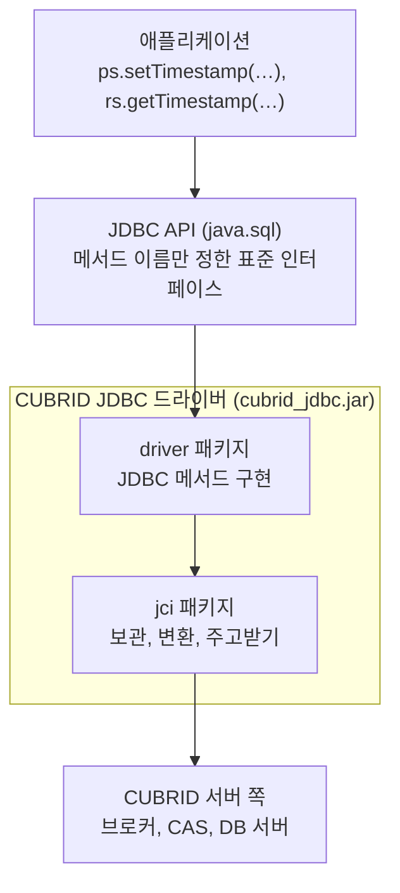

# CUBRID JDBC 실행 구조: 애플리케이션에서 서버까지 다섯 층

- 분류: study
- 날짜: 2026-10-08
- 관련: [APIS-1120](http://jira.cubrid.org/browse/APIS-1120), 같은 날 쓴 APIS-1120 study 노트 7편 중 1편 (목록은 참고)

## 요약
JDBC 호출은 애플리케이션, JDBC API(java.sql), driver 패키지, jci 패키지, CUBRID 서버 쪽(브로커, CAS, DB 서버)을 차례로 지나고, 결과는 같은 길을 거꾸로 올라온다. APIS-1120이 바꾼 8개 파일은 모두 드라이버 안의 두 층(driver, jci)에 있다.

## 목적
APIS-1120(Calendar 인자 무시) 코드 변경을 읽기 위한 바탕으로, JDBC 호출이 어느 층을 지나 서버까지 가는지 한 장으로 정리한다.

## 배경
APIS-1120의 변경 코드를 읽을 때 "어느 클래스가 무엇을 하는지"부터 막혔다. 글로 된 설명보다 층 구조를 먼저 그림으로 잡아야 나머지 흐름이 읽혔다.

## 범위 / 방법
- 드라이버 소스의 패키지 구성과 호출 관계를 읽고 정리했다. 기준은 develop 9bd89eb와 APIS-1120 브랜치 15a71e0이다.
- 서버 쪽(브로커, CAS, DB 서버)은 드라이버가 연결하는 상대로만 다룬다. 내부 동작은 범위 밖이다.

## 발견 / 관찰

### 다섯 층

| 층 | 하는 일 |
|---|---|
| 애플리케이션 | java.sql 인터페이스(`PreparedStatement`, `ResultSet` 등)만 보고 코드를 쓴다 |
| JDBC API | 메서드 이름과 약속만 정한다. 구현은 없다 |
| driver 패키지 (`cubrid.jdbc.driver`) | JDBC 메서드를 구현하는 입구. 인자를 검사하고, 오류를 `SQLException`으로 바꾸고, 실제 일은 jci에 맡긴다 |
| jci 패키지 (`cubrid.jdbc.jci`) | 실제 일: 바인딩 값 보관, 보낼 바이트 만들기, 서버와 주고받기, 받은 바이트 읽기, 타입 변환 |
| CUBRID 서버 쪽 | 드라이버가 연결하는 상대. 브로커가 연결을 CAS에 넘기고, CAS가 문장을 실행한다 |

결과는 같은 길을 거꾸로 올라온다.

### jci 패키지의 주요 클래스

| 클래스 | 역할 |
|---|---|
| `UStatement` | 문장 하나. 바인딩, 실행, 받은 행 보관, getter |
| `UBindParameter` | 바인딩 값 보관 (`types[]`, `values[]`) |
| `UOutputBuffer` | 보낼 바이트 만들기. 연결마다 하나이고, 연결을 처음 맺을 때 만든다 |
| `UConnection` | 연결 하나. `send_recv_msg`로 요청을 보내고 응답을 받는다 |
| `UInputBuffer` | 받은 바이트 읽기. 응답마다 새로 만든다 |
| `UResultTuple` | 받은 행 하나 (`attributes[]`) |
| `UGetTypeConvertedValue` | 칼럼 값을 getter가 요청한 타입으로 바꾼다 |
| `UDateTimeFields` | 날짜·시각 숫자와 시점을 함께 담는 값 (APIS-1107에서 생김) |

- `UOutputBuffer`를 만드는 곳: `UConnection.checkReconnect`의 `if (outBuffer == null)` ([UConnection.java:1929][uc-1929])
- `UInputBuffer`를 만드는 곳: `UConnection.send_recv_msg` ([UConnection.java:1852][uc-1852])

### APIS-1120이 바꾼 파일

| 패키지 | 파일 수 | 파일 |
|---|---|---|
| driver | 4 | `CUBRIDPreparedStatement`, `CUBRIDResultSet`, `CUBRIDCallableStatement`, `CUBRIDResultSetWithoutQuery` |
| jci | 4 | `UStatement`, `UOutputBuffer`, `UGetTypeConvertedValue`, `UDateTimeFields` |

`UConnection`, `UInputBuffer`, `UBindParameter`, `UResultTuple`은 바꾸지 않았다. develop과 APIS-1120에서 파일 내용이 같다.

## 결론
Calendar 문제를 볼 때는 두 층으로 나눠 보면 된다. driver 패키지는 Calendar를 받아 시간대만 꺼내 jci에 넘기는 곳이고, jci 패키지는 실제로 날짜·시각 숫자와 시점을 서로 바꾸는 곳이다.

## 다음 단계
- 이슈화하지 않는다. 공부용 정리다.
- 이어서 볼 노트: 쓰기·읽기 흐름, jci 패키지 안의 흐름 (참고의 목록)

## 참고
- [APIS-1120](http://jira.cubrid.org/browse/APIS-1120): Date, time and timestamp methods ignore the Calendar argument
- 드라이버 develop 9bd89eb (공개): https://github.com/CUBRID/cubrid-jdbc/tree/9bd89eb7f8d3c7ef5965373fff254061fcd30738
- 줄 번호 기준: 바뀌지 않은 파일은 develop 9bd89eb(위 링크), APIS-1120에서 바뀐 파일은 APIS-1120 브랜치 15a71e0(공개 전)
- 같은 날 쓴 APIS-1120 study 노트
  1. [CUBRID JDBC 실행 구조](./2026-10-08-apis1120-jdbc-layers.md) (이 노트)
  2. [Calendar 인자 쓰기·읽기 흐름](./2026-10-08-apis1120-calendar-write-read-flow.md)
  3. [숫자, 시간대, 시점](./2026-10-08-apis1120-fields-zone-instant.md)
  4. [jci 패키지 안의 흐름](./2026-10-08-apis1120-jci-internal-flow.md)
  5. [Calendar 유무에 따른 경로 분기](./2026-10-08-apis1120-calendar-path-split.md)
  6. [values[]와 attributes[]](./2026-10-08-apis1120-values-and-attributes.md)
  7. [inZone 흐름](./2026-10-08-apis1120-inzone-flow.md)

[uc-1929]: https://github.com/CUBRID/cubrid-jdbc/blob/9bd89eb7f8d3c7ef5965373fff254061fcd30738/src/jdbc/cubrid/jdbc/jci/UConnection.java#L1929
[uc-1852]: https://github.com/CUBRID/cubrid-jdbc/blob/9bd89eb7f8d3c7ef5965373fff254061fcd30738/src/jdbc/cubrid/jdbc/jci/UConnection.java#L1852
