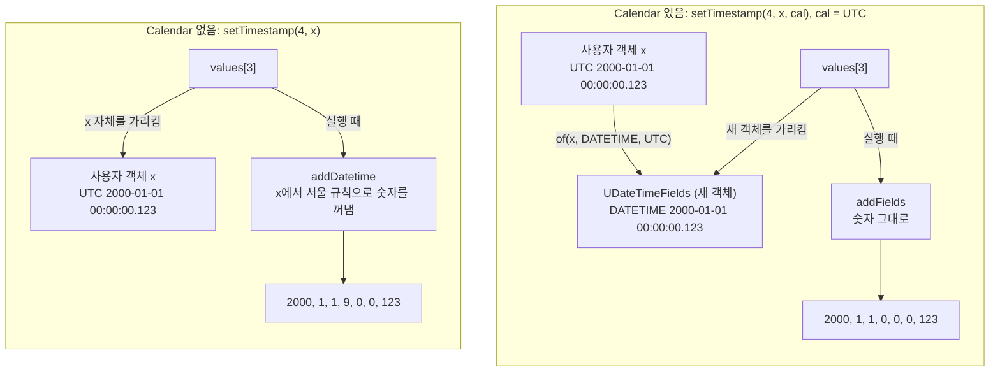
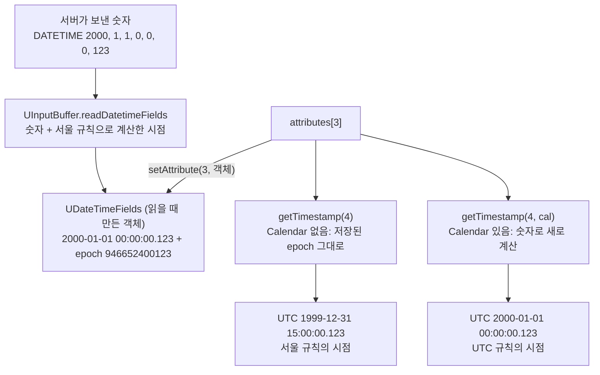

# values[]와 attributes[]: 바인딩 값과 받은 행에 담기는 객체

- 분류: study
- 날짜: 2026-10-08
- 관련: [APIS-1120](http://jira.cubrid.org/browse/APIS-1120), 같은 날 쓴 APIS-1120 study 노트 7편 중 6편

## 요약
- **쓰기 (`UBindParameter.values[]`):** Calendar가 없으면 사용자 객체의 참조가 들어가고, 있으면 바인딩할 때 만든 `UDateTimeFields`가 들어간다.
- **읽기 (`UResultTuple.attributes[]`):** Calendar와 상관없이 `UDateTimeFields`가 들어간다(APIS-1107부터). Calendar는 그것을 읽는 방법만 바꾼다.

## 목적
쓰기와 읽기에서 날짜·시각 값이 어느 배열에 어떤 객체로 담기는지 정리한다. 그 차이가 동작에 어떤 영향을 주는지도 본다.

## 배경
"values[]에는 Calendar가 없을 때 사용자 객체가, 있을 때 UDateTimeFields가 들어가는가", "읽기의 tuples에 저장되는 것이 UDateTimeFields인가"라는 질문을 확인한 결과다.

## 범위 / 방법
- **코드 기준:**
  - `UBindParameter.setParameter`, `UResultTuple`, `UStatement.readData`: 세 파일 모두 develop과 APIS-1120이 같다.
  - `UStatement.bind(…, TimeZone)`: APIS-1120 브랜치 15a71e0
- **실측:** 바인딩한 뒤 객체를 바꾸는 동작은 11.4.6에서 실측했다(후속 이슈 초안). develop jar와 APIS-1120 jar 모두 같은 결과다.

## 발견 / 관찰

### 쓰기: `values[]`에는 받은 참조가 그대로 들어간다

`setParameter`는 받은 값을 복사하지 않고 그대로 저장한다([UBindParameter.java:100][ubp-100]).

```java
types[index] = bType;
values[index] = bValue;
```



| 호출 | `types[i]` | `values[i]` |
|---|---|---|
| `setTimestamp(i, x)` | DATETIME | x 그 자체. 사용자가 넘긴 객체의 참조 |
| `setTimestamp(i, x, cal)` | DATETIME | `UDateTimeFields`. 바인딩하는 순간 cal 시간대로 계산해 새로 만든 숫자 객체 |
| `setTimestamp(i, null, cal)` | NULL | `null` (Calendar 없는 메서드로 감) |
| `setTimestamp(i, tz값, cal)` (`CUBRIDTimestamptz`) | TIMESTAMPTZ 또는 DATETIMETZ | tz값 그대로 (Calendar 무시) |

`setDate`, `setTime`도 같다. Calendar가 있으면 DATE나 TIME 타입의 `UDateTimeFields`가 들어간다.

### 참조를 그대로 넣어서 생기는 일

바인딩한 뒤 실행하기 전에 사용자가 x의 값을 바꾸는 경우다. 예를 들어 `x.setTime(…)`으로 서울 2111-11-11 11:11:11로 바꾼다.

| | Calendar 없음 | Calendar 있음 |
|---|---|---|
| `values[3]`이 가리키는 것 | 바뀐 x | 바인딩할 때 만든 숫자 객체 |
| 서버로 가는 숫자 | 2111, 11, 11, 11, 11, 11, 0 | 2000, 1, 1, 0, 0, 0, 123 |
| 저장 | `2111-11-11 11:11:11` | `2000-01-01 00:00:00.123` |
| 근거 | 11.4.6 실측 (develop jar, APIS-1120 jar 같음) | 코드 기준. 바인딩할 때 만든 불변 객체라 x와 연결이 없음 |

배치에서 객체 하나를 재사용하면 Calendar 없는 쪽은 앞 행까지 마지막 값으로 저장된다(실측). 이것이 후속 이슈의 버그다. Calendar 쪽은 행마다 Calendar가 달라도 각 행이 자기 값을 갖는다(TC 확인).

### 읽기: `attributes[]`에는 칼럼 타입에 따라 정해진 객체가 들어간다

행을 받으면 `UStatement.readATuple`이 칼럼마다 `readData`로 값을 만들어 `UResultTuple.setAttribute`로 넣는다([UResultTuple.java:81][urt-81]). `tuples`는 `UStatement`의 필드다. `UInputBuffer`는 바이트를 읽어 값을 만들어 줄 뿐이다.

| 칼럼 타입 | 저장되는 값 | 만드는 함수 |
|---|---|---|
| DATE | `UDateTimeFields` | `readDate` |
| TIME | `UDateTimeFields` | `readTime` |
| TIMESTAMP | `UDateTimeFields` | `readTimestampFields` |
| DATETIME | `UDateTimeFields` | `readDatetimeFields` |
| TIMESTAMPTZ, TIMESTAMPLTZ, DATETIMETZ, DATETIMELTZ | `CUBRIDTimestamptz` | `readTimestamptz`, `readDatetimetz` |
| 문자열 | `String` | `readString` 등 |
| 숫자 | `Integer`, `Short`, `Long`, `BigDecimal` 등 | `readInt` 등 |
| SQL NULL, `convertToNull` 모드의 0 날짜 | `null` | |

DATE, TIME, TIMESTAMP, DATETIME이 `UDateTimeFields`로 저장되는 것은 APIS-1107부터다. APIS-1120은 읽기 저장을 바꾸지 않았다.



- **두 getter는 같은 객체를 쓴다.**
  - Calendar 없는 getter는 저장된 epoch를 쓴다(`sqlValueOf`).
  - Calendar getter는 같은 객체의 숫자로 시점을 새로 계산한다(`toSqlValue(zone)`).
- **저장된 객체는 바뀌지 않는다.** Calendar getter의 계산 결과는 새 객체에 담긴다. 그래서 같은 행을 두 방식으로 번갈아 읽어도 서로 영향이 없다.

### 같은 `UDateTimeFields`라도 쓰기와 읽기에서 epoch의 뜻이 다르다

| | 쓰기 (`values[i]`) | 읽기 (`attributes[칼럼]`) |
|---|---|---|
| 누가 만드나 | `UDateTimeFields.of` (Calendar setter) | `UInputBuffer.readXxx` (모든 읽기) |
| 숫자 | cal 시간대로 본 값의 날짜·시각 | 서버가 보낸 날짜·시각 |
| epoch | 사용자가 넘긴 값의 시점. 서버로 보내지 않고 `equals`에서도 비교하지 않음 | JVM 기본 시간대로 계산한 시점. Calendar 없는 getter가 씀 |

## 결론
두 배열이 대칭이 아니다.
- **쓰기:** Calendar가 있을 때만 `UDateTimeFields`가 생긴다. 그 덕분에 바인딩한 값이 사용자 객체와 끊어진다.
- **읽기:** Calendar와 상관없이 늘 `UDateTimeFields`가 있다. Calendar는 그 숫자를 어떤 규칙으로 계산할지만 정한다.

## 다음 단계
- **후속 이슈:** Calendar 없는 setter와 `setObject`도 바인딩할 때 `UDateTimeFields`로 값을 확정하게 한다. 바인딩 뒤 변경과 배치 재사용 문제를 고친다.

## 참고
- [APIS-1120](http://jira.cubrid.org/browse/APIS-1120)
- 바뀌지 않은 파일 (develop 9bd89eb, 공개)

  | 위치 | 메서드 |
  |---|---|
  | [UBindParameter.java:100][ubp-100] | `setParameter` |
  | [UResultTuple.java:81][urt-81] | `setAttribute` |
  | [UInputBuffer.java:314][uib-314] | `readDate` |
  | [UInputBuffer.java:422][uib-422] | `readDatetimeFields` |

- 바뀐 파일: `UStatement.java:478`, `:489`, `:500` (zone을 받는 `bind`), APIS-1120 브랜치 15a71e0 (공개 전)
- 함께 보는 노트: [jci 패키지 안의 흐름](./2026-10-08-apis1120-jci-internal-flow.md), [Calendar 유무에 따른 경로 분기](./2026-10-08-apis1120-calendar-path-split.md)

[ubp-100]: https://github.com/CUBRID/cubrid-jdbc/blob/9bd89eb7f8d3c7ef5965373fff254061fcd30738/src/jdbc/cubrid/jdbc/jci/UBindParameter.java#L100
[urt-81]: https://github.com/CUBRID/cubrid-jdbc/blob/9bd89eb7f8d3c7ef5965373fff254061fcd30738/src/jdbc/cubrid/jdbc/jci/UResultTuple.java#L81
[uib-314]: https://github.com/CUBRID/cubrid-jdbc/blob/9bd89eb7f8d3c7ef5965373fff254061fcd30738/src/jdbc/cubrid/jdbc/jci/UInputBuffer.java#L314
[uib-422]: https://github.com/CUBRID/cubrid-jdbc/blob/9bd89eb7f8d3c7ef5965373fff254061fcd30738/src/jdbc/cubrid/jdbc/jci/UInputBuffer.java#L422
