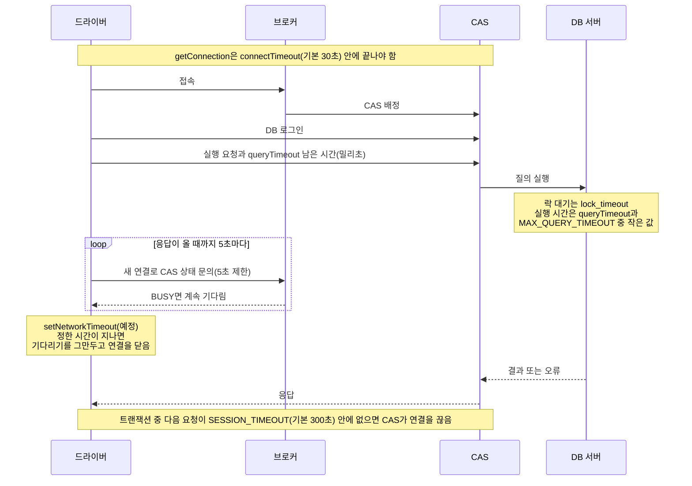

# CUBRID JDBC의 타임아웃: 누가 무엇을 끊는가

- 분류: study
- 날짜: 2026-10-30
- 관련: [APIS-1123](http://jira.cubrid.org/browse/APIS-1123)(setNetworkTimeout 구현), [CUBRID/cubrid-jdbc#96](https://github.com/CUBRID/cubrid-jdbc/pull/96), [CUBRID/cubrid-jdbc#99](https://github.com/CUBRID/cubrid-jdbc/pull/99)

## 요약
CUBRID JDBC의 시간 제한은 끊는 곳(드라이버, CAS, DB 서버)마다 끝난 뒤의 모습이 다르고, 지금은 CAS가 살아서 일하는 동안 드라이버가 스스로 대기를 끝낼 장치가 없다. APIS-1123의 setNetworkTimeout이 그 자리를 채운다.

## 목적
APIS-1123(setNetworkTimeout 구현)을 설계하다 보니 이름이 비슷한 시간 제한이 여럿 나왔다. 각 설정이 무엇을 제한하는지, 누가 끊는지, 끊긴 뒤 연결과 트랜잭션이 어떻게 되는지를 정리해서 setNetworkTimeout이 들어갈 자리를 분명히 한다.

## 배경
JDBC 표준 이름(login timeout, query timeout, network timeout)만 보면 모두 같은 종류처럼 보인다. 하지만 CUBRID는 드라이버, 브로커, CAS, DB 서버로 나뉘어 있어서, 같은 "시간 초과"라도 끊는 곳이 다르다. 게다가 드라이버는 응답을 기다리는 동안 5초마다 깨어나 CAS 상태를 확인하는데, 이것이 시간 제한처럼 보이기 쉽다.

| 구성 요소 | 하는 일 |
|---|---|
| 드라이버 | 응용 프로그램 안의 CUBRID JDBC. 요청을 보내고 응답을 기다린다 |
| 브로커 | 접속을 받아 CAS에 넘기고, CAS 상태를 묻는 요청에 답한다 |
| CAS | 연결 하나를 맡아 요청을 처리하는 프로세스. 드라이버와 직접 통신한다 |
| DB 서버 | 질의를 실행하고 락을 관리한다 |

## 범위 / 방법
- 드라이버 코드: CUBRID/cubrid-jdbc develop `a2aa90f`에서 시간 제한 설정, 내부 상수, 응답 대기 루프를 읽었다.
- 엔진 코드: CUBRID/cubrid develop `4f1a68c`에서 CAS가 락 타임아웃 값을 받는 부분을 읽었다.
- 매뉴얼: CUBRID 11.4 한국어 매뉴얼의 JDBC 연결 설정, 브로커 파라미터, 잠금 파라미터.
- 실측: Docker에 띄운 CUBRID guava 빌드(11.5.0.2726, develop `4b32f66`), 위 드라이버 커밋으로 빌드한 jar, JDK 8.
  - 한 연결이 행 하나를 수정해 락을 잡고, 다른 연결이 같은 행을 수정하며 기다리게 했다.
  - 기다리는 쪽은 수정하기 전에 같은 트랜잭션에서 행 하나를 먼저 넣어 두었다. 대기가 끝난 뒤 이 행이 남는지로 트랜잭션이 취소됐는지 봤다.
  - 설정마다 대기가 끝난 시간, 오류, `isClosed()`, 같은 연결의 다음 SQL, 트랜잭션 상태를 기록했다.
- 근거 표시
  - **[코드]**: 코드를 읽고 알아낸 것(실측 전)
  - **[매뉴얼]**: 매뉴얼에 적힌 것
  - **[실측]**: 직접 확인한 것
  - **[이슈]**: APIS-1123 본문의 요구 사항

## 발견 / 관찰

### 1. 한눈에 보기

끊는 곳이 드라이버면 드라이버가 기다리기를 그만두는 것이고, CAS나 DB 서버면 그쪽이 작업을 멈추고 오류 응답을 돌려주는 것이다.

**접속할 때**

| 설정 | 정하는 곳 | 단위 · 기본값 | 제한하는 것 | 끊는 곳 | 넘으면 | 근거 |
|---|---|---|---|---|---|---|
| `connectTimeout` | 연결 URL | 초 · 30 (0이면 제한 없음) | 브로커 접속과 DB 로그인. 연결이 끊긴 뒤 다시 접속할 때도 적용 | 드라이버 | 접속 실패(시간 초과 오류) | [매뉴얼] [코드] |
| `DriverManager.setLoginTimeout` | JDBC 표준 API | 초 · 0 | URL에 connectTimeout이 없을 때 그 기본값이 됨 | 드라이버 | connectTimeout과 같음 | [매뉴얼] [코드] |
| `DataSource.setLoginTimeout` | DataSource API | 초 · 0 | 없음. 값만 저장하고 접속에는 쓰지 않음 | 없음 | 영향 없음 | [코드] |

**질의를 실행할 때**

| 설정 | 정하는 곳 | 단위 · 기본값 | 제한하는 것 | 끊는 곳 | 넘으면 | 근거 |
|---|---|---|---|---|---|---|
| `queryTimeout` | 연결 URL. 새로 만드는 문장마다 기본값으로 들어감 | 초 · 0 (제한 없음), 최대 2,000,000 | 문장 실행 시간. `executeBatch`는 호출 한 번 단위 | CAS·서버 | 그 문장만 `-4`로 실패. 연결과 트랜잭션은 그대로 | [매뉴얼] [코드] [실측] |
| `Statement.setQueryTimeout` | JDBC 표준 API | 초 · 0 | 그 문장의 실행 시간 | CAS·서버 | 위와 같음 | [코드] [실측] |
| `MAX_QUERY_TIMEOUT` | 브로커 설정 | 초 · 0 (제한 없음), 범위 0~86,400 | 질의 실행 시간의 상한. 응용의 값과 둘 다 0이 아니면 작은 값 | CAS | 질의를 멈추고 롤백 | [매뉴얼] |
| `CUBRIDConnection.setLockTimeout` | CUBRID 전용 API | 밀리초 · 서버 값 (-1 무제한, 0 기다리지 않음) | 이 연결의 락 대기 시간. 서버의 lock_timeout을 세션 단위로 바꿈. 다시 접속하면 드라이버가 다시 적용 | DB 서버 | 그 문장만 `-73`으로 실패. 연결과 트랜잭션은 그대로 | [코드] [실측] |
| `lock_timeout` | 서버 파라미터(세션마다 바꿀 수 있음) | 밀리초 · -1 (무제한) | 락 대기 시간 | DB 서버 | 매뉴얼은 트랜잭션이 취소된다고 적음. setLockTimeout으로 잰 실측에서는 그 문장만 실패 | [매뉴얼] [실측] |
| `setNetworkTimeout` | JDBC 표준 API(Connection) | 밀리초 · 지금은 지원 안 함(예외) | APIS-1123에서 구현 예정. 요청 하나의 응답 대기 시간, 연결의 모든 요청에 적용 | 드라이버(예정) | 예외를 던지고 연결을 닫음(예정) | [코드] [이슈] |

**연결을 확인하거나 유지할 때**

| 설정 | 정하는 곳 | 단위 · 기본값 | 제한하는 것 | 끊는 곳 | 넘으면 | 근거 |
|---|---|---|---|---|---|---|
| `isValid(timeout)` | JDBC 표준 API | 초 · 호출할 때 지정 (0이면 제한 없음) | 브로커에 새 연결을 열어 CAS 상태를 묻는 시간 | 드라이버 | `false`를 돌려줌 | [코드] |
| `Statement.cancel` | JDBC 표준 API | 고정 10초 | 브로커에 보내는 취소 요청 | 드라이버 | 취소 요청이 시간 초과 오류로 실패 | [코드] |
| `SESSION_TIMEOUT` | 브로커 설정 | 초 · 300 | 트랜잭션 중인데 다음 요청이 오지 않는 시간 | CAS | CAS가 연결을 끊음. 다음 요청은 `-21019` | [매뉴얼] [실측] |

### 2. 요청 하나를 따라가 보기

1. **접속.** 브로커 접속과 DB 로그인을 connectTimeout 안에 끝내야 한다. 시간은 JDBC 호출이 시작된 때부터 잰다. altHosts를 쓰면 호스트를 바꿀 때마다 새로 잰다. [코드]
2. **실행 요청.** queryTimeout이 있으면 남은 시간을 밀리초로 요청에 실어 보낸다. 보내기 전에 이미 남은 시간이 없으면 드라이버가 바로 `-21024`(Request timed out)로 끝낸다. [코드]
3. **서버 쪽 제한.** 락 대기는 lock_timeout이, 실행 시간은 queryTimeout과 MAX_QUERY_TIMEOUT 중 작은 값이 끊는다. 끊으면 그 문장이 오류로 끝난다. [매뉴얼] [실측]
4. **드라이버의 대기.** 드라이버는 응답을 기다리는 동안 5초마다 깨어나 브로커에 CAS 상태를 묻고, BUSY면 계속 기다린다. 시간 제한이 아니라 CAS가 살아 있는지 확인하는 동작이다. 그래서 CAS가 살아서 락을 기다리면, 서버 쪽 제한이 없는 한 끝없이 기다린다. [코드] [실측]
5. **setNetworkTimeout(예정).** 이 값을 정하면, 그 시간이 지났을 때 드라이버가 기다리기를 그만두고 연결을 닫는다. [이슈]
6. **요청 사이.** 트랜잭션 중 다음 요청이 SESSION_TIMEOUT 안에 오지 않으면 CAS가 연결을 끊는다. 트랜잭션 밖이면 CAS가 계속 기다린다. [매뉴얼] [실측]

### 3. 드라이버 안의 고정 값

사용자가 바꿀 수 없는 상수다. 위 설정들이 실제로 동작하는 방식을 정한다.

| 상수 | 값 | 쓰는 곳 | 근거 |
|---|---|---|---|
| `SOCKET_TIMEOUT` | 5,000 ms | 응답을 기다리는 소켓이 깨어나는 주기. 깨어나면 시간 제한을 검사하고, 남았으면 CAS 상태를 확인 | [코드] |
| `PING_TIMEOUT` | 5,000 ms | CAS 상태 확인 한 번에 주는 시간 | [코드] |
| `READ_TIMEOUT` | 10,000 ms | 문자열 배치 실행의 응답 대기 여유분(queryTimeout + 10초), 취소 요청의 제한 | [코드] |
| `TIMEOUT_UNIT` | 1,000 ms | 접속 단계에서 브로커 응답을 기다리는 소켓이 깨어나는 주기 | [코드] |

### 4. 락 대기 실측

| 설정 | 대기가 끝난 시간 | 오류 | `isClosed()` | 같은 연결의 다음 SQL | 먼저 넣은 행 |
|---|---|---|---|---|---|
| `setQueryTimeout(2)` | 1,912 ms | `-4` Has been interrupted. | false | 성공 | 남음. 커밋하면 다른 연결에서도 보임 |
| `setLockTimeout(2000)` | 2,063 ms | `-73` Your transaction ... timed out waiting on X_LOCK lock ... | false | 성공 | 남음. 커밋하면 다른 연결에서도 보임 |
| 시간 제한 없음, 7초 뒤 락 해제 | 6,999 ms | 없음(정상 완료) | false | 성공 | 남음 |

- 세 경우 모두 연결은 그대로 쓸 수 있었고, 실패한 문장만 취소됐다. 트랜잭션 전체가 취소되지는 않았다. [실측]
- 시간 제한이 없으면 5초가 지나도 계속 기다렸다가, 락이 풀리자 정상으로 끝났다. 5초마다 하는 확인이 시간 제한이 아니라는 뜻이다. [실측]
- queryTimeout이 2초보다 조금 일찍 끝난 것은, 드라이버가 JDBC 호출이 시작된 때부터 잰 남은 시간을 보내기 때문으로 보인다. [코드]
- SESSION_TIMEOUT을 10초로 줄이고 확인했을 때(2026-10-29, 같은 빌드), 트랜잭션 중인 연결은 CAS가 끊어서 다음 SQL이 `-21019`로 실패했다. 트랜잭션 밖인 연결은 15초 뒤에도 유지됐다. [실측]

### 5. 헷갈리기 쉬운 점

- **5초마다 하는 확인은 시간 제한이 아니다.** CAS가 살아 있는지 보는 것이라, CAS가 BUSY면 계속 기다린다. [코드] [실측]
- **일반 실행은 드라이버 쪽 대기 제한이 없다.** queryTimeout도 서버가 끊어 주기를 기다린다. 드라이버가 직접 시간을 재며 기다리는 요청은 문자열 배치 실행(queryTimeout + 10초) 하나뿐이다. [코드]
- **응답 본문을 읽을 때는 connectTimeout이 대기 제한으로 쓰인다.** 응답의 앞부분이 온 뒤 나머지가 늦게 오는 경우에 해당한다. [코드]
- **DataSource.setLoginTimeout은 값만 저장한다.** 접속 시간을 바꾸려면 URL의 connectTimeout이나 DriverManager.setLoginTimeout을 써야 한다. [코드]
- **lockTimeout URL 속성은 지금 없다.** APIS-1108에서 추가됐다가(#96, 09-17) 되돌려졌다(#99, 10-06). 지금은 setLockTimeout API와 서버 lock_timeout만 있다. [코드]
- **매뉴얼의 lock_timeout 설명과 실제 동작이 다르다.** 매뉴얼은 락을 못 얻으면 트랜잭션이 취소된다고 적었지만, 실측에서는 그 문장만 실패하고 앞서 넣은 행은 커밋까지 남았다. queryTimeout도 같았다. [매뉴얼] [실측]
- **드라이버가 시간 초과로 대기를 그만두면 일반 통신 오류로 처리된다.** 트랜잭션의 첫 실행이면 다시 접속해서 한 번 더 실행하고, 연결도 닫히지 않는다. APIS-1123에서 바꿀 부분이다. [코드]
- **slowQueryThresholdMillis는 시간 제한이 아니다.** 느린 질의를 로그에 남기는 기준이다(기본 60,000 ms). [매뉴얼]

### 6. APIS-1123의 자리

지금은 CAS가 살아서 BUSY인 동안 드라이버가 스스로 대기를 끝낼 방법이 없다. 서버 쪽 제한(lock_timeout, queryTimeout)이 걸려 있으면 서버가 끊어 주지만, 제한이 없거나 응답 자체가 오지 않으면 끝없이 기다린다. 다른 트랜잭션이 잠근 행을 수정하려고 기다리는 경우(APIS-1123의 완료 조건과 같은 상황)로 비교하면 이렇다.

| 락을 기다리는 수정에서 | lock_timeout · setLockTimeout | queryTimeout | setNetworkTimeout(예정) |
|---|---|---|---|
| 끊는 곳 | DB 서버 | CAS·서버 | 드라이버 |
| 단위 | 밀리초 | 초 | 밀리초 |
| 적용 범위 | 락 대기 | 그 문장의 실행 | 연결의 모든 요청 |
| 끝나는 모습 | `-73`, 그 문장만 실패 [실측] | `-4`, 그 문장만 실패 [실측] | 예외(`request_timeout`, `-21141`) [이슈] |
| 그 뒤 연결 | 계속 쓸 수 있음 [실측] | 계속 쓸 수 있음 [실측] | 닫힘 [이슈] |

## 결론
- 끊는 곳은 드라이버, CAS, DB 서버 세 곳이다. CAS나 DB 서버가 끊으면 그 문장만 오류로 끝나고, 연결과 트랜잭션은 그대로 남는다. [실측]
- 드라이버는 응답을 기다리는 동안 CAS가 살아 있는지만 확인한다. 그래서 서버 쪽 제한이 없으면 끝없이 기다린다. [코드] [실측]
- setNetworkTimeout은 드라이버가 스스로 대기를 끝내는 유일한 장치가 된다. 서버 쪽 제한과 달리, 대기를 끝낸 뒤 연결을 닫는다. [이슈]

## 다음 단계
- APIS-1123 설계에 반영한다.
  - 드라이버가 시간 초과로 대기를 그만둘 때, 일반 통신 오류처럼 다시 접속해 재실행하지 않게 하고 연결을 닫는다.
  - 소켓이 깨어나는 주기를 설정 값에 맞춘다. 5초보다 짧은 값과 5초의 배수가 아닌 값이 대상이다.
- 매뉴얼의 lock_timeout 설명("트랜잭션 취소")이 실측과 다르다. 다른 버전과 설정에서도 확인한 뒤 매뉴얼 수정 요청을 정한다(이슈화 후보).
- `DataSource.setLoginTimeout`이 접속에 쓰이지 않는다. 매뉴얼에는 기능처럼 적혀 있어 별도 이슈 후보다.
- 아직 재지 않은 것: MAX_QUERY_TIMEOUT으로 끊길 때 트랜잭션이 롤백되는지, connectTimeout과 isValid, cancel이 실제로 끝나는 시점.

## 참고

**매뉴얼(11.4)**
- [JDBC 연결 설정](https://www.cubrid.org/manual/ko/11.4/api/jdbc.html#jdbc-connection-conf): connectTimeout, queryTimeout, slowQueryThresholdMillis
- [브로커 파라미터: 트랜잭션 및 질의](https://www.cubrid.org/manual/ko/11.4/admin/config.html#id37): MAX_QUERY_TIMEOUT, SESSION_TIMEOUT
- [잠금 파라미터](https://www.cubrid.org/manual/ko/11.4/admin/config.html#lock-parameters): lock_timeout

**드라이버 코드(CUBRID/cubrid-jdbc `a2aa90f`)**
- [ConnectionProperties.java#L381-L394](https://github.com/CUBRID/cubrid-jdbc/blob/a2aa90fc82fc0d52038842835ce4d8a187baa8fb/src/jdbc/cubrid/jdbc/driver/ConnectionProperties.java#L381-L394): queryTimeout, connectTimeout 기본값
- [CUBRIDConnection.java#L556-L560](https://github.com/CUBRID/cubrid-jdbc/blob/a2aa90fc82fc0d52038842835ce4d8a187baa8fb/src/jdbc/cubrid/jdbc/driver/CUBRIDConnection.java#L556-L560): setLockTimeout
- [CUBRIDConnection.java#L706-L707](https://github.com/CUBRID/cubrid-jdbc/blob/a2aa90fc82fc0d52038842835ce4d8a187baa8fb/src/jdbc/cubrid/jdbc/driver/CUBRIDConnection.java#L706-L707): 문장에 queryTimeout 기본값 넣기
- [CUBRIDConnection.java#L1074-L1081](https://github.com/CUBRID/cubrid-jdbc/blob/a2aa90fc82fc0d52038842835ce4d8a187baa8fb/src/jdbc/cubrid/jdbc/driver/CUBRIDConnection.java#L1074-L1081): setNetworkTimeout 미지원
- [CUBRIDDataSourceBase.java#L89-L94](https://github.com/CUBRID/cubrid-jdbc/blob/a2aa90fc82fc0d52038842835ce4d8a187baa8fb/src/jdbc/cubrid/jdbc/driver/CUBRIDDataSourceBase.java#L89-L94): loginTimeout을 저장만 함
- [CUBRIDStatement.java#L236-L241](https://github.com/CUBRID/cubrid-jdbc/blob/a2aa90fc82fc0d52038842835ce4d8a187baa8fb/src/jdbc/cubrid/jdbc/driver/CUBRIDStatement.java#L236-L241): setQueryTimeout 범위
- [UConnection.java#L154](https://github.com/CUBRID/cubrid-jdbc/blob/a2aa90fc82fc0d52038842835ce4d8a187baa8fb/src/jdbc/cubrid/jdbc/jci/UConnection.java#L154), [#L195-L198](https://github.com/CUBRID/cubrid-jdbc/blob/a2aa90fc82fc0d52038842835ce4d8a187baa8fb/src/jdbc/cubrid/jdbc/jci/UConnection.java#L195-L198): SOCKET_TIMEOUT, MAX_QUERY_TIMEOUT, READ_TIMEOUT
- [UConnection.java#L560-L590](https://github.com/CUBRID/cubrid-jdbc/blob/a2aa90fc82fc0d52038842835ce4d8a187baa8fb/src/jdbc/cubrid/jdbc/jci/UConnection.java#L560-L590): 문자열 배치 실행의 대기 제한
- [UConnection.java#L959-L990](https://github.com/CUBRID/cubrid-jdbc/blob/a2aa90fc82fc0d52038842835ce4d8a187baa8fb/src/jdbc/cubrid/jdbc/jci/UConnection.java#L959-L990): setLockTimeout을 SET_DB_PARAMETER로 보냄
- [UConnection.java#L1384-L1409](https://github.com/CUBRID/cubrid-jdbc/blob/a2aa90fc82fc0d52038842835ce4d8a187baa8fb/src/jdbc/cubrid/jdbc/jci/UConnection.java#L1384-L1409): isValid, cancel
- [UConnection.java#L1856-L1864](https://github.com/CUBRID/cubrid-jdbc/blob/a2aa90fc82fc0d52038842835ce4d8a187baa8fb/src/jdbc/cubrid/jdbc/jci/UConnection.java#L1856-L1864): 응답 대기 시간 값 넘기기
- [UClientSideConnection.java#L195-L251](https://github.com/CUBRID/cubrid-jdbc/blob/a2aa90fc82fc0d52038842835ce4d8a187baa8fb/src/jdbc/cubrid/jdbc/jci/UClientSideConnection.java#L195-L251): 다시 접속, altHosts, connectTimeout 마감 시각
- [UClientSideConnection.java#L253-L271](https://github.com/CUBRID/cubrid-jdbc/blob/a2aa90fc82fc0d52038842835ce4d8a187baa8fb/src/jdbc/cubrid/jdbc/jci/UClientSideConnection.java#L253-L271): 입력 스트림의 기본 대기 제한, 소켓 5초
- [UTimedDataInputStream.java#L50](https://github.com/CUBRID/cubrid-jdbc/blob/a2aa90fc82fc0d52038842835ce4d8a187baa8fb/src/jdbc/cubrid/jdbc/jci/UTimedDataInputStream.java#L50), [#L79-L160](https://github.com/CUBRID/cubrid-jdbc/blob/a2aa90fc82fc0d52038842835ce4d8a187baa8fb/src/jdbc/cubrid/jdbc/jci/UTimedDataInputStream.java#L79-L160): PING_TIMEOUT, 5초 주기 대기 루프
- [UStatement.java#L815-L817](https://github.com/CUBRID/cubrid-jdbc/blob/a2aa90fc82fc0d52038842835ce4d8a187baa8fb/src/jdbc/cubrid/jdbc/jci/UStatement.java#L815-L817): 남은 시간 계산
- [UStatement.java#L983-L1003](https://github.com/CUBRID/cubrid-jdbc/blob/a2aa90fc82fc0d52038842835ce4d8a187baa8fb/src/jdbc/cubrid/jdbc/jci/UStatement.java#L983-L1003): 통신 오류 뒤 다시 실행
- [BrokerHandler.java#L57](https://github.com/CUBRID/cubrid-jdbc/blob/a2aa90fc82fc0d52038842835ce4d8a187baa8fb/src/jdbc/cubrid/jdbc/net/BrokerHandler.java#L57): TIMEOUT_UNIT
- [BrokerHandler.java#L157-L189](https://github.com/CUBRID/cubrid-jdbc/blob/a2aa90fc82fc0d52038842835ce4d8a187baa8fb/src/jdbc/cubrid/jdbc/net/BrokerHandler.java#L157-L189), [#L271-L286](https://github.com/CUBRID/cubrid-jdbc/blob/a2aa90fc82fc0d52038842835ce4d8a187baa8fb/src/jdbc/cubrid/jdbc/net/BrokerHandler.java#L271-L286): pingBroker, statusBroker

**엔진 코드(CUBRID/cubrid `4f1a68c`)**
- [cas_function.c#L1075-L1106](https://github.com/CUBRID/cubrid/blob/4f1a68c1ebec12f29bc8ba98b5ce8cacb1fc8735/src/broker/cas_function.c#L1075-L1106): 락 타임아웃 값 처리(-2는 기본값, 밀리초)

**이력**
- [CUBRID/cubrid-jdbc#96](https://github.com/CUBRID/cubrid-jdbc/pull/96), [CUBRID/cubrid-jdbc#99](https://github.com/CUBRID/cubrid-jdbc/pull/99): lockTimeout URL 속성 추가와 되돌리기
- [APIS-1123](http://jira.cubrid.org/browse/APIS-1123): setNetworkTimeout 요구 사항
